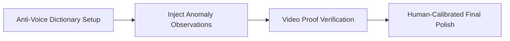

# AI Slop vs. Human Authenticity: How to Protect Your Voice When Using AI Tools

Social media in 2026 is seeing a consumer revolt against synthetic, mass-produced posts known as AI Slop. Viewers on Instagram and TikTok spot automated writing quickly. They reject corporate clichés, hollow lists without real experience, and robotic voices that lack personality.

Most creators use AI tools today. But top creators never post raw, unedited AI drafts. The real advantage is keeping an honest human voice while using AI only to organize structure.

This guide gives you the exact rules and frameworks to protect your creative voice in the AI era.

## Quick answer

Follow three core rules to use AI tools without producing generic slop.
1. **Write Your Own Spoken Words:** Use AI to research angles and test outlines. But write every word you say on camera yourself.
2. **Ban Corporate Buzzwords:** Strip out clichés like revolutionary, paradigm shift, or in today's world from every script.
3. **Anchor Claims in Real Evidence:** Back every point with a real client case, hands-on test, or personal mistake.



## The Spectrum of Content Authenticity

```text
SYNTHETIC AI SLOP ──► Full text generation + generic templates + zero lived proof (Audience Disgust)
ASSISTIVE WORKFLOW ──► Human creative direction + AI outline stress-testing + personal voice (High trust)
```

### The 5 Tell-Tale Markers of AI Slop
1. **The Abstract Introduction:** Starting a video with broad philosophical ideas rather than immediate tactical tension.
2. **The "Rule of 3" Clichés:** Over-using balanced, formulaic bullet points that sound polished but say nothing actionable.
3. **Absence of Negative Information:** Generic AI outputs almost never admit limitations, edge cases, or who the advice is not for.
4. **Vague Call to Actions:** Asking viewers to *"Share your thoughts in the comments below!"* instead of posing a provocative, specific debate question.
5. **Sterile Perfection:** Lack of personal anecdotes, colloquial rhythm, regional idioms, or honest admissions.

---

## The AI Slop vs. Human Authenticity Filter Matrix

| Characteristic. | Generic AI Slop. | Human-Led Directing (Anomaly Box). |
| :--- | :--- | :--- |
| **Opening Hook**. | *"Here are 5 tips to boost your Instagram growth"*. | *"The single biggest mistake keeping your Reels stuck at 200 views"*. |
| **Supporting Evidence**. | Vague claims: *"Studies show video is engaging"*. | Concrete proof: *"When we tested this on a beauty brand, DM shares rose 40%"*. |
| **Voice & Vocabulary**. | Generic corporate buzzwords: *"Corporate jargon, hollow promises"*. | Natural conversational phrasing: *"Cut the fluff, show the receipts"*. |
| **Trade-Off Acknowledgment**. | Presents advice as a universal guarantee. | Explains boundary conditions: *"This works for solo consultants, not e-commerce"*. |
| **Visual Direction**. | Stock footage or generic avatar talking head. | Specific physical shot direction with eye-level lens proximity. |

---

## The 4-Step Authenticity Guardrail Protocol

### Step 1: Establish Your "Anti-Voice" Dictionary
Write down fifteen phrases you refuse to say on camera. When an AI tool drafts a script, remove those clichés before you hit record.

### Step 2: Inject First-Hand Anomaly Observations
Before shooting, answer one question: what did I observe that contradicts standard advice? That personal insight forms the anchor of your credibility.

### Step 3: Use Video for Proof, Text for Searchability
Use video to show genuine human presence and emotion. Use written website guides for readers who want reference tables.

---

## Fill-in-the-Blank Humanization Script Framework

Use this framework to transform any abstract concept into a human-led brief.

```text
[Spoken Hook]: "Most people in [industry/niche] will tell you to [popular generic advice]. But after testing this with [specific sample/feel], here is the uncomfortable truth."
+ [Lived Evidence]: "When I tried [method], [honest failure/unexpected result happened]. Here is the exact data."
+ [Tactical Nuance]: "If you are [specific creator persona]. Do [alternative tactical move] instead."
+ [Boundary]: "Do not use this if [specific scenario where it fails]."
```

---

## Frequently Asked Questions

### Is it wrong to use AI for video editing or transcription?
Not at all. AI tools for audio cleanup and auto-captions save valuable production hours. Let software handle tedious manual work while your own judgment guides the creative premise, voice, and proof.

### How do audiences react when they discover content was AI-assisted?
Audiences accept assistive tools for research or grammar. They rebel when automation replaces genuine human warmth or feeds them fake claims that waste their time.

### What is the fastest way to make an AI-generated idea feel human?
Add a real personal constraint or mistake. Generic AI advice says wake up at five. Human advice says waking up early wrecked my afternoon energy, so here is what I do instead.
