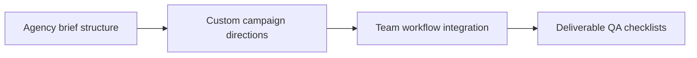

# AnomalyBox Atelier Direction for Agencies & High-Ticket Founders

A planning tool earns its place when it cuts decisions on shoot day. **AnomalyBox Atelier Direction for Agencies & High-Ticket Founders** has one clear job. The practical goal is to review a custom digital direction system for agencies, UGC teams, and executive-led campaigns. This guide is built for creators and teams comparing direction systems. Set **agency brief structure** alongside **custom campaign directions** before adding extra steps or decorative edits.

## Quick answer

Start with **Agency brief structure**. Use **Custom campaign directions** to show the method clearly on camera in 4K at 60fps. Let **Team workflow integration** deliver the visual proof under locked 5600K light. Treat **Deliverable QA checklists** as your review gate. The core rule is simple: show the artifact, the handoff and the production decision it replaces.

## Judge the product through the production handoff

A planning product creates more work when buyers cannot see what decisions it resolves before shoot day. Here, the issue starts when **agency brief structure** is planned without **custom campaign directions**. The draft may look good. Yet the creator still does not know what to film or approve.

Start with the smallest version of **agency brief structure** that delivers faster handoff. Check it against a real Creator Vault brief. Keep this boundary in mind: Describe the contents without inventing results. If proof is not ready, tighten the promise. Do not mask it with buzzwords.

## Decision map for AnomalyBox Atelier Direction for Agencies & High-Ticket Founders

| Decision | Evidence to prepare | Boundary |
| :--- | :--- | :--- |
| **Agency brief structure** | Prepare a real Creator Vault brief | Describe the contents without inventing results. |
| **Custom campaign directions** | Prepare a real Creator Vault brief | Describe the contents without inventing results. |
| **Team workflow integration** | Prepare a clear comparison of workflow steps | Do not present colour as the only difference between tiers. |
| **Deliverable QA checklists** | Prepare a strategist-to-creator handoff | Do not present colour as the only difference between tiers. |

## How to put the method into practice

### 1. Agency brief structure

Treat agency brief structure as a direct operational step. Make it support **custom campaign directions** and follow this rule: show the artifact, the handoff and the production decision it replaces.

Verify this step with a real Creator Vault brief. Describe the contents without inventing results. Look for faster handoff. If that outcome is missing, adjust **agency brief structure** before filming **custom campaign directions**.

### 2. Custom campaign directions

Make custom campaign directions easy to verify on set. Confirm the proof before moving to **team workflow integration**.

Verify this step with a real Creator Vault brief. Describe the contents without inventing results. Look for fewer clarification messages. If that outcome is missing, adjust **custom campaign directions** before filming **team workflow integration**.

### 3. Team workflow integration

Cut team workflow integration on action: show the step, reveal the proof in 3-15s, and trim empty pauses to keep pace tight. Keep it aligned with **deliverable QA checklists**.

Verify this step with a clear comparison of workflow steps. Do not present colour as the only difference between tiers. Look for better fit between tier and job. If that outcome is missing, adjust **team workflow integration** before filming **deliverable QA checklists**.

### 4. Deliverable QA checklists

Use deliverable QA checklists to set a clear boundary for **agency brief structure**. Name what counts as done and what needs a retake.

Verify this step with a strategist-to-creator handoff. Do not present colour as the only difference between tiers. Look for fewer clarification messages. If that outcome is missing, adjust **deliverable QA checklists** before filming **agency brief structure**.

## A script you can adapt

Use this handoff sheet for **AnomalyBox Atelier Direction for Agencies & High-Ticket Founders**:

- **Before the brief:** `[Decisions that usually waste time on shoot day]`
- **On the brief:** `Agency brief structure, Custom campaign directions and [claim boundary]`
- **Creator action (0-45 min):** `[Film 3 takes with locked 5600K lighting and lav mic]`
- **Proof:** `a clear comparison of workflow steps`
- **Final approval:** `[Sign-off within 24 hours on approved claim delivery]`

Follow **Agency brief structure** through **Deliverable QA checklists** to finish the shoot without extra meetings.

## A practical first pass

Suppose creators and teams comparing direction systems must complete one clean creator handoff in a short 45-minute window. First, they lock **agency brief structure**. They prepare a real Creator Vault brief. Then they use **team workflow integration** to keep the promise visible on camera in 4K at 60fps. Do not present colour as the only difference between tiers. During review, they judge **deliverable QA checklists** against fewer clarification messages. A vague request for more polish is rejected.

## Review Deliverable QA checklists before the next pass

- **Direction:** Does agency brief structure name one clear choice?
- **Visibility:** Can the viewer see custom campaign directions without reading the caption?
- **Proof:** Does a clear comparison of workflow steps back up the main claim under 5600K light?
- **Boundary:** Has the creator respected this guardrail: Do not present colour as the only difference between tiers.
- **Learning:** Will the next pass improve based on better fit between tier and job?

## Frequently asked questions

### What must Agency brief structure decide first?

Set one clear default for **agency brief structure** next to **custom campaign directions**. State the exact condition that justifies a change. A real creator vault brief is far more useful than a long reference deck because you can test it directly on set.

### How can Custom campaign directions be tested with simple gear?

Protect the proof moment above all else. Cut optional shots first. A short version works well when **custom campaign directions** stays visible and claims stay inside your approved boundary.

### When should Deliverable QA checklists be updated?

Update **deliverable QA checklists** when repeated passes on **team workflow integration** show the same friction. A shift in audience, offer, or weekly capacity also justifies an update. A single slow video is not a reason to rebuild your whole system.

### How long should this workflow take for AnomalyBox Atelier Direction for Agencies & High-Ticket Founders?

Keep the shoot for **AnomalyBox Atelier Direction for Agencies & High-Ticket Founders** within a 45-minute filming block. Set up lighting in 10 minutes, film 3 takes of **custom campaign directions** in 4K at 60fps, and lock your primary cut.

## Next step

Before the first take, settle **agency brief structure** and **team workflow integration**. If the crew still asks the same questions, [open the store](/store).
