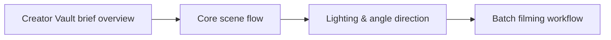

# AnomalyBox Classic Red Brief: Core Creator Direction

A practical tool comparison shows which choices are settled and which stay with the creator. **AnomalyBox Classic Red Brief: Core Creator Direction** has one clear job. The practical goal is to see how the Classic Red creative brief arrives in Creator Vault and supports practical content production. This guide is built for creators and teams comparing direction systems. Set **Creator Vault brief overview** alongside **core scene flow** before adding extra steps or decorative edits.

## Quick answer

Start with **Creator Vault brief overview**. Use **Core scene flow** to show the method clearly on camera in 4K at 60fps. Let **Lighting & angle direction** deliver the visual proof under locked 5600K light. Treat **Batch filming workflow** as your review gate. The core rule is simple: show the artifact, the handoff and the production decision it replaces.

## Judge the product through the production handoff

A planning product creates more work when buyers cannot see what decisions it resolves before shoot day. Here, the issue starts when **Creator Vault brief overview** is planned without **core scene flow**. The draft may look good. Yet the creator still does not know what to film or approve.

Start with the smallest version of **Creator Vault brief overview** that delivers fewer clarification messages. Check it against a real Creator Vault brief. Keep this boundary in mind: Do not present colour as the only difference between tiers. If proof is not ready, tighten the promise. Do not mask it with buzzwords.

## Decision map for AnomalyBox Classic Red Brief

| Decision | Evidence to prepare | Boundary |
| :--- | :--- | :--- |
| **Creator Vault brief overview** | Prepare a real Creator Vault brief | Do not present colour as the only difference between tiers. |
| **Core scene flow** | Prepare a shot completed from the written direction | Keep product claims aligned with the actual service. |
| **Lighting & angle direction** | Prepare a real Creator Vault brief | Keep product claims aligned with the actual service. |
| **Batch filming workflow** | Prepare a clear comparison of workflow steps | Describe the contents without inventing results. |

## How to put the method into practice

### 1. Creator Vault brief overview

Treat Creator Vault brief overview as a direct operational step. Make it support **core scene flow** and follow this rule: show the artifact, the handoff and the production decision it replaces.

Verify this step with a real Creator Vault brief. Do not present colour as the only difference between tiers. Look for fewer clarification messages. If that outcome is missing, adjust **Creator Vault brief overview** before filming **core scene flow**.

### 2. Core scene flow

Cut core scene flow on action: show the step, reveal the proof in 3-15s, and trim empty pauses to keep pace tight. Keep it aligned with **lighting & angle direction**.

Verify this step with a shot completed from the written direction. Keep product claims aligned with the actual service. Look for fewer clarification messages. If that outcome is missing, adjust **core scene flow** before filming **lighting & angle direction**.

### 3. Lighting & angle direction

Set up lighting & angle direction with a fixed 50mm or 85mm macro lens. Keep camera distance locked at 3 to 4 feet across takes. Keep it aligned with **batch filming workflow**.

Verify this step with a real Creator Vault brief. Keep product claims aligned with the actual service. Look for fewer clarification messages. If that outcome is missing, adjust **lighting & angle direction** before filming **batch filming workflow**.

### 4. Batch filming workflow

Cut batch filming workflow on action: show the step, reveal the proof in 3-15s, and trim empty pauses to keep pace tight. Keep it aligned with **Creator Vault brief overview**.

Verify this step with a clear comparison of workflow steps. Describe the contents without inventing results. Look for better fit between tier and job. If that outcome is missing, adjust **batch filming workflow** before filming **Creator Vault brief overview**.

## A script you can adapt

Use this handoff sheet for **AnomalyBox Classic Red Brief**:

- **Before the brief:** `[Decisions that usually waste time on shoot day]`
- **On the brief:** `Creator Vault brief overview, Core scene flow and [claim boundary]`
- **Creator action (0-45 min):** `[Film 3 takes with locked 5600K lighting and lav mic]`
- **Proof:** `a real Creator Vault brief`
- **Final approval:** `[Sign-off within 24 hours on approved claim delivery]`

Follow **Creator Vault brief overview** through **Batch filming workflow** to finish the shoot without extra meetings.

## A practical first pass

Suppose creators and teams comparing direction systems must complete one clean creator handoff in a short 45-minute window. First, they lock **Creator Vault brief overview**. They prepare a shot completed from the written direction. Then they use **lighting & angle direction** to keep the promise visible on camera in 4K at 60fps. Keep product claims aligned with the actual service. During review, they judge **batch filming workflow** against better fit between tier and job. A vague request for more polish is rejected.

## Review Batch filming workflow before the next pass

- **Direction:** Does Creator Vault brief overview name one clear choice?
- **Visibility:** Can the viewer see core scene flow without reading the caption?
- **Proof:** Does a real Creator Vault brief back up the main claim under 5600K light?
- **Boundary:** Has the creator respected this guardrail: Describe the contents without inventing results.
- **Learning:** Will the next pass improve based on fewer clarification messages?

## Frequently asked questions

### What must Creator Vault brief overview decide first?

Set one clear default for **Creator Vault brief overview** next to **core scene flow**. State the exact condition that justifies a change. A real creator vault brief is far more useful than a long reference deck because you can test it directly on set.

### How can Core scene flow be tested with simple gear?

Protect the proof moment above all else. Cut optional shots first. A short version works well when **core scene flow** stays visible and claims stay inside your approved boundary.

### When should Batch filming workflow be updated?

Update **batch filming workflow** when repeated passes on **lighting & angle direction** show the same friction. A shift in audience, offer, or weekly capacity also justifies an update. A single slow video is not a reason to rebuild your whole system.

### How long should this workflow take for AnomalyBox Classic Red Brief?

Plan 40 minutes for the entire one clean creator handoff. Lock **Creator Vault brief overview** before setup, record 3 clean passes, and review fewer clarification messages immediately.

## Next step

Before the first take, settle **Creator Vault brief overview** and **lighting & angle direction**. If the crew still asks the same questions, [open the store](/store).
