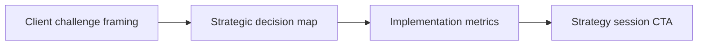

# B2B Consultant Case Breakdown Reels Architecture

A plan becomes useful when you can film without rethinking the strategy each time. **B2B Consultant Case Breakdown Reels Architecture** has one clear job. The practical goal is to deconstruct real client strategy wins into 60-second video case studies. This guide is built for founders, consultants and B2B teams. Set **client challenge framing** alongside **strategic decision map** before adding extra steps or decorative edits.

## Quick answer

Start with **Client challenge framing**. Use **Strategic decision map** to show the method clearly on camera in 4K at 60fps. Let **Implementation metrics** deliver the visual proof under locked 5600K light. Treat **Strategy session CTA** as your review gate. The core rule is simple: lead with operational friction, show a receipt and explain the trade-off in plain language.

## Build the minimum workable version

Thought leadership sounds interchangeable when it opens with a job title instead of a real decision and its consequences. Here, the issue starts when **client challenge framing** is planned without **strategic decision map**. The draft may look good. Yet the creator still does not know what to film or approve.

Start with the smallest version of **client challenge framing** that delivers qualified replies. Check it against a metric with enough context to interpret it. Keep this boundary in mind: Give metrics a timeframe and baseline. If proof is not ready, tighten the promise. Do not mask it with buzzwords.

## Decision map for B2B Consultant Case Breakdown Reels Architecture

| Decision | Evidence to prepare | Boundary |
| :--- | :--- | :--- |
| **Client challenge framing** | Prepare a metric with enough context to interpret it | Give metrics a timeframe and baseline. |
| **Strategic decision map** | Prepare a decision memo excerpt | Do not publish confidential customer information. |
| **Implementation metrics** | Prepare a decision memo excerpt | Do not publish confidential customer information. |
| **Strategy session CTA** | Prepare an anonymised workflow screen | Do not publish confidential customer information. |

## How to put the method into practice

### 1. Client challenge framing

Treat client challenge framing as a direct operational step. Make it support **strategic decision map** and follow this rule: lead with operational friction, show a receipt and explain the trade-off in plain language.

Verify this step with a metric with enough context to interpret it. Give metrics a timeframe and baseline. Look for qualified replies. If that outcome is missing, adjust **client challenge framing** before filming **strategic decision map**.

### 2. Strategic decision map

Make strategic decision map easy to verify on set. Confirm the proof before moving to **implementation metrics**.

Verify this step with a decision memo excerpt. Do not publish confidential customer information. Look for sales-relevant questions. If that outcome is missing, adjust **strategic decision map** before filming **implementation metrics**.

### 3. Implementation metrics

Test implementation metrics under your real time limit. Keep only the step that protects the proof for **strategy session CTA**.

Verify this step with a decision memo excerpt. Do not publish confidential customer information. Look for stronger category recall. If that outcome is missing, adjust **implementation metrics** before filming **strategy session CTA**.

### 4. Strategy session CTA

Make strategy session CTA a direct prompt: ask for one specific action or keyword response in the final 5s of the video. Keep it aligned with **client challenge framing**.

Verify this step with an anonymised workflow screen. Do not publish confidential customer information. Look for qualified replies. If that outcome is missing, adjust **strategy session CTA** before filming **client challenge framing**.

## A script you can adapt

Use this shoot card for **B2B Consultant Case Breakdown Reels Architecture**:

- **Audience job:** `[The exact moment this post helps the viewer]`
- **Promise:** `[One clear outcome delivered in 30 seconds]`
- **Workflow:** `Client challenge framing → Strategic decision map → Implementation metrics`
- **Proof:** `a decision memo excerpt`
- **Capacity rule:** `[Cap weekly filming to a single 45-minute block]`
- **Call to action:** `[One clear save or reply prompt]`

Finish **Client challenge framing** and **Strategic decision map** for **B2B Consultant Case Breakdown Reels Architecture** before adding extra format variations.

## A practical first pass

Suppose founders, consultants and B2B teams must complete one finished content cycle in a short 45-minute window. First, they lock **client challenge framing**. They prepare a decision memo excerpt. Then they use **implementation metrics** to keep the promise visible on camera in 4K at 60fps. Do not publish confidential customer information. During review, they judge **strategy session CTA** against qualified replies. A vague request for more polish is rejected.

## Review Strategy session CTA before the next pass

- **Direction:** Does client challenge framing name one clear choice?
- **Visibility:** Can the viewer see strategic decision map without reading the caption?
- **Proof:** Does a decision memo excerpt back up the main claim under 5600K light?
- **Boundary:** Has the creator respected this guardrail: Do not publish confidential customer information.
- **Learning:** Will the next pass improve based on stronger category recall?

## Frequently asked questions

### What must Client challenge framing decide first?

Set one clear default for **client challenge framing** next to **strategic decision map**. State the exact condition that justifies a change. A metric with enough context to interpret it is far more useful than a long reference deck because you can test it directly on set.

### How can Strategic decision map be tested with simple gear?

Protect the proof moment above all else. Cut optional shots first. A short version works well when **strategic decision map** stays visible and claims stay inside your approved boundary.

### When should Strategy session CTA be updated?

Update **strategy session CTA** when repeated passes on **implementation metrics** show the same friction. A shift in audience, offer, or weekly capacity also justifies an update. A single slow video is not a reason to rebuild your whole system.

### How long should this workflow take for B2B Consultant Case Breakdown Reels Architecture?

Keep the shoot for **B2B Consultant Case Breakdown Reels Architecture** within a 45-minute filming block. Set up lighting in 10 minutes, film 3 takes of **strategic decision map** in 4K at 60fps, and lock your primary cut.

## Next step

Before the first take, settle **client challenge framing** and **implementation metrics**. If the crew still asks the same questions, [open the store](/store).
