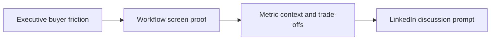

# B2B SaaS LinkedIn Video Systems for Executive Founders

A repeatable content system is a small set of habits that works even on busy weeks. **B2B SaaS LinkedIn Video Systems for Executive Founders** has one clear job. The practical goal is to build executive authority by connecting buyer friction to workflow evidence, metric context, and an informed discussion prompt. This guide is built for founders, consultants and B2B teams. Set **executive buyer friction** alongside **workflow screen proof** before adding extra steps or decorative edits.

## Quick answer

Start with **Executive buyer friction**. Use **Workflow screen proof** to show the method clearly on camera in 4K at 60fps. Let **Metric context and trade-offs** deliver the visual proof under locked 5600K light. Treat **LinkedIn discussion prompt** as your review gate. The core rule is simple: lead with operational friction, show a receipt and explain the trade-off in plain language.

## Build the minimum workable version

Thought leadership sounds interchangeable when it opens with a job title instead of a real decision and its consequences. Here, the issue starts when **executive buyer friction** is planned without **workflow screen proof**. The draft may look good. Yet the creator still does not know what to film or approve.

Start with the smallest version of **executive buyer friction** that delivers qualified replies. Check it against an anonymised workflow screen. Keep this boundary in mind: Give metrics a timeframe and baseline. If proof is not ready, tighten the promise. Do not mask it with buzzwords.

## Decision map for B2B SaaS LinkedIn Video Systems for Executive Founders

| Decision | Evidence to prepare | Boundary |
| :--- | :--- | :--- |
| **Executive buyer friction** | Prepare an anonymised workflow screen | Give metrics a timeframe and baseline. |
| **Workflow screen proof** | Prepare a before-and-after process | Do not publish confidential customer information. |
| **Metric context and trade-offs** | Prepare a metric with enough context to interpret it | Do not publish confidential customer information. |
| **LinkedIn discussion prompt** | Prepare a before-and-after process | Do not publish confidential customer information. |

## How to put the method into practice

### 1. Executive buyer friction

Treat executive buyer friction as a direct operational step. Make it support **workflow screen proof** and follow this rule: lead with operational friction, show a receipt and explain the trade-off in plain language.

Verify this step with an anonymised workflow screen. Give metrics a timeframe and baseline. Look for qualified replies. If that outcome is missing, adjust **executive buyer friction** before filming **workflow screen proof**.

### 2. Workflow screen proof

Cut workflow screen proof on action: show the step, reveal the proof in 3-15s, and trim empty pauses to keep pace tight. Keep it aligned with **metric context and trade-offs**.

Verify this step with a before-and-after process. Do not publish confidential customer information. Look for sales-relevant questions. If that outcome is missing, adjust **workflow screen proof** before filming **metric context and trade-offs**.

### 3. Metric context and trade-offs

Test metric context and trade-offs under your real time limit. Keep only the step that protects the proof for **LinkedIn discussion prompt**.

Verify this step with a metric with enough context to interpret it. Do not publish confidential customer information. Look for qualified replies. If that outcome is missing, adjust **metric context and trade-offs** before filming **LinkedIn discussion prompt**.

### 4. LinkedIn discussion prompt

Use LinkedIn discussion prompt to set a clear boundary for **executive buyer friction**. Name what counts as done and what needs a retake.

Verify this step with a before-and-after process. Do not publish confidential customer information. Look for qualified replies. If that outcome is missing, adjust **LinkedIn discussion prompt** before filming **executive buyer friction**.

## A script you can adapt

Use this shoot card for **B2B SaaS LinkedIn Video Systems for Executive Founders**:

- **Audience job:** `[The exact moment this post helps the viewer]`
- **Promise:** `[One clear outcome delivered in 30 seconds]`
- **Workflow:** `Executive buyer friction → Workflow screen proof → Metric context and trade-offs`
- **Proof:** `a metric with enough context to interpret it`
- **Capacity rule:** `[Cap weekly filming to a single 45-minute block]`
- **Call to action:** `[One clear save or reply prompt]`

Finish **Executive buyer friction** and **Workflow screen proof** for **B2B SaaS LinkedIn Video Systems for Executive Founders** before adding extra format variations.

## A practical first pass

Suppose founders, consultants and B2B teams must complete one finished content cycle in a short 45-minute window. First, they lock **executive buyer friction**. They prepare a before-and-after process. Then they use **metric context and trade-offs** to keep the promise visible on camera in 4K at 60fps. Do not publish confidential customer information. During review, they judge **LinkedIn discussion prompt** against qualified replies. A vague request for more polish is rejected.

## Review LinkedIn discussion prompt before the next pass

- **Direction:** Does executive buyer friction name one clear choice?
- **Visibility:** Can the viewer see workflow screen proof without reading the caption?
- **Proof:** Does a metric with enough context to interpret it back up the main claim under 5600K light?
- **Boundary:** Has the creator respected this guardrail: Do not publish confidential customer information.
- **Learning:** Will the next pass improve based on qualified replies?

## Frequently asked questions

### What must Executive buyer friction decide first?

Set one clear default for **executive buyer friction** next to **workflow screen proof**. State the exact condition that justifies a change. An anonymised workflow screen is far more useful than a long reference deck because you can test it directly on set.

### How can Workflow screen proof be tested with simple gear?

Protect the proof moment above all else. Cut optional shots first. A short version works well when **workflow screen proof** stays visible and claims stay inside your approved boundary.

### When should LinkedIn discussion prompt be updated?

Update **LinkedIn discussion prompt** when repeated passes on **metric context and trade-offs** show the same friction. A shift in audience, offer, or weekly capacity also justifies an update. A single slow video is not a reason to rebuild your whole system.

### How long should this workflow take for B2B SaaS LinkedIn Video Systems for Executive Founders?

Timebox **executive buyer friction** to 30 minutes on Monday, then capture **metric context and trade-offs** in one focused 40-minute filming block with locked 5600K key light.

## Next step

Use **executive buyer friction** and **metric context and trade-offs** as the only two must-haves on the next card. For a packed brief, [go to the store](/store).
