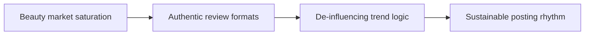

# Beauty Creator Burnout and Mass Exodus Analysis

The obvious symptom is rarely the whole issue. The production choice underneath matters more. **Beauty Creator Burnout and Mass Exodus Analysis** has one clear job. The practical goal is to navigate saturation, sponsored content fatigue, and formulaic beauty formats. This guide is built for beauty and skincare creators. Set **beauty market saturation** alongside **authentic review formats** before adding extra steps or decorative edits.

## Quick answer

Start with **Beauty market saturation**. Use **Authentic review formats** to show the method clearly on camera in 4K at 60fps. Let **De-influencing trend logic** deliver the visual proof under locked 5600K light. Treat **Sustainable posting rhythm** as your review gate. The core rule is simple: show the product under repeatable conditions and describe only what the footage can support.

## Choose the decision behind the comparison

Texture, finish and wear become unreliable when light or camera distance changes between shots. Here, the issue starts when **beauty market saturation** is planned without **authentic review formats**. The draft may look good. Yet the creator still does not know what to film or approve.

Start with the smallest version of **beauty market saturation** that delivers more useful saves. Check it against an unfiltered application sequence. Keep this boundary in mind: Name the finish instead of calling it beautiful. If proof is not ready, tighten the promise. Do not mask it with buzzwords.

## Decision map for Beauty Creator Burnout and Mass Exodus Analysis

| Decision | Evidence to prepare | Boundary |
| :--- | :--- | :--- |
| **Beauty market saturation** | Prepare an unfiltered application sequence | Name the finish instead of calling it beautiful. |
| **Authentic review formats** | Prepare an unfiltered application sequence | Show application pressure and product amount when they affect the result. |
| **De-influencing trend logic** | Prepare a clearly timed wear check | Show application pressure and product amount when they affect the result. |
| **Sustainable posting rhythm** | Prepare a texture close-up | Name the finish instead of calling it beautiful. |

## How to put the method into practice

### 1. Beauty market saturation

Treat beauty market saturation as a direct operational step. Make it support **authentic review formats** and follow this rule: show the product under repeatable conditions and describe only what the footage can support.

Verify this step with an unfiltered application sequence. Name the finish instead of calling it beautiful. Look for more useful saves. If that outcome is missing, adjust **beauty market saturation** before filming **authentic review formats**.

### 2. Authentic review formats

Make authentic review formats easy to verify on set. Confirm the proof before moving to **de-influencing trend logic**.

Verify this step with an unfiltered application sequence. Show application pressure and product amount when they affect the result. Look for fewer unsupported claims. If that outcome is missing, adjust **authentic review formats** before filming **de-influencing trend logic**.

### 3. De-influencing trend logic

Test de-influencing trend logic under your real time limit. Keep only the step that protects the proof for **sustainable posting rhythm**.

Verify this step with a clearly timed wear check. Show application pressure and product amount when they affect the result. Look for fewer unsupported claims. If that outcome is missing, adjust **de-influencing trend logic** before filming **sustainable posting rhythm**.

### 4. Sustainable posting rhythm

Cut sustainable posting rhythm on action: show the step, reveal the proof in 3-15s, and trim empty pauses to keep pace tight. Keep it aligned with **beauty market saturation**.

Verify this step with a texture close-up. Name the finish instead of calling it beautiful. Look for fewer unsupported claims. If that outcome is missing, adjust **sustainable posting rhythm** before filming **beauty market saturation**.

## A script you can adapt

Use this decision sheet for **Beauty Creator Burnout and Mass Exodus Analysis**:

- **Constraint:** `[Time, budget, gear, or recovery limit]`
- **Route A:** `Beauty market saturation — [clear pros and costs]`
- **Route B:** `Authentic review formats — [clear pros and costs]`
- **Proof test:** `a clearly timed wear check`
- **Decision rule:** `[The exact condition that triggers a switch]`
- **Review timeline:** `[Review data after 4 completed episodes]`

Compare **Beauty market saturation** against **Authentic review formats** using real metrics, not vague impressions.

## A practical first pass

Suppose beauty and skincare creators must complete one documented choice in a short 45-minute window. First, they lock **beauty market saturation**. They prepare an unfiltered application sequence. Then they use **de-influencing trend logic** to keep the promise visible on camera in 4K at 60fps. Show application pressure and product amount when they affect the result. During review, they judge **sustainable posting rhythm** against fewer unsupported claims. A vague request for more polish is rejected.

## Review Sustainable posting rhythm before the next pass

- **Direction:** Does beauty market saturation name one clear choice?
- **Visibility:** Can the viewer see authentic review formats without reading the caption?
- **Proof:** Does a clearly timed wear check back up the main claim under 5600K light?
- **Boundary:** Has the creator respected this guardrail: Name the finish instead of calling it beautiful.
- **Learning:** Will the next pass improve based on fewer unsupported claims?

## Frequently asked questions

### What must Beauty market saturation decide first?

Set one clear default for **beauty market saturation** next to **authentic review formats**. State the exact condition that justifies a change. An unfiltered application sequence is far more useful than a long reference deck because you can test it directly on set.

### How can Authentic review formats be tested with simple gear?

Protect the proof moment above all else. Cut optional shots first. A short version works well when **authentic review formats** stays visible and claims stay inside your approved boundary.

### When should Sustainable posting rhythm be updated?

Update **sustainable posting rhythm** when repeated passes on **de-influencing trend logic** show the same friction. A shift in audience, offer, or weekly capacity also justifies an update. A single slow video is not a reason to rebuild your whole system.

### How long should this workflow take for Beauty Creator Burnout and Mass Exodus Analysis?

Timebox **beauty market saturation** to 30 minutes on Monday, then capture **de-influencing trend logic** in one focused 40-minute filming block with locked 5600K key light.

## Next step

Before the first take, settle **beauty market saturation** and **de-influencing trend logic**. If the crew still asks the same questions, [open the store](/store).
