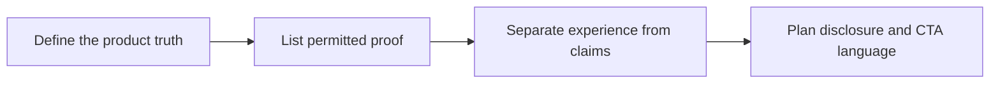

# How to Write a Brand-Safe UGC Brief

Creative freedom works best when facts, deliverables and owners are clear. **How to Write a Brand-Safe UGC Brief** has one clear job. The practical goal is to make product direction credible, useful, and claim-aware. This guide is built for UGC creators and brand teams. Set **define the product truth** alongside **list permitted proof** before adding extra steps or decorative edits.

## Quick answer

Start with **Define the product truth**. Use **List permitted proof** to show the method clearly on camera in 4K at 60fps. Let **Separate experience from claims** deliver the visual proof under locked 5600K light. Treat **Plan disclosure and CTA language** as your review gate. The core rule is simple: agree on the claim, evidence and approval route before the first take.

## What the handoff must settle

Revision rounds multiply when the brief leaves product truth, usage and proof open to interpretation. Here, the issue starts when **define the product truth** is planned without **list permitted proof**. The draft may look good. Yet the creator still does not know what to film or approve.

Start with the smallest version of **define the product truth** that delivers clearer approvals. Check it against a real-use demonstration. Keep this boundary in mind: Keep one feedback owner for each approval round. If proof is not ready, tighten the promise. Do not mask it with buzzwords.

## Decision map for How to Write a Brand-Safe UGC Brief

| Decision | Evidence to prepare | Boundary |
| :--- | :--- | :--- |
| **Define the product truth** | Prepare a real-use demonstration | Keep one feedback owner for each approval round. |
| **List permitted proof** | Prepare a clearly labelled comparison | Do not improvise a product claim on set. |
| **Separate experience from claims** | Prepare an approved product detail | Treat a new concept as new scope, not a small revision. |
| **Plan disclosure and CTA language** | Prepare an approved product detail | Separate paid usage from organic posting rights. |

## How to put the method into practice

### 1. Define the product truth

Treat define the product truth as a direct operational step. Make it support **list permitted proof** and follow this rule: agree on the claim, evidence and approval route before the first take.

Verify this step with a real-use demonstration. Keep one feedback owner for each approval round. Look for clearer approvals. If that outcome is missing, adjust **define the product truth** before filming **list permitted proof**.

### 2. List permitted proof

Build list permitted proof around visible proof. Show the before-and-after test under identical light with zero filter trickery. Keep it aligned with **separate experience from claims**.

Verify this step with a clearly labelled comparison. Do not improvise a product claim on set. Look for fewer avoidable revisions. If that outcome is missing, adjust **list permitted proof** before filming **separate experience from claims**.

### 3. Separate experience from claims

Write separate experience from claims with explicit legal scope. Separate 30-day organic rights from paid ad whitelisting to stop scope creep. Keep it aligned with **plan disclosure and CTA language**.

Verify this step with an approved product detail. Treat a new concept as new scope, not a small revision. Look for claim-safe final assets. If that outcome is missing, adjust **separate experience from claims** before filming **plan disclosure and CTA language**.

### 4. Plan disclosure and CTA language

Write plan disclosure and CTA language with explicit legal scope. Separate 30-day organic rights from paid ad whitelisting to stop scope creep. Keep it aligned with **define the product truth**.

Verify this step with an approved product detail. Separate paid usage from organic posting rights. Look for usable hook variations. If that outcome is missing, adjust **plan disclosure and CTA language** before filming **define the product truth**.

## A script you can adapt

Use this approval brief for **How to Write a Brand-Safe UGC Brief**:

- **Objective:** `[One clear audience outcome]`
- **Required claim:** `[Approved fact or disclosure boundary]`
- **Rights scope:** `[30-day organic posting vs paid ad whitelisting]`
- **Evidence beat (0-15s):** `an approved product detail`
- **Revision limit:** `[One round of script fixes within 48 hours; new concepts require new scope]`

Keep **Define the product truth** inside the signed claim boundary before shooting take one.

## A practical first pass

Suppose UGC creators and brand teams must complete one approval-ready brief in a short 45-minute window. First, they lock **define the product truth**. They prepare a clearly labelled comparison. Then they use **separate experience from claims** to keep the promise visible on camera in 4K at 60fps. Treat a new concept as new scope, not a small revision. During review, they judge **plan disclosure and CTA language** against usable hook variations. A vague request for more polish is rejected.

## Review Plan disclosure and CTA language before the next pass

- **Direction:** Does define the product truth name one clear choice?
- **Visibility:** Can the viewer see list permitted proof without reading the caption?
- **Proof:** Does an approved product detail back up the main claim under 5600K light?
- **Boundary:** Has the creator respected this guardrail: Separate paid usage from organic posting rights.
- **Learning:** Will the next pass improve based on claim-safe final assets?

## Frequently asked questions

### What must Define the product truth decide first?

Set one clear default for **define the product truth** next to **list permitted proof**. State the exact condition that justifies a change. A real-use demonstration is far more useful than a long reference deck because you can test it directly on set.

### How can List permitted proof be tested with simple gear?

Protect the proof moment above all else. Cut optional shots first. A short version works well when **list permitted proof** stays visible and claims stay inside your approved boundary.

### When should Plan disclosure and CTA language be updated?

Update **plan disclosure and CTA language** when repeated passes on **separate experience from claims** show the same friction. A shift in audience, offer, or weekly capacity also justifies an update. A single slow video is not a reason to rebuild your whole system.

### How long should this workflow take for How to Write a Brand-Safe UGC Brief?

Timebox **define the product truth** to 30 minutes on Monday, then capture **separate experience from claims** in one focused 40-minute filming block with locked 5600K key light.

## Next step

Keep **define the product truth** and **separate experience from claims** on a page you can hold. If that is still too loose, [compare brief packages](/store).
