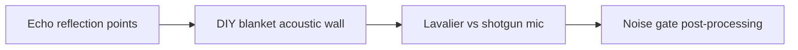

# Budget Sound Dampening for Home Studio Video Creators

Clean footage comes from repeatable setup markers, not from buying more gear. **Budget Sound Dampening for Home Studio Video Creators** has one clear job. The practical goal is to eliminate room echo using blankets, rugs, and strategic mic placement. This guide is built for solo creators improving a small production setup. Set **echo reflection points** alongside **DIY blanket acoustic wall** before adding extra steps or decorative edits.

## Quick answer

Start with **Echo reflection points**. Use **DIY blanket acoustic wall** to show the method clearly on camera in 4K at 60fps. Let **Lavalier vs shotgun mic** deliver the visual proof under locked 5600K light. Treat **Noise gate post-processing** as your review gate. The core rule is simple: stabilise the setup with measurable defaults before adding equipment.

## Set the production constraint

Buying more gear does not fix footage when exposure, white balance, distance and room sound change every session. Here, the issue starts when **echo reflection points** is planned without **DIY blanket acoustic wall**. The draft may look good. Yet the creator still does not know what to film or approve.

Start with the smallest version of **echo reflection points** that delivers cleaner audio. Check it against a short audio test. Keep this boundary in mind: Test audio at the actual recording distance. If proof is not ready, tighten the promise. Do not mask it with buzzwords.

## Decision map for Budget Sound Dampening for Home Studio Video Creators

| Decision | Evidence to prepare | Boundary |
| :--- | :--- | :--- |
| **Echo reflection points** | Prepare a short audio test | Test audio at the actual recording distance. |
| **DIY blanket acoustic wall** | Prepare a repeatable camera-position marker | Test audio at the actual recording distance. |
| **Lavalier vs shotgun mic** | Prepare a short audio test | Match colour temperature or switch one source off. |
| **Noise gate post-processing** | Prepare a locked-light comparison | Save settings only after checking the proof shot. |

## How to put the method into practice

### 1. Echo reflection points

Treat echo reflection points as a direct operational step. Make it support **DIY blanket acoustic wall** and follow this rule: stabilise the setup with measurable defaults before adding equipment.

Verify this step with a short audio test. Test audio at the actual recording distance. Look for cleaner audio. If that outcome is missing, adjust **echo reflection points** before filming **DIY blanket acoustic wall**.

### 2. DIY blanket acoustic wall

Make DIY blanket acoustic wall easy to verify on set. Confirm the proof before moving to **lavalier vs shotgun mic**.

Verify this step with a repeatable camera-position marker. Test audio at the actual recording distance. Look for cleaner audio. If that outcome is missing, adjust **DIY blanket acoustic wall** before filming **lavalier vs shotgun mic**.

### 3. Lavalier vs shotgun mic

Set up lavalier vs shotgun mic with a fixed 50mm or 85mm macro lens. Keep camera distance locked at 3 to 4 feet across takes. Keep it aligned with **noise gate post-processing**.

Verify this step with a short audio test. Match colour temperature or switch one source off. Look for consistent skin and product colour. If that outcome is missing, adjust **lavalier vs shotgun mic** before filming **noise gate post-processing**.

### 4. Noise gate post-processing

Use noise gate post-processing to set a clear boundary for **echo reflection points**. Name what counts as done and what needs a retake.

Verify this step with a locked-light comparison. Save settings only after checking the proof shot. Look for consistent skin and product colour. If that outcome is missing, adjust **noise gate post-processing** before filming **echo reflection points**.

## A script you can adapt

Use this shot note for **Budget Sound Dampening for Home Studio Video Creators**:

- **Opening frame:** `[Main tension visible under 5600K key light in 4K at 60fps]`
- **Hook (0-3s):** `[Spoken problem line matching the first frame]`
- **Coverage (3-15s):** `Echo reflection points → DIY blanket acoustic wall → [proof macro close-up]`
- **Continuity (15-25s):** `[Camera height locked at eye level; mic at 5 inches]`
- **Call to action (25-30s):** `[One direct comment or save prompt]`

For **Echo reflection points**, record a short audio test before adding optional B-roll shots.

## A practical first pass

Suppose solo creators improving a small production setup must complete one complete filming pass in a short 45-minute window. First, they lock **echo reflection points**. They prepare a repeatable camera-position marker. Then they use **lavalier vs shotgun mic** to keep the promise visible on camera in 4K at 60fps. Match colour temperature or switch one source off. During review, they judge **noise gate post-processing** against consistent skin and product colour. A vague request for more polish is rejected.

## Review Noise gate post-processing before the next pass

- **Direction:** Does echo reflection points name one clear choice?
- **Visibility:** Can the viewer see DIY blanket acoustic wall without reading the caption?
- **Proof:** Does a short audio test back up the main claim under 5600K light?
- **Boundary:** Has the creator respected this guardrail: Save settings only after checking the proof shot.
- **Learning:** Will the next pass improve based on consistent skin and product colour?

## Frequently asked questions

### What must Echo reflection points decide first?

Set one clear default for **echo reflection points** next to **DIY blanket acoustic wall**. State the exact condition that justifies a change. A short audio test is far more useful than a long reference deck because you can test it directly on set.

### How can DIY blanket acoustic wall be tested with simple gear?

Protect the proof moment above all else. Cut optional shots first. A short version works well when **DIY blanket acoustic wall** stays visible and claims stay inside your approved boundary.

### When should Noise gate post-processing be updated?

Update **noise gate post-processing** when repeated passes on **lavalier vs shotgun mic** show the same friction. A shift in audience, offer, or weekly capacity also justifies an update. A single slow video is not a reason to rebuild your whole system.

### How long should this workflow take for Budget Sound Dampening for Home Studio Video Creators?

Plan 40 minutes for the entire one complete filming pass. Lock **echo reflection points** before setup, record 3 clean passes, and review cleaner audio immediately.

## Next step

Keep **echo reflection points** and **lavalier vs shotgun mic** on a page you can hold. If that is still too loose, [compare brief packages](/store).
