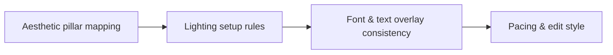

# Building a Recognizable Reels Brand Aesthetic from Scratch

A repeatable content system is a small set of habits that works even on busy weeks. **Building a Recognizable Reels Brand Aesthetic from Scratch** has one clear job. The practical goal is to develop an editorial aesthetic for short-form video on a creator budget. This guide is built for creators building a recognisable visual identity. Set **aesthetic pillar mapping** alongside **lighting setup rules** before adding extra steps or decorative edits.

## Quick answer

Start with **Aesthetic pillar mapping**. Use **Lighting setup rules** to show the method clearly on camera in 4K at 60fps. Let **Font & text overlay consistency** deliver the visual proof under locked 5600K light. Treat **Pacing & edit style** as your review gate. The core rule is simple: set a small number of visual defaults, test them across formats and change one variable at a time.

## Build the minimum workable version

A feed feels inconsistent when camera height, light, crop and props change before any pattern has time to register. Here, the issue starts when **aesthetic pillar mapping** is planned without **lighting setup rules**. The draft may look good. Yet the creator still does not know what to film or approve.

Start with the smallest version of **aesthetic pillar mapping** that delivers consistent product truth. Check it against the same setup across two formats. Keep this boundary in mind: Keep props limited enough to become recognisable. If proof is not ready, tighten the promise. Do not mask it with buzzwords.

## Decision map for Building a Recognizable Reels Brand Aesthetic from Scratch

| Decision | Evidence to prepare | Boundary |
| :--- | :--- | :--- |
| **Aesthetic pillar mapping** | Prepare the same setup across two formats | Keep props limited enough to become recognisable. |
| **Lighting setup rules** | Prepare the same setup across two formats | Keep props limited enough to become recognisable. |
| **Font & text overlay consistency** | Prepare the same setup across two formats | Test the crop on feed, Stories and Reels covers. |
| **Pacing & edit style** | Prepare the same setup across two formats | Test the crop on feed, Stories and Reels covers. |

## How to put the method into practice

### 1. Aesthetic pillar mapping

Focus aesthetic pillar mapping on one specific viewer problem. Deliver one measurable outcome without inflated claims. Keep it aligned with **lighting setup rules**.

Verify this step with the same setup across two formats. Keep props limited enough to become recognisable. Look for consistent product truth. If that outcome is missing, adjust **aesthetic pillar mapping** before filming **lighting setup rules**.

### 2. Lighting setup rules

Set lighting setup rules under a locked 5600K diffused key light. Lock manual exposure at 100% before take one to stop flicker. Keep it aligned with **font & text overlay consistency**.

Verify this step with the same setup across two formats. Keep props limited enough to become recognisable. Look for stronger visual recognition. If that outcome is missing, adjust **lighting setup rules** before filming **font & text overlay consistency**.

### 3. Font & text overlay consistency

Timebox font & text overlay consistency to a 45-minute filming block. Cap batching at 3 to 4 short videos to preserve voice energy. Keep it aligned with **pacing & edit style**.

Verify this step with the same setup across two formats. Test the crop on feed, Stories and Reels covers. Look for consistent product truth. If that outcome is missing, adjust **font & text overlay consistency** before filming **pacing & edit style**.

### 4. Pacing & edit style

Cut pacing & edit style on action: show the step, reveal the proof in 3-15s, and trim empty pauses to keep pace tight. Keep it aligned with **aesthetic pillar mapping**.

Verify this step with the same setup across two formats. Test the crop on feed, Stories and Reels covers. Look for consistent product truth. If that outcome is missing, adjust **pacing & edit style** before filming **aesthetic pillar mapping**.

## A script you can adapt

Use this shoot card for **Building a Recognizable Reels Brand Aesthetic from Scratch**:

- **Audience job:** `[The exact moment this post helps the viewer]`
- **Promise:** `[One clear outcome delivered in 30 seconds]`
- **Workflow:** `Aesthetic pillar mapping → Lighting setup rules → Font & text overlay consistency`
- **Proof:** `the same setup across two formats`
- **Capacity rule:** `[Cap weekly filming to a single 45-minute block]`
- **Call to action:** `[One clear save or reply prompt]`

Finish **Aesthetic pillar mapping** and **Lighting setup rules** for **Building a Recognizable Reels Brand Aesthetic from Scratch** before adding extra format variations.

## A practical first pass

Suppose creators building a recognisable visual identity must complete one finished content cycle in a short 45-minute window. First, they lock **aesthetic pillar mapping**. They prepare the same setup across two formats. Then they use **font & text overlay consistency** to keep the promise visible on camera in 4K at 60fps. Test the crop on feed, Stories and Reels covers. During review, they judge **pacing & edit style** against consistent product truth. A vague request for more polish is rejected.

## Review Pacing & edit style before the next pass

- **Direction:** Does aesthetic pillar mapping name one clear choice?
- **Visibility:** Can the viewer see lighting setup rules without reading the caption?
- **Proof:** Does the same setup across two formats back up the main claim under 5600K light?
- **Boundary:** Has the creator respected this guardrail: Test the crop on feed, Stories and Reels covers.
- **Learning:** Will the next pass improve based on consistent product truth?

## Frequently asked questions

### What must Aesthetic pillar mapping decide first?

Set one clear default for **aesthetic pillar mapping** next to **lighting setup rules**. State the exact condition that justifies a change. The same setup across two formats is far more useful than a long reference deck because you can test it directly on set.

### How can Lighting setup rules be tested with simple gear?

Protect the proof moment above all else. Cut optional shots first. A short version works well when **lighting setup rules** stays visible and claims stay inside your approved boundary.

### When should Pacing & edit style be updated?

Update **pacing & edit style** when repeated passes on **font & text overlay consistency** show the same friction. A shift in audience, offer, or weekly capacity also justifies an update. A single slow video is not a reason to rebuild your whole system.

### How long should this workflow take for Building a Recognizable Reels Brand Aesthetic from Scratch?

Aim for 45 minutes total production for **Building a Recognizable Reels Brand Aesthetic from Scratch**. Spend 15 minutes setting up your mic and camera, film 3 takes, and confirm the same setup across two formats before tearing down.

## Next step

Put **aesthetic pillar mapping** next to **font & text overlay consistency** on one sheet. If you still need someone else to lock the shoot, [start in the store](/store).
