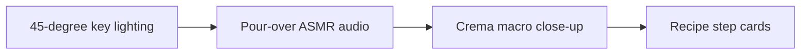

# Coffee & Beverage Recipe Filming Angles & Sound Design

Filming gets faster when camera and light choices are settled before take one. **Coffee & Beverage Recipe Filming Angles & Sound Design** has one clear job. The practical goal is to capture rich pour-over ASMR, espresso crema textures, and beverage recipes. This guide is built for food creators and hospitality teams. Set **45-degree key lighting** alongside **pour-over ASMR audio** before adding extra steps or decorative edits.

## Quick answer

Start with **45-degree key lighting**. Use **Pour-over ASMR audio** to show the method clearly on camera in 4K at 60fps. Let **Crema macro close-up** deliver the visual proof under locked 5600K light. Treat **Recipe step cards** as your review gate. The core rule is simple: build the sequence around a sensory payoff and give the viewer enough context to act on it.

## Set the production constraint

A recipe or venue story loses appetite appeal when process, texture and practical details arrive out of order. Here, the issue starts when **45-degree key lighting** is planned without **pour-over ASMR audio**. The draft may look good. Yet the creator still does not know what to film or approve.

Start with the smallest version of **45-degree key lighting** that delivers qualified venue interest. Check it against a clearly shown technique. Keep this boundary in mind: Turn off mixed overhead light when it greys the food. If proof is not ready, tighten the promise. Do not mask it with buzzwords.

## Decision map for Coffee & Beverage Recipe Filming Angles & Sound Design

| Decision | Evidence to prepare | Boundary |
| :--- | :--- | :--- |
| **45-degree key lighting** | Prepare a clearly shown technique | Turn off mixed overhead light when it greys the food. |
| **Pour-over ASMR audio** | Prepare a useful portion, timing or location detail | State practical details viewers need before visiting or cooking. |
| **Crema macro close-up** | Prepare a texture close-up | Record clean natural sound before adding music. |
| **Recipe step cards** | Prepare a texture close-up | Record clean natural sound before adding music. |

## How to put the method into practice

### 1. 45-degree key lighting

Set 45-degree key lighting under a locked 5600K diffused key light. Lock manual exposure at 100% before take one to stop flicker. Keep it aligned with **pour-over ASMR audio**.

Verify this step with a clearly shown technique. Turn off mixed overhead light when it greys the food. Look for qualified venue interest. If that outcome is missing, adjust **45-degree key lighting** before filming **pour-over ASMR audio**.

### 2. Pour-over ASMR audio

Record pour-over ASMR audio with a mic 4-6 inches from the source. Apply a -48dB noise gate and keep background music ducked at -22dB. Keep it aligned with **crema macro close-up**.

Verify this step with a useful portion, timing or location detail. State practical details viewers need before visiting or cooking. Look for stronger sensory recall. If that outcome is missing, adjust **pour-over ASMR audio** before filming **crema macro close-up**.

### 3. Crema macro close-up

Set up crema macro close-up with a fixed 50mm or 85mm macro lens. Keep camera distance locked at 3 to 4 feet across takes. Keep it aligned with **recipe step cards**.

Verify this step with a texture close-up. Record clean natural sound before adding music. Look for recipe saves. If that outcome is missing, adjust **crema macro close-up** before filming **recipe step cards**.

### 4. Recipe step cards

Use recipe step cards to set a clear boundary for **45-degree key lighting**. Name what counts as done and what needs a retake.

Verify this step with a texture close-up. Record clean natural sound before adding music. Look for recipe saves. If that outcome is missing, adjust **recipe step cards** before filming **45-degree key lighting**.

## A script you can adapt

Use this shot note for **Coffee & Beverage Recipe Filming Angles & Sound Design**:

- **Opening frame:** `[Main tension visible under 5600K key light in 4K at 60fps]`
- **Hook (0-3s):** `[Spoken problem line matching the first frame]`
- **Coverage (3-15s):** `45-degree key lighting → Pour-over ASMR audio → [proof macro close-up]`
- **Continuity (15-25s):** `[Camera height locked at eye level; mic at 5 inches]`
- **Call to action (25-30s):** `[One direct comment or save prompt]`

For **45-degree key lighting**, record a texture close-up before adding optional B-roll shots.

## A practical first pass

Suppose food creators and hospitality teams must complete one complete filming pass in a short 45-minute window. First, they lock **45-degree key lighting**. They prepare a useful portion, timing or location detail. Then they use **crema macro close-up** to keep the promise visible on camera in 4K at 60fps. Record clean natural sound before adding music. During review, they judge **recipe step cards** against recipe saves. A vague request for more polish is rejected.

## Review Recipe step cards before the next pass

- **Direction:** Does 45-degree key lighting name one clear choice?
- **Visibility:** Can the viewer see pour-over ASMR audio without reading the caption?
- **Proof:** Does a texture close-up back up the main claim under 5600K light?
- **Boundary:** Has the creator respected this guardrail: Record clean natural sound before adding music.
- **Learning:** Will the next pass improve based on recipe saves?

## Frequently asked questions

### What must 45-degree key lighting decide first?

Set one clear default for **45-degree key lighting** next to **pour-over ASMR audio**. State the exact condition that justifies a change. A clearly shown technique is far more useful than a long reference deck because you can test it directly on set.

### How can Pour-over ASMR audio be tested with simple gear?

Protect the proof moment above all else. Cut optional shots first. A short version works well when **pour-over ASMR audio** stays visible and claims stay inside your approved boundary.

### When should Recipe step cards be updated?

Update **recipe step cards** when repeated passes on **crema macro close-up** show the same friction. A shift in audience, offer, or weekly capacity also justifies an update. A single slow video is not a reason to rebuild your whole system.

### How long should this workflow take for Coffee & Beverage Recipe Filming Angles & Sound Design?

Keep the shoot for **Coffee & Beverage Recipe Filming Angles & Sound Design** within a 45-minute filming block. Set up lighting in 10 minutes, film 3 takes of **pour-over ASMR audio** in 4K at 60fps, and lock your primary cut.

## Next step

Use **45-degree key lighting** and **crema macro close-up** as the only two must-haves on the next card. For a packed brief, [go to the store](/store).
