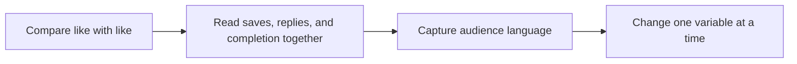

# A Better Content Performance Review

A repeatable content system is a small set of habits that works even on busy weeks. **A Better Content Performance Review** has one clear job. The practical goal is to use qualitative and quantitative signals to improve the next brief. This guide is built for coaches and fitness creators. Set **compare like with like** alongside **read saves, replies, and completion together** before adding extra steps or decorative edits.

## Quick answer

Start with **Compare like with like**. Use **Read saves, replies, and completion together** to show the method clearly on camera in 4K at 60fps. Let **Capture audience language** deliver the visual proof under locked 5600K light. Treat **Change one variable at a time** as your review gate. The core rule is simple: teach one cue at a time, show the relevant angle and keep outcome language responsible.

## Build the minimum workable version

A single flattering angle can hide the movement detail that viewers actually need to understand. Here, the issue starts when **compare like with like** is planned without **read saves, replies, and completion together**. The draft may look good. Yet the creator still does not know what to film or approve.

Start with the smallest version of **compare like with like** that delivers safer demonstrations. Check it against a second camera angle. Keep this boundary in mind: Keep music below the coaching cue. If proof is not ready, tighten the promise. Do not mask it with buzzwords.

## Decision map for A Better Content Performance Review

| Decision | Evidence to prepare | Boundary |
| :--- | :--- | :--- |
| **Compare like with like** | Prepare a second camera angle | Keep music below the coaching cue. |
| **Read saves, replies, and completion together** | Prepare a second camera angle | Avoid guaranteed body or income outcomes. |
| **Capture audience language** | Prepare a second camera angle | Show the common error before the correction. |
| **Change one variable at a time** | Prepare a slowed technique comparison | Keep music below the coaching cue. |

## How to put the method into practice

### 1. Compare like with like

Treat compare like with like as a direct operational step. Make it support **read saves, replies, and completion together** and follow this rule: teach one cue at a time, show the relevant angle and keep outcome language responsible.

Verify this step with a second camera angle. Keep music below the coaching cue. Look for safer demonstrations. If that outcome is missing, adjust **compare like with like** before filming **read saves, replies, and completion together**.

### 2. Read saves, replies, and completion together

Make read saves, replies, and completion together easy to verify on set. Confirm the proof before moving to **capture audience language**.

Verify this step with a second camera angle. Avoid guaranteed body or income outcomes. Look for more qualified enquiries. If that outcome is missing, adjust **read saves, replies, and completion together** before filming **capture audience language**.

### 3. Capture audience language

Focus capture audience language on one specific viewer problem. Deliver one measurable outcome without inflated claims. Keep it aligned with **change one variable at a time**.

Verify this step with a second camera angle. Show the common error before the correction. Look for safer demonstrations. If that outcome is missing, adjust **capture audience language** before filming **change one variable at a time**.

### 4. Change one variable at a time

Use change one variable at a time to set a clear boundary for **compare like with like**. Name what counts as done and what needs a retake.

Verify this step with a slowed technique comparison. Keep music below the coaching cue. Look for better technique questions. If that outcome is missing, adjust **change one variable at a time** before filming **compare like with like**.

## A script you can adapt

Use this shoot card for **A Better Content Performance Review**:

- **Audience job:** `[The exact moment this post helps the viewer]`
- **Promise:** `[One clear outcome delivered in 30 seconds]`
- **Workflow:** `Compare like with like → Read saves, replies, and completion together → Capture audience language`
- **Proof:** `a second camera angle`
- **Capacity rule:** `[Cap weekly filming to a single 45-minute block]`
- **Call to action:** `[One clear save or reply prompt]`

Finish **Compare like with like** and **Read saves, replies, and completion together** for **A Better Content Performance Review** before adding extra format variations.

## A practical first pass

Suppose coaches and fitness creators must complete one finished content cycle in a short 45-minute window. First, they lock **compare like with like**. They prepare a second camera angle. Then they use **capture audience language** to keep the promise visible on camera in 4K at 60fps. Show the common error before the correction. During review, they judge **change one variable at a time** against better technique questions. A vague request for more polish is rejected.

## Review Change one variable at a time before the next pass

- **Direction:** Does compare like with like name one clear choice?
- **Visibility:** Can the viewer see read saves, replies, and completion together without reading the caption?
- **Proof:** Does a second camera angle back up the main claim under 5600K light?
- **Boundary:** Has the creator respected this guardrail: Keep music below the coaching cue.
- **Learning:** Will the next pass improve based on safer demonstrations?

## Frequently asked questions

### What must Compare like with like decide first?

Set one clear default for **compare like with like** next to **read saves, replies, and completion together**. State the exact condition that justifies a change. A second camera angle is far more useful than a long reference deck because you can test it directly on set.

### How can Read saves, replies, and completion together be tested with simple gear?

Protect the proof moment above all else. Cut optional shots first. A short version works well when **read saves, replies, and completion together** stays visible and claims stay inside your approved boundary.

### When should Change one variable at a time be updated?

Update **change one variable at a time** when repeated passes on **capture audience language** show the same friction. A shift in audience, offer, or weekly capacity also justifies an update. A single slow video is not a reason to rebuild your whole system.

### How long should this workflow take for A Better Content Performance Review?

Timebox **compare like with like** to 30 minutes on Monday, then capture **capture audience language** in one focused 40-minute filming block with locked 5600K key light.

## Next step

Film the next piece only after **compare like with like** and **capture audience language** are written down. Need a finished brief instead? [See Classic and Signature](/store).
