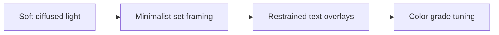

# Creating an Editorial Look on a Creator Budget

Consistency is easier to protect when each post has one goal and one clear proof. **Creating an Editorial Look on a Creator Budget** has one clear job. The practical goal is to achieve luxury magazine visual quality using smart lighting and composition. This guide is built for creators building a recognisable visual identity. Set **soft diffused light** alongside **minimalist set framing** before adding extra steps or decorative edits.

## Quick answer

Start with **Soft diffused light**. Use **Minimalist set framing** to show the method clearly on camera in 4K at 60fps. Let **Restrained text overlays** deliver the visual proof under locked 5600K light. Treat **Color grade tuning** as your review gate. The core rule is simple: set a small number of visual defaults, test them across formats and change one variable at a time.

## Build the minimum workable version

A feed feels inconsistent when camera height, light, crop and props change before any pattern has time to register. Here, the issue starts when **soft diffused light** is planned without **minimalist set framing**. The draft may look good. Yet the creator still does not know what to film or approve.

Start with the smallest version of **soft diffused light** that delivers faster production decisions. Check it against a labelled lighting reference. Keep this boundary in mind: Do not mistake a preset for a complete visual system. If proof is not ready, tighten the promise. Do not mask it with buzzwords.

## Decision map for Creating an Editorial Look on a Creator Budget

| Decision | Evidence to prepare | Boundary |
| :--- | :--- | :--- |
| **Soft diffused light** | Prepare a labelled lighting reference | Do not mistake a preset for a complete visual system. |
| **Minimalist set framing** | Prepare the same setup across two formats | Keep props limited enough to become recognisable. |
| **Restrained text overlays** | Prepare a controlled before-and-after grade | Test the crop on feed, Stories and Reels covers. |
| **Color grade tuning** | Prepare the same setup across two formats | Do not mistake a preset for a complete visual system. |

## How to put the method into practice

### 1. Soft diffused light

Set soft diffused light under a locked 5600K diffused key light. Lock manual exposure at 100% before take one to stop flicker. Keep it aligned with **minimalist set framing**.

Verify this step with a labelled lighting reference. Do not mistake a preset for a complete visual system. Look for faster production decisions. If that outcome is missing, adjust **soft diffused light** before filming **minimalist set framing**.

### 2. Minimalist set framing

Make minimalist set framing easy to verify on set. Confirm the proof before moving to **restrained text overlays**.

Verify this step with the same setup across two formats. Keep props limited enough to become recognisable. Look for consistent product truth. If that outcome is missing, adjust **minimalist set framing** before filming **restrained text overlays**.

### 3. Restrained text overlays

Test restrained text overlays under your real time limit. Keep only the step that protects the proof for **color grade tuning**.

Verify this step with a controlled before-and-after grade. Test the crop on feed, Stories and Reels covers. Look for stronger visual recognition. If that outcome is missing, adjust **restrained text overlays** before filming **color grade tuning**.

### 4. Color grade tuning

Set color grade tuning under a locked 5600K diffused key light. Lock manual exposure at 100% before take one to stop flicker. Keep it aligned with **soft diffused light**.

Verify this step with the same setup across two formats. Do not mistake a preset for a complete visual system. Look for faster production decisions. If that outcome is missing, adjust **color grade tuning** before filming **soft diffused light**.

## A script you can adapt

Use this shoot card for **Creating an Editorial Look on a Creator Budget**:

- **Audience job:** `[The exact moment this post helps the viewer]`
- **Promise:** `[One clear outcome delivered in 30 seconds]`
- **Workflow:** `Soft diffused light → Minimalist set framing → Restrained text overlays`
- **Proof:** `a controlled before-and-after grade`
- **Capacity rule:** `[Cap weekly filming to a single 45-minute block]`
- **Call to action:** `[One clear save or reply prompt]`

Finish **Soft diffused light** and **Minimalist set framing** for **Creating an Editorial Look on a Creator Budget** before adding extra format variations.

## A practical first pass

Suppose creators building a recognisable visual identity must complete one finished content cycle in a short 45-minute window. First, they lock **soft diffused light**. They prepare the same setup across two formats. Then they use **restrained text overlays** to keep the promise visible on camera in 4K at 60fps. Test the crop on feed, Stories and Reels covers. During review, they judge **color grade tuning** against faster production decisions. A vague request for more polish is rejected.

## Review Color grade tuning before the next pass

- **Direction:** Does soft diffused light name one clear choice?
- **Visibility:** Can the viewer see minimalist set framing without reading the caption?
- **Proof:** Does a controlled before-and-after grade back up the main claim under 5600K light?
- **Boundary:** Has the creator respected this guardrail: Do not mistake a preset for a complete visual system.
- **Learning:** Will the next pass improve based on stronger visual recognition?

## Frequently asked questions

### What must Soft diffused light decide first?

Set one clear default for **soft diffused light** next to **minimalist set framing**. State the exact condition that justifies a change. A labelled lighting reference is far more useful than a long reference deck because you can test it directly on set.

### How can Minimalist set framing be tested with simple gear?

Protect the proof moment above all else. Cut optional shots first. A short version works well when **minimalist set framing** stays visible and claims stay inside your approved boundary.

### When should Color grade tuning be updated?

Update **color grade tuning** when repeated passes on **restrained text overlays** show the same friction. A shift in audience, offer, or weekly capacity also justifies an update. A single slow video is not a reason to rebuild your whole system.

### How long should this workflow take for Creating an Editorial Look on a Creator Budget?

Plan 40 minutes for the entire one finished content cycle. Lock **soft diffused light** before setup, record 3 clean passes, and review faster production decisions immediately.

## Next step

Use **soft diffused light** and **restrained text overlays** as the only two must-haves on the next card. For a packed brief, [go to the store](/store).
