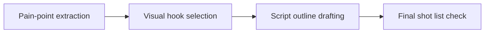

# Creative Block to Shoot-Ready Script Workflow

Natural delivery comes from short beats. It does not come from reciting long paragraphs. **Creative Block to Shoot-Ready Script Workflow** has one clear job. The practical goal is to break through blank-page anxiety with a 4-step script transformation. This guide is built for creators rebuilding a sustainable workload. Set **pain-point extraction** alongside **visual hook selection** before adding extra steps or decorative edits.

## Quick answer

Start with **Pain-point extraction**. Use **Visual hook selection** to show the method clearly on camera in 4K at 60fps. Let **Script outline drafting** deliver the visual proof under locked 5600K light. Treat **Final shot list check** as your review gate. The core rule is simple: reduce commitments first, then rebuild around a minimum cadence the creator can actually sustain.

## Why Pain-point extraction and Visual hook selection must agree

Adding more tools or batching targets can increase pressure when the real problem is volume, boundaries or recovery debt. Here, the issue starts when **pain-point extraction** is planned without **visual hook selection**. The draft may look good. Yet the creator still does not know what to film or approve.

Start with the smallest version of **pain-point extraction** that delivers lower context switching. Check it against a workload log. Keep this boundary in mind: Seek qualified support when health or daily functioning is affected. If proof is not ready, tighten the promise. Do not mask it with buzzwords.

## Decision map for Creative Block to Shoot-Ready Script Workflow

| Decision | Evidence to prepare | Boundary |
| :--- | :--- | :--- |
| **Pain-point extraction** | Prepare a workload log | Seek qualified support when health or daily functioning is affected. |
| **Visual hook selection** | Prepare a reduced publishing plan | Seek qualified support when health or daily functioning is affected. |
| **Script outline drafting** | Prepare a recovery check after each production block | Remove a format before adding a new system. |
| **Final shot list check** | Prepare a reduced publishing plan | Seek qualified support when health or daily functioning is affected. |

## How to put the method into practice

### 1. Pain-point extraction

Treat pain-point extraction as a direct operational step. Make it support **visual hook selection** and follow this rule: reduce commitments first, then rebuild around a minimum cadence the creator can actually sustain.

Verify this step with a workload log. Seek qualified support when health or daily functioning is affected. Look for lower context switching. If that outcome is missing, adjust **pain-point extraction** before filming **visual hook selection**.

### 2. Visual hook selection

Open visual hook selection in the first 0-3s with the visual result before any setup. Pair the spoken line with clear 4K 60fps action. Keep it aligned with **script outline drafting**.

Verify this step with a reduced publishing plan. Seek qualified support when health or daily functioning is affected. Look for lower context switching. If that outcome is missing, adjust **visual hook selection** before filming **script outline drafting**.

### 3. Script outline drafting

Test script outline drafting under your real time limit. Keep only the step that protects the proof for **final shot list check**.

Verify this step with a recovery check after each production block. Remove a format before adding a new system. Look for more predictable recovery. If that outcome is missing, adjust **script outline drafting** before filming **final shot list check**.

### 4. Final shot list check

Set up final shot list check with a fixed 50mm or 85mm macro lens. Keep camera distance locked at 3 to 4 feet across takes. Keep it aligned with **pain-point extraction**.

Verify this step with a reduced publishing plan. Seek qualified support when health or daily functioning is affected. Look for lower context switching. If that outcome is missing, adjust **final shot list check** before filming **pain-point extraction**.

## A script you can adapt

Use this 30-second script structure for **Creative Block to Shoot-Ready Script Workflow**:

- **Opening shot (0-3s):** `[Visual friction visible under 5600K light]`
- **Spoken hook (0-3s):** "If you struggle with `[exact problem]`, watch this step."
- **Method beats (3-15s):** `Pain-point extraction followed by Visual hook selection`
- **Proof beat (15-25s):** `a recovery check after each production block`
- **Call to action (25-30s):** "Save this card before your next shoot."

Read the lines for **Pain-point extraction** in **Creative Block to Shoot-Ready Script Workflow** aloud. Trim any sentence that takes more than 4 seconds to say on camera.

## A practical first pass

Suppose creators rebuilding a sustainable workload must complete one short video script in a short 45-minute window. First, they lock **pain-point extraction**. They prepare a reduced publishing plan. Then they use **script outline drafting** to keep the promise visible on camera in 4K at 60fps. Remove a format before adding a new system. During review, they judge **final shot list check** against lower context switching. A vague request for more polish is rejected.

## Review Final shot list check before the next pass

- **Direction:** Does pain-point extraction name one clear choice?
- **Visibility:** Can the viewer see visual hook selection without reading the caption?
- **Proof:** Does a recovery check after each production block back up the main claim under 5600K light?
- **Boundary:** Has the creator respected this guardrail: Seek qualified support when health or daily functioning is affected.
- **Learning:** Will the next pass improve based on more predictable recovery?

## Frequently asked questions

### What must Pain-point extraction decide first?

Set one clear default for **pain-point extraction** next to **visual hook selection**. State the exact condition that justifies a change. A workload log is far more useful than a long reference deck because you can test it directly on set.

### How can Visual hook selection be tested with simple gear?

Protect the proof moment above all else. Cut optional shots first. A short version works well when **visual hook selection** stays visible and claims stay inside your approved boundary.

### When should Final shot list check be updated?

Update **final shot list check** when repeated passes on **script outline drafting** show the same friction. A shift in audience, offer, or weekly capacity also justifies an update. A single slow video is not a reason to rebuild your whole system.

### How long should this workflow take for Creative Block to Shoot-Ready Script Workflow?

Keep the shoot for **Creative Block to Shoot-Ready Script Workflow** within a 45-minute filming block. Set up lighting in 10 minutes, film 3 takes of **visual hook selection** in 4K at 60fps, and lock your primary cut.

## Next step

Write **pain-point extraction** and **script outline drafting** on one card before you shoot. If the same two points still stall the set, [pick a brief in the store](/store).
