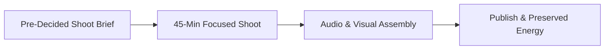

# Solving Creator Decision Fatigue: How Pre-Decided Shot Lists Prevent Burnout

The biggest threat to a creator is not algorithm volatility or slow views. It is mental exhaustion from micro-decision overload. When creators film without a brief, they must make dozens of small choices at once: what angle to use, what hook to say, and when a take is good enough to post.

This mental strain drains energy. It turns a simple filming session into an exhausting ordeal and leads to burnout and publishing silence.

This guide shows how to stop decision fatigue by separating ideation from shoot days through clear shot lists and batching.

## Quick answer

To eliminate decision fatigue and build a steady cadence, follow three rules.
1. **Separate Brainstorming from Filming:** Never plan topics on the same day you turn on studio lights.
2. **Use Pre-Decided Shoot Cards:** Lock spoken lines, camera angles, and proof cutaways before recording.
3. **Set a Definition of Done:** Cap takes at three per scene to stop perfectionist over-editing.



## The Cognitive Architecture of Creator Burnout

```text
THE BURNOUT LOOP: Blank Page ──► Unstructured Shoot (50+ Decisions) ──► Over-Editing ──► Exhaustion ──► Post Silence
THE BRIEF SYSTEM: Pre-Decided Brief ──► 45-Min Focused Shoot ──► Fast Edit ──► Published ──► Preserved Energy
```

### The "Blank Page" Trap on Shoot Day
Filming without a written brief forces the brain to juggle planning and delivery at once. Switching between topic logic and on-camera energy burns mental focus fast. This leads to frustration, doubt, and wasted takes.

### The Perfectionism Spiral in Post-Production
Without a clear finish line, editing turns into an endless loop of minor tweaks. Creators test dozens of songs and obsess over small pauses. A structured brief sets clear stopping rules before editing starts.

---

## The Decision Elimination Matrix

| Production Phase. | Unstructured Approach (High Friction). | Anomaly Box Brief Approach (Zero Fatigue). |
| :--- | :--- | :--- |
| **Ideation**. | Staring at phone on filming day asking what to post today. | Three pre-vetted concepts selected from your idea bank on Monday. |
| **Hook Selection**. | Ad-libbing 10 random openings in front of the camera. | Choosing between 2 pre-written hook modes (Contrarian vs Proof-First). |
| **Framing & Lighting**. | Adjusting tripod height and moving furniture for 40 minutes. | Standardized eye-level 50mm setup locked to marked floor points. |
| **Filming Protocol**. | Filming 15 chaotic takes hoping one works. | Max 3 takes per beat following structured timecoded prompts. |
| **Editing Finish Line**. | Tweaking timeline for 3 hours with no clear stopping point. | Definition of Done: Trim audio breath + duck music -16dB + export. |

---

## The 3-Hour Weekly Batch Production Rhythm

Adopt this weekly production schedule to film three high-impact videos in under four hours.

### Monday (45 Minutes): Brief Selection & Calibration
Review your upcoming content goals. Select 2 to 3 shoot briefs for your purchase lane and creator mode. Fill in your personal product truths or client examples into the script brackets.

### Tuesday (90 Minutes): The Batch Filming Window
Set up your camera once. Record all 3 videos in one focused session:
- *Minutes 0–15:* Warmup and lighting check.
- *Minutes 15–40:* Record Video 1 (Film hook takes first, then body beats).
- *Minutes 40–65:* Record Video 2.
- *Minutes 65–90:* Record Video 3 and capture supporting B-roll.

### Wednesday (60 Minutes): Assembly & Export
Import all footage. Assemble cuts on action, insert pre-planned on-screen keyword overlays. Add caption, and schedule uploads for the week.

---

## Fill-in-the-Blank Production Definition-of-Done Sheet

Keep this checklist next to your editing setup to declare when a video is finished.

```text
[ ] Audio: Spoken dialogue is crisp, loud. And background music is ducked by -16dB.
[ ] First 0.5s: First frame contains active physical movement and immediate speech.
[ ] Proof Beat: Supporting proof artifact shown within the first 3 seconds.
[ ] Text Safe Zone: On-screen keywords do not cover face or overlap UI icons.
[ ] Decision CTA: Caption includes one specific next action (Save / Brief / DM).
[ ] Status: APPROVED FOR EXPORT (No further micro-edits allowed).
```

---

## Frequently Asked Questions

### Does batching content make my videos feel less authentic or timely?
No. Batching evergreen lessons frees mental energy. It gives you space to post spontaneous Stories or timely updates when industry news breaks.

### What should I do if I feel creative resistance on filming day?
With pre-decided briefs, you do not need sudden inspiration. You simply execute a blueprint. Complete take one of your first scene, and momentum carries you through.

### How many takes should I allow myself per scene?
Enforce a maximum of three takes per scene. If the third take is imperfect, move forward anyway. Natural delivery often connects better than stiff perfection.
