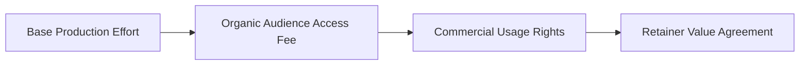

# How to Price Creator Packages and Retainers: The Expected Value Calculation Framework

Pricing is one of the biggest challenges for creators and UGC producers. When a brand asks for a quote, creators often hesitate: Am I asking for too much? Am I leaving money on the table? What should three Reels and a usage license cost?

Most social media pricing tips rely on arbitrary rules like one hundred dollars per ten thousand followers. This outdated model ignores production effort, audience purchasing power, and commercial ad usage rights.

This guide explains our pricing framework to help you price single briefs, monthly retainers, and brand deals with confidence.

## Quick answer

To price your packages professionally, follow three core rules.
1. **Quote on Total Value:** Price across three pillars: base production, audience access, and commercial ad rights.
2. **Offer Retainer Discounts:** Give a fifteen percent discount for a 3-month retainer in exchange for predictable cash flow.
3. **Set Revision Limits:** Limit packages to one script review pass and one minor post-delivery edit. Extra reshoots require a fifty percent fee.



## The 3-Pillar Creator Pricing Equation

```text
TOTAL PROJECT QUOTE = [1. Base Production Effort] + [2. Organic reach Fee] + [3. Commercial Usage Rights]
```

### Pillar 1: Base Production & Creative Direction Fee
This covers your studio setup, scripting, filming, and editing. A standard baseline ranges from $250 to $750 per finished brief, regardless of follower count.

### Pillar 2: Organic Audience Access Fee
This reflects your audience size, engagement, and buying power. High-ticket B2B, finance, and tech niches command much higher rates than general lifestyle accounts.

### Pillar 3: Commercial Usage Rights & Whitelisting (The Big Multiplier)
If a brand runs your video as a paid ad, your creative drives direct revenue for them. Commercial rights should add thirty to one hundred percent of your base fee per 30-day ad window.

---

## Creator Pricing Benchmark Matrix (2026 Standards)

| Package Tier. | Deliverables Included. | Standard Price Range. | Ideal Brand Client. |
| :--- | :--- | :--- | :--- |
| **Single UGC Asset**. | 1 Concept + 2 Hook Variations + 30-Day Paid Ad Rights. | $450 – $950. | DTC E-commerce, Skincare, Apps. |
| **Organic Partnership**. | 1 Dedicated Reel + Story Sequence + Organic Link. | $750 – $2,500+. | Niche SaaS, Consumer Brands. |
| **Monthly Creative Retainer**. | 4 Campaign-Ready Briefs / Month (3-Month Minimum). | $2,000 – $5,000 / month. | Growth-stage startups, Agency partners. |
| **Full Creative Direction Package**. | 8 Briefs + Whitelisting + Raw B-Roll Handoff. | $4,500 – $10,000+. | Enterprise brands, Launch campaigns. |

---

## The Expected Value Retainer Pitch Strategy

Brands prefer retainers because they provide steady video volume and lower acquisition costs. Structure your retainer pitch around three clear phases.

### Month 1: Baseline Creative Calibration
Deliver four diverse briefs testing distinct hook angles. Identify which creative approach earns the highest watch time.

### Month 2: Scaling the Winning Hook Angle
Produce four iterations expanding on the winning angle from month one. Vary your visual proof and backgrounds.

### Month 3: Conversion tuning & Retargeting Variants
Deliver four conversion briefs designed to turn interested viewers into paying clients.

---

## Fill-in-the-Blank Commercial Rate Sheet Template

Adapt this scope-of-work template for your formal brand proposals.

```text
PROPOSAL FOR [BRAND NAME]:
1. Deliverable: [X] Campaign-Ready Short-Form Video Assets (9:16 format. 4K resolution, color-graded).
2. Production Scope: Scripting, high-contrast hook variants, eye-level framing. And clean audio ducking.
3. Usage Rights: Organic posting on creator channels + [30/60/90] days paid ad paid ads.
4. Revision Boundary: 1 round of script feedback before filming. 1 round of timing edits post-delivery.
5. Total Investment: $[Amount] USD (50% upfront deposit required to secure filming schedule).
```

---

## Frequently Asked Questions

### Should I ever accept "gifted product" collabs in exchange for content?
Only accept gifted products if the item holds high value and you have complete creative freedom. For commercial campaigns, always charge cash for your labor and usage rights.

### How do I handle brands that ask for "Perpetual Usage Rights"?
Never grant perpetual usage rights at standard rates. If a brand insists on a permanent buyout, charge three to five times your standard production fee.
