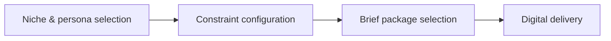

# Custom Creative Brief Configuration Guide

The value of a creative brief shows in how fast the team completes the handoff. **Custom Creative Brief Configuration Guide** has one clear job. The practical goal is to configure an Anomaly Box creative brief for your niche, production constraints, and setup. This guide is built for creators and teams comparing direction systems. Set **niche & persona selection** alongside **constraint configuration** before adding extra steps or decorative edits.

## Quick answer

Start with **Niche & persona selection**. Use **Constraint configuration** to show the method clearly on camera in 4K at 60fps. Let **Brief package selection** deliver the visual proof under locked 5600K light. Treat **Digital delivery** as your review gate. The core rule is simple: show the artifact, the handoff and the production decision it replaces.

## Judge the product through the production handoff

A planning product creates more work when buyers cannot see what decisions it resolves before shoot day. Here, the issue starts when **niche & persona selection** is planned without **constraint configuration**. The draft may look good. Yet the creator still does not know what to film or approve.

Start with the smallest version of **niche & persona selection** that delivers more complete shoots. Check it against a clear comparison of workflow steps. Keep this boundary in mind: Keep product claims aligned with the actual service. If proof is not ready, tighten the promise. Do not mask it with buzzwords.

## Decision map for Custom Creative Brief Configuration Guide

| Decision | Evidence to prepare | Boundary |
| :--- | :--- | :--- |
| **Niche & persona selection** | Prepare a clear comparison of workflow steps | Keep product claims aligned with the actual service. |
| **Constraint configuration** | Prepare a real Creator Vault brief | Do not present colour as the only difference between tiers. |
| **Brief package selection** | Prepare a shot completed from the written direction | Show what remains the creator's decision. |
| **Digital delivery** | Prepare a strategist-to-creator handoff | Do not present colour as the only difference between tiers. |

## How to put the method into practice

### 1. Niche & persona selection

Focus niche & persona selection on one specific viewer problem. Deliver one measurable outcome without inflated claims. Keep it aligned with **constraint configuration**.

Verify this step with a clear comparison of workflow steps. Keep product claims aligned with the actual service. Look for more complete shoots. If that outcome is missing, adjust **niche & persona selection** before filming **constraint configuration**.

### 2. Constraint configuration

Make constraint configuration easy to verify on set. Confirm the proof before moving to **brief package selection**.

Verify this step with a real Creator Vault brief. Do not present colour as the only difference between tiers. Look for more complete shoots. If that outcome is missing, adjust **constraint configuration** before filming **brief package selection**.

### 3. Brief package selection

Test brief package selection under your real time limit. Keep only the step that protects the proof for **digital delivery**.

Verify this step with a shot completed from the written direction. Show what remains the creator's decision. Look for fewer clarification messages. If that outcome is missing, adjust **brief package selection** before filming **digital delivery**.

### 4. Digital delivery

Use digital delivery to set a clear boundary for **niche & persona selection**. Name what counts as done and what needs a retake.

Verify this step with a strategist-to-creator handoff. Do not present colour as the only difference between tiers. Look for faster handoff. If that outcome is missing, adjust **digital delivery** before filming **niche & persona selection**.

## A script you can adapt

Use this handoff sheet for **Custom Creative Brief Configuration Guide**:

- **Before the brief:** `[Decisions that usually waste time on shoot day]`
- **On the brief:** `Niche & persona selection, Constraint configuration and [claim boundary]`
- **Creator action (0-45 min):** `[Film 3 takes with locked 5600K lighting and lav mic]`
- **Proof:** `a shot completed from the written direction`
- **Final approval:** `[Sign-off within 24 hours on approved claim delivery]`

Follow **Niche & persona selection** through **Digital delivery** to finish the shoot without extra meetings.

## A practical first pass

Suppose creators and teams comparing direction systems must complete one clean creator handoff in a short 45-minute window. First, they lock **niche & persona selection**. They prepare a real Creator Vault brief. Then they use **brief package selection** to keep the promise visible on camera in 4K at 60fps. Show what remains the creator's decision. During review, they judge **digital delivery** against faster handoff. A vague request for more polish is rejected.

## Review Digital delivery before the next pass

- **Direction:** Does niche & persona selection name one clear choice?
- **Visibility:** Can the viewer see constraint configuration without reading the caption?
- **Proof:** Does a shot completed from the written direction back up the main claim under 5600K light?
- **Boundary:** Has the creator respected this guardrail: Do not present colour as the only difference between tiers.
- **Learning:** Will the next pass improve based on fewer clarification messages?

## Frequently asked questions

### What must Niche & persona selection decide first?

Set one clear default for **niche & persona selection** next to **constraint configuration**. State the exact condition that justifies a change. A clear comparison of workflow steps is far more useful than a long reference deck because you can test it directly on set.

### How can Constraint configuration be tested with simple gear?

Protect the proof moment above all else. Cut optional shots first. A short version works well when **constraint configuration** stays visible and claims stay inside your approved boundary.

### When should Digital delivery be updated?

Update **digital delivery** when repeated passes on **brief package selection** show the same friction. A shift in audience, offer, or weekly capacity also justifies an update. A single slow video is not a reason to rebuild your whole system.

### How long should this workflow take for Custom Creative Brief Configuration Guide?

Keep the shoot for **Custom Creative Brief Configuration Guide** within a 45-minute filming block. Set up lighting in 10 minutes, film 3 takes of **constraint configuration** in 4K at 60fps, and lock your primary cut.

## Next step

Keep **niche & persona selection** and **brief package selection** on a page you can hold. If that is still too loose, [compare brief packages](/store).
