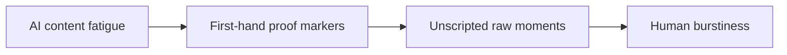

# Do Audiences Trust Creators Less in the AI Content Era?

The real question is not which option sounds best. It is which trade-off fits your limit. **Do Audiences Trust Creators Less in the AI Content Era?** has one clear job. The practical goal is to maintain human authenticity and trust in an AI-saturated social feed. This guide is built for creators building a repeatable publishing system. Set **AI content fatigue** alongside **first-hand proof markers** before adding extra steps or decorative edits.

## Quick answer

Start with **AI content fatigue**. Use **First-hand proof markers** to show the method clearly on camera in 4K at 60fps. Let **Unscripted raw moments** deliver the visual proof under locked 5600K light. Treat **Human burstiness** as your review gate. The core rule is simple: give each piece one job and resolve the opening, evidence and next action before filming.

## Choose the decision behind the comparison

Ideas stay unfinished when audience promise, proof and production limits are decided after recording begins. Here, the issue starts when **AI content fatigue** is planned without **first-hand proof markers**. The draft may look good. Yet the creator still does not know what to film or approve.

Start with the smallest version of **AI content fatigue** that delivers stronger format recognition. Check it against a before-and-after decision. Keep this boundary in mind: Do not make several promises in one piece. If proof is not ready, tighten the promise. Do not mask it with buzzwords.

## Decision map for Do Audiences Trust Creators Less in the AI Content Era?

| Decision | Evidence to prepare | Boundary |
| :--- | :--- | :--- |
| **AI content fatigue** | Prepare a before-and-after decision | Do not make several promises in one piece. |
| **First-hand proof markers** | Prepare a completed example | Do not make several promises in one piece. |
| **Unscripted raw moments** | Prepare a visible process step | Review comparable posts rather than isolated spikes. |
| **Human burstiness** | Prepare an audience question answered on screen | Choose a format that fits the evidence. |

## How to put the method into practice

### 1. AI content fatigue

Treat AI content fatigue as a direct operational step. Make it support **first-hand proof markers** and follow this rule: give each piece one job and resolve the opening, evidence and next action before filming.

Verify this step with a before-and-after decision. Do not make several promises in one piece. Look for stronger format recognition. If that outcome is missing, adjust **AI content fatigue** before filming **first-hand proof markers**.

### 2. First-hand proof markers

Build first-hand proof markers around visible proof. Show the before-and-after test under identical light with zero filter trickery. Keep it aligned with **unscripted raw moments**.

Verify this step with a completed example. Do not make several promises in one piece. Look for more finished pieces. If that outcome is missing, adjust **first-hand proof markers** before filming **unscripted raw moments**.

### 3. Unscripted raw moments

Test unscripted raw moments under your real time limit. Keep only the step that protects the proof for **human burstiness**.

Verify this step with a visible process step. Review comparable posts rather than isolated spikes. Look for useful saves and replies. If that outcome is missing, adjust **unscripted raw moments** before filming **human burstiness**.

### 4. Human burstiness

Use human burstiness to set a clear boundary for **AI content fatigue**. Name what counts as done and what needs a retake.

Verify this step with an audience question answered on screen. Choose a format that fits the evidence. Look for shorter planning time. If that outcome is missing, adjust **human burstiness** before filming **AI content fatigue**.

## A script you can adapt

Use this decision sheet for **Do Audiences Trust Creators Less in the AI Content Era?**:

- **Constraint:** `[Time, budget, gear, or recovery limit]`
- **Route A:** `AI content fatigue — [clear pros and costs]`
- **Route B:** `First-hand proof markers — [clear pros and costs]`
- **Proof test:** `a visible process step`
- **Decision rule:** `[The exact condition that triggers a switch]`
- **Review timeline:** `[Review data after 4 completed episodes]`

Compare **AI content fatigue** against **First-hand proof markers** using real metrics, not vague impressions.

## A practical first pass

Suppose creators building a repeatable publishing system must complete one documented choice in a short 45-minute window. First, they lock **AI content fatigue**. They prepare a completed example. Then they use **unscripted raw moments** to keep the promise visible on camera in 4K at 60fps. Review comparable posts rather than isolated spikes. During review, they judge **human burstiness** against shorter planning time. A vague request for more polish is rejected.

## Review Human burstiness before the next pass

- **Direction:** Does AI content fatigue name one clear choice?
- **Visibility:** Can the viewer see first-hand proof markers without reading the caption?
- **Proof:** Does a visible process step back up the main claim under 5600K light?
- **Boundary:** Has the creator respected this guardrail: Choose a format that fits the evidence.
- **Learning:** Will the next pass improve based on useful saves and replies?

## Frequently asked questions

### What must AI content fatigue decide first?

Set one clear default for **AI content fatigue** next to **first-hand proof markers**. State the exact condition that justifies a change. A before-and-after decision is far more useful than a long reference deck because you can test it directly on set.

### How can First-hand proof markers be tested with simple gear?

Protect the proof moment above all else. Cut optional shots first. A short version works well when **first-hand proof markers** stays visible and claims stay inside your approved boundary.

### When should Human burstiness be updated?

Update **human burstiness** when repeated passes on **unscripted raw moments** show the same friction. A shift in audience, offer, or weekly capacity also justifies an update. A single slow video is not a reason to rebuild your whole system.

### How long should this workflow take for Do Audiences Trust Creators Less in the AI Content Era??

Aim for 45 minutes total production for **Do Audiences Trust Creators Less in the AI Content Era?**. Spend 15 minutes setting up your mic and camera, film 3 takes, and confirm a before-and-after decision before tearing down.

## Next step

Put **AI content fatigue** next to **unscripted raw moments** on one sheet. If you still need someone else to lock the shoot, [start in the store](/store).
