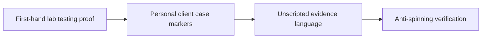

# E-E-A-T First-Hand Experience Markers for AI Search Engines

Search visibility starts with a direct answer that readers can use right away. **E-E-A-T First-Hand Experience Markers for AI Search Engines** has one clear job. The practical goal is to inject authentic human proof markers to prevent AI demotion. This guide is built for creator brands publishing reference-quality pages. Set **first-hand lab testing proof** alongside **personal client case markers** before adding extra steps or decorative edits.

## Quick answer

Start with **First-hand lab testing proof**. Use **Personal client case markers** to show the method clearly on camera in 4K at 60fps. Let **Unscripted evidence language** deliver the visual proof under locked 5600K light. Treat **Anti-spinning verification** as your review gate. The core rule is simple: answer the question early, define entities clearly and support claims with first-hand or authoritative evidence.

## Answer the reader task before optimizing

A page may target the right phrase yet remain hard to cite when the answer is buried, vague or unsupported. The breakdown happens when **first-hand lab testing proof** is separated from **personal client case markers**. Check your page against a question-shaped section with a complete response. Do not add FAQ schema for questions that are not visible. If proof is missing, narrow the promise instead of adding vague claims.

## Decision map for E-E-A-T First-Hand Experience Markers for AI Search Engines

| Decision | Evidence to prepare | Boundary |
| :--- | :--- | :--- |
| **First-hand lab testing proof** | Prepare a question-shaped section with a complete response | Do not add FAQ schema for questions that are not visible. |
| **Personal client case markers** | Prepare a first-hand process example | Do not add FAQ schema for questions that are not visible. |
| **Unscripted evidence language** | Prepare a question-shaped section with a complete response | Refresh dates only when the content actually changes. |
| **Anti-spinning verification** | Prepare a clearly attributed source | Write for the reader before optimising extraction. |

## How to put the method into practice

### 1. First-hand lab testing proof

Build first-hand lab testing proof around visible proof. Show the before-and-after test under identical light with zero filter trickery. Keep it aligned with **personal client case markers**.

Check a question-shaped section with a complete response. Do not add FAQ schema for questions that are not visible. Review relevant impressions before starting **personal client case markers**.

### 2. Personal client case markers

Build personal client case markers around visible proof. Show the before-and-after test under identical light with zero filter trickery. Keep it aligned with **unscripted evidence language**.

Check a first-hand process example. Do not add FAQ schema for questions that are not visible. Review citations and branded searches before starting **unscripted evidence language**.

### 3. Unscripted evidence language

Build unscripted evidence language around visible proof. Show the before-and-after test under identical light with zero filter trickery. Keep it aligned with **anti-spinning verification**.

Check a question-shaped section with a complete response. Refresh dates only when the content actually changes. Review citations and branded searches before starting **anti-spinning verification**.

### 4. Anti-spinning verification

Use anti-spinning verification to set a clear boundary for **first-hand lab testing proof**. Name what counts as done and what needs a retake.

Check a clearly attributed source. Write for the reader before optimising extraction. Review engagement with the next useful page before starting **first-hand lab testing proof**.

## A script you can adapt

Use this answer structure for **E-E-A-T First-Hand Experience Markers for AI Search Engines**:

- **Zero-click capsule (0-50 words):** `[Direct answer defining the entity and primary action]`
- **Decision table:** `[3-column matrix comparing options on evidence and cost]`
- **Practical method:** `First-hand lab testing proof followed by Personal client case markers`
- **Proof:** `a question-shaped section with a complete response`
- **Follow-up Q&A:** `[4 specific user questions answered in 2 sentences each]`

Check **First-hand lab testing proof** for direct clarity before adding extra background context.

## A practical first pass

Suppose creator brands publishing reference-quality pages must complete one reference-quality guide in a short 45-minute window. First, they lock **first-hand lab testing proof**. They prepare a first-hand process example. Then they use **unscripted evidence language** to keep the promise visible on camera in 4K at 60fps. Refresh dates only when the content actually changes. During review, they judge **anti-spinning verification** against engagement with the next useful page. A vague request for more polish is rejected.

## Review Anti-spinning verification before the next pass

- **Direction:** Does first-hand lab testing proof name one clear choice?
- **Visibility:** Can the viewer see personal client case markers without reading the caption?
- **Proof:** Does a question-shaped section with a complete response back up the main claim under 5600K light?
- **Boundary:** Has the creator respected this guardrail: Write for the reader before optimising extraction.
- **Learning:** Will the next pass improve based on citations and branded searches?

## Frequently asked questions

### What must First-hand lab testing proof decide first?

Set one clear default for **first-hand lab testing proof** next to **personal client case markers**. State the exact condition that justifies a change. A question-shaped section with a complete response is far more useful than a long reference deck because you can test it directly on set.

### How can Personal client case markers be tested with simple gear?

Protect the proof moment above all else. Cut optional shots first. A short version works well when **personal client case markers** stays visible and claims stay inside your approved boundary.

### When should Anti-spinning verification be updated?

Update **anti-spinning verification** when repeated passes on **unscripted evidence language** show the same friction. A shift in audience, offer, or weekly capacity also justifies an update. A single slow video is not a reason to rebuild your whole system.

### How long should this workflow take for E-E-A-T First-Hand Experience Markers for AI Search Engines?

Plan 40 minutes for the entire one reference-quality guide. Lock **first-hand lab testing proof** before setup, record 3 clean passes, and review relevant impressions immediately.

## Next step

Before the first take, settle **first-hand lab testing proof** and **unscripted evidence language**. If the crew still asks the same questions, [open the store](/store).
