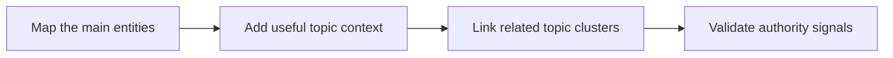

# Entity Clustering Strategy for Instagram Creators

Search visibility starts with a direct answer that readers can use right away. **Entity Clustering Strategy for Instagram Creators** has one clear job. The practical goal is to help search systems understand how your main creator topics connect. This guide is built for creator brands publishing reference-quality pages. Set **map the main entities** alongside **add useful topic context** before adding extra steps or decorative edits.

## Quick answer

Start with **Map the main entities**. Use **Add useful topic context** to show the method clearly on camera in 4K at 60fps. Let **Link related topic clusters** deliver the visual proof under locked 5600K light. Treat **Validate authority signals** as your review gate. The core rule is simple: answer the question early, define entities clearly and support claims with first-hand or authoritative evidence.

## Answer the reader task before optimizing

A page may target the right phrase yet remain hard to cite when the answer is buried, vague or unsupported. The breakdown happens when **map the main entities** is separated from **add useful topic context**. Check your page against a concise direct answer. Write for the reader before optimising extraction. If proof is missing, narrow the promise instead of adding vague claims.

## Decision map for Entity Clustering Strategy for Instagram Creators

| Decision | Evidence to prepare | Boundary |
| :--- | :--- | :--- |
| **Map the main entities** | Prepare a concise direct answer | Write for the reader before optimising extraction. |
| **Add useful topic context** | Prepare a clearly attributed source | Avoid claims that the cited source does not support. |
| **Link related topic clusters** | Prepare a first-hand process example | Avoid claims that the cited source does not support. |
| **Validate authority signals** | Prepare a concise direct answer | Write for the reader before optimising extraction. |

## How to put the method into practice

### 1. Map the main entities

Treat map the main entities as a direct operational step. Make it support **add useful topic context** and follow this rule: answer the question early, define entities clearly and support claims with first-hand or authoritative evidence.

Check a concise direct answer. Write for the reader before optimising extraction. Review qualified organic visits before starting **add useful topic context**.

### 2. Add useful topic context

Make add useful topic context easy to verify on set. Confirm the proof before moving to **link related topic clusters**.

Check a clearly attributed source. Avoid claims that the cited source does not support. Review engagement with the next useful page before starting **link related topic clusters**.

### 3. Link related topic clusters

Test link related topic clusters under your real time limit. Keep only the step that protects the proof for **validate authority signals**.

Check a first-hand process example. Avoid claims that the cited source does not support. Review citations and branded searches before starting **validate authority signals**.

### 4. Validate authority signals

Use validate authority signals to set a clear boundary for **map the main entities**. Name what counts as done and what needs a retake.

Check a concise direct answer. Write for the reader before optimising extraction. Review relevant impressions before starting **map the main entities**.

## A script you can adapt

Use this answer structure for **Entity Clustering Strategy for Instagram Creators**:

- **Zero-click capsule (0-50 words):** `[Direct answer defining the entity and primary action]`
- **Decision table:** `[3-column matrix comparing options on evidence and cost]`
- **Practical method:** `Map the main entities followed by Add useful topic context`
- **Proof:** `a first-hand process example`
- **Follow-up Q&A:** `[4 specific user questions answered in 2 sentences each]`

Check **Map the main entities** for direct clarity before adding extra background context.

## A practical first pass

Suppose creator brands publishing reference-quality pages must complete one reference-quality guide in a short 45-minute window. First, they lock **map the main entities**. They prepare a clearly attributed source. Then they use **link related topic clusters** to keep the promise visible on camera in 4K at 60fps. Avoid claims that the cited source does not support. During review, they judge **validate authority signals** against relevant impressions. A vague request for more polish is rejected.

## Review Validate authority signals before the next pass

- **Direction:** Does map the main entities name one clear choice?
- **Visibility:** Can the viewer see add useful topic context without reading the caption?
- **Proof:** Does a first-hand process example back up the main claim under 5600K light?
- **Boundary:** Has the creator respected this guardrail: Write for the reader before optimising extraction.
- **Learning:** Will the next pass improve based on citations and branded searches?

## Frequently asked questions

### What must Map the main entities decide first?

Set one clear default for **map the main entities** next to **add useful topic context**. State the exact condition that justifies a change. A concise direct answer is far more useful than a long reference deck because you can test it directly on set.

### How can Add useful topic context be tested with simple gear?

Protect the proof moment above all else. Cut optional shots first. A short version works well when **add useful topic context** stays visible and claims stay inside your approved boundary.

### When should Validate authority signals be updated?

Update **validate authority signals** when repeated passes on **link related topic clusters** show the same friction. A shift in audience, offer, or weekly capacity also justifies an update. A single slow video is not a reason to rebuild your whole system.

### How long should this workflow take for Entity Clustering Strategy for Instagram Creators?

Aim for 45 minutes total production for **Entity Clustering Strategy for Instagram Creators**. Spend 15 minutes setting up your mic and camera, film 3 takes, and confirm a concise direct answer before tearing down.

## Next step

Before the first take, settle **map the main entities** and **link related topic clusters**. If the crew still asks the same questions, [open the store](/store).
