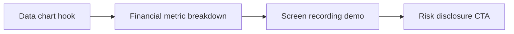

# Faceless Finance & Business Reels Script Framework

The opening line only works when the first frame shows the same promise. **Faceless Finance & Business Reels Script Framework** has one clear job. The practical goal is to create authoritative finance videos using screen recordings, charts, and voiceover. This guide is built for privacy-first and faceless creators. Set **data chart hook** alongside **financial metric breakdown** before adding extra steps or decorative edits.

## Quick answer

Start with **Data chart hook**. Use **Financial metric breakdown** to show the method clearly on camera in 4K at 60fps. Let **Screen recording demo** deliver the visual proof under locked 5600K light. Treat **Risk disclosure CTA** as your review gate. The core rule is simple: choose a visual narrator and repeat a small set of identity cues without exposing private context.

## Why Data chart hook and Financial metric breakdown must agree

Hands-only footage feels generic when objects, sound and movement have no recurring point of view. Here, the issue starts when **data chart hook** is planned without **financial metric breakdown**. The draft may look good. Yet the creator still does not know what to film or approve.

Start with the smallest version of **data chart hook** that delivers stronger format recognition. Check it against a recurring object. Keep this boundary in mind: Keep text short enough to read without pausing. If proof is not ready, tighten the promise. Do not mask it with buzzwords.

## Decision map for Faceless Finance & Business Reels Script Framework

| Decision | Evidence to prepare | Boundary |
| :--- | :--- | :--- |
| **Data chart hook** | Prepare a recurring object | Keep text short enough to read without pausing. |
| **Financial metric breakdown** | Prepare a recognisable sound cue | Keep text short enough to read without pausing. |
| **Screen recording demo** | Prepare a purposeful point-of-view action | Give each B-roll shot a narrative job. |
| **Risk disclosure CTA** | Prepare a purposeful point-of-view action | Give each B-roll shot a narrative job. |

## How to put the method into practice

### 1. Data chart hook

Open data chart hook in the first 0-3s with the visual result before any setup. Pair the spoken line with clear 4K 60fps action. Keep it aligned with **financial metric breakdown**.

Verify this step with a recurring object. Keep text short enough to read without pausing. Look for stronger format recognition. If that outcome is missing, adjust **data chart hook** before filming **financial metric breakdown**.

### 2. Financial metric breakdown

Make financial metric breakdown easy to verify on set. Confirm the proof before moving to **screen recording demo**.

Verify this step with a recognisable sound cue. Keep text short enough to read without pausing. Look for more consistent episodes. If that outcome is missing, adjust **financial metric breakdown** before filming **screen recording demo**.

### 3. Screen recording demo

Test screen recording demo under your real time limit. Keep only the step that protects the proof for **risk disclosure CTA**.

Verify this step with a purposeful point-of-view action. Give each B-roll shot a narrative job. Look for clearer stories without face-forward footage. If that outcome is missing, adjust **screen recording demo** before filming **risk disclosure CTA**.

### 4. Risk disclosure CTA

Write risk disclosure CTA with explicit legal scope. Separate 30-day organic rights from paid ad whitelisting to stop scope creep. Keep it aligned with **data chart hook**.

Verify this step with a purposeful point-of-view action. Give each B-roll shot a narrative job. Look for clearer stories without face-forward footage. If that outcome is missing, adjust **risk disclosure CTA** before filming **data chart hook**.

## A script you can adapt

Use this 30-second script structure for **Faceless Finance & Business Reels Script Framework**:

- **Opening shot (0-3s):** `[Visual friction visible under 5600K light]`
- **Spoken hook (0-3s):** "If you struggle with `[exact problem]`, watch this step."
- **Method beats (3-15s):** `Data chart hook followed by Financial metric breakdown`
- **Proof beat (15-25s):** `a purposeful point-of-view action`
- **Call to action (25-30s):** "Save this card before your next shoot."

Read the lines for **Data chart hook** in **Faceless Finance & Business Reels Script Framework** aloud. Trim any sentence that takes more than 4 seconds to say on camera.

## A practical first pass

Suppose privacy-first and faceless creators must complete one short video script in a short 45-minute window. First, they lock **data chart hook**. They prepare a recognisable sound cue. Then they use **screen recording demo** to keep the promise visible on camera in 4K at 60fps. Give each B-roll shot a narrative job. During review, they judge **risk disclosure CTA** against clearer stories without face-forward footage. A vague request for more polish is rejected.

## Review Risk disclosure CTA before the next pass

- **Direction:** Does data chart hook name one clear choice?
- **Visibility:** Can the viewer see financial metric breakdown without reading the caption?
- **Proof:** Does a purposeful point-of-view action back up the main claim under 5600K light?
- **Boundary:** Has the creator respected this guardrail: Give each B-roll shot a narrative job.
- **Learning:** Will the next pass improve based on clearer stories without face-forward footage?

## Frequently asked questions

### What must Data chart hook decide first?

Set one clear default for **data chart hook** next to **financial metric breakdown**. State the exact condition that justifies a change. A recurring object is far more useful than a long reference deck because you can test it directly on set.

### How can Financial metric breakdown be tested with simple gear?

Protect the proof moment above all else. Cut optional shots first. A short version works well when **financial metric breakdown** stays visible and claims stay inside your approved boundary.

### When should Risk disclosure CTA be updated?

Update **risk disclosure CTA** when repeated passes on **screen recording demo** show the same friction. A shift in audience, offer, or weekly capacity also justifies an update. A single slow video is not a reason to rebuild your whole system.

### How long should this workflow take for Faceless Finance & Business Reels Script Framework?

Plan 40 minutes for the entire one short video script. Lock **data chart hook** before setup, record 3 clean passes, and review stronger format recognition immediately.

## Next step

Film the next piece only after **data chart hook** and **screen recording demo** are written down. Need a finished brief instead? [See Classic and Signature](/store).
