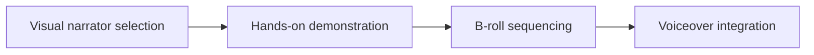

# Faceless Reels Ideas for Busy Creators & Introverts

A plan becomes useful when you can film without rethinking the strategy each time. **Faceless Reels Ideas for Busy Creators & Introverts** has one clear job. The practical goal is to film expressive short-form videos with hands, objects, environments, and optional voiceover instead of forced camera presence. This guide is built for privacy-first and faceless creators. Set **visual narrator selection** alongside **hands-on proof** before adding extra steps or decorative edits.

## Quick answer

Start with **Visual narrator selection**. Use **Hands-on proof** to show the method clearly on camera in 4K at 60fps. Let **B-roll sequencing** deliver the visual proof under locked 5600K light. Treat **Voiceover integration** as your review gate. The core rule is simple: choose a visual narrator and repeat a small set of identity cues without exposing private context.

## Build the minimum workable version

Hands-only footage feels generic when objects, sound and movement have no recurring point of view. Here, the issue starts when **visual narrator selection** is planned without **hands-on proof**. The draft may look good. Yet the creator still does not know what to film or approve.

Start with the smallest version of **visual narrator selection** that delivers clearer stories without face-forward footage. Check it against a purposeful point-of-view action. Keep this boundary in mind: Give each B-roll shot a narrative job. If proof is not ready, tighten the promise. Do not mask it with buzzwords.

## Decision map for Faceless Reels Ideas for Busy Creators & Introverts

| Decision | Evidence to prepare | Boundary |
| :--- | :--- | :--- |
| **Visual narrator selection** | Prepare a purposeful point-of-view action | Give each B-roll shot a narrative job. |
| **Hands-on demonstration** | Prepare a purposeful point-of-view action | Check screens and reflections for private information. |
| **B-roll sequencing** | Prepare a purposeful point-of-view action | Give each B-roll shot a narrative job. |
| **Voiceover integration** | Prepare a purposeful point-of-view action | Give each B-roll shot a narrative job. |

## How to put the method into practice

### 1. Visual narrator selection

Treat visual narrator selection as a direct operational step. Make it support **hands-on proof** and follow this rule: choose a visual narrator and repeat a small set of identity cues without exposing private context.

Verify this step with a purposeful point-of-view action. Give each B-roll shot a narrative job. Look for clearer stories without face-forward footage. If that outcome is missing, adjust **visual narrator selection** before filming **hands-on proof**.

### 2. Hands-on demonstration

Build hands-on proof around visible proof. Show the before-and-after test under identical light with zero filter trickery. Keep it aligned with **b-roll sequencing**.

Verify this step with a purposeful point-of-view action. Check screens and reflections for private information. Look for clearer stories without face-forward footage. If that outcome is missing, adjust **hands-on proof** before filming **b-roll sequencing**.

### 3. B-roll sequencing

Set up b-roll sequencing with a fixed 50mm or 85mm macro lens. Keep camera distance locked at 3 to 4 feet across takes. Keep it aligned with **voiceover integration**.

Verify this step with a purposeful point-of-view action. Give each B-roll shot a narrative job. Look for clearer stories without face-forward footage. If that outcome is missing, adjust **b-roll sequencing** before filming **voiceover integration**.

### 4. Voiceover integration

Record voiceover integration with a mic 4-6 inches from the source. Apply a -48dB noise gate and keep background music ducked at -22dB. Keep it aligned with **visual narrator selection**.

Verify this step with a purposeful point-of-view action. Give each B-roll shot a narrative job. Look for safer production. If that outcome is missing, adjust **voiceover integration** before filming **visual narrator selection**.

## A script you can adapt

Use this shoot card for **Faceless Reels Ideas for Busy Creators & Introverts**:

- **Audience job:** `[The exact moment this post helps the viewer]`
- **Promise:** `[One clear outcome delivered in 30 seconds]`
- **Workflow:** `Visual narrator selection → Hands-on demonstration → B-roll sequencing`
- **Proof:** `a purposeful point-of-view action`
- **Capacity rule:** `[Cap weekly filming to a single 45-minute block]`
- **Call to action:** `[One clear save or reply prompt]`

Finish **Visual narrator selection** and **Hands-on proof** for **Faceless Reels Ideas for Busy Creators & Introverts** before adding extra format variations.

## A practical first pass

Suppose privacy-first and faceless creators must complete one finished content cycle in a short 45-minute window. First, they lock **visual narrator selection**. They prepare a purposeful point-of-view action. Then they use **b-roll sequencing** to keep the promise visible on camera in 4K at 60fps. Give each B-roll shot a narrative job. During review, they judge **voiceover integration** against safer production. A vague request for more polish is rejected.

## Review Voiceover integration before the next pass

- **Direction:** Does visual narrator selection name one clear choice?
- **Visibility:** Can the viewer see hands-on demonstration without reading the caption?
- **Proof:** Does a purposeful point-of-view action back up the main claim under 5600K light?
- **Boundary:** Has the creator respected this guardrail: Give each B-roll shot a narrative job.
- **Learning:** Will the next pass improve based on clearer stories without face-forward footage?

## Frequently asked questions

### What must Visual narrator selection decide first?

Set one clear default for **visual narrator selection** next to **hands-on proof**. State the exact condition that justifies a change. A purposeful point-of-view action is far more useful than a long reference deck because you can test it directly on set.

### How can Hands-on demonstration be tested with simple gear?

Protect the proof moment above all else. Cut optional shots first. A short version works well when **hands-on proof** stays visible and claims stay inside your approved boundary.

### When should Voiceover integration be updated?

Update **voiceover integration** when repeated passes on **b-roll sequencing** show the same friction. A shift in audience, offer, or weekly capacity also justifies an update. A single slow video is not a reason to rebuild your whole system.

### How long should this workflow take for Faceless Reels Ideas for Busy Creators & Introverts?

Plan 40 minutes for the entire one finished content cycle. Lock **visual narrator selection** before setup, record 3 clean passes, and review clearer stories without face-forward footage immediately.

## Next step

Use **visual narrator selection** and **b-roll sequencing** as the only two must-haves on the next card. For a packed brief, [go to the store](/store).
