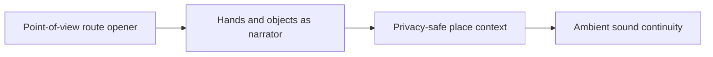

# Faceless Travel Content System & Route Storytelling

The opening line only works when the first frame shows the same promise. **Faceless Travel Content System & Route Storytelling** has one clear job. The practical goal is to build useful travel stories through point-of-view footage, objects, route context, and privacy-safe narration. This guide is built for travel creators. Set **point-of-view route opener** alongside **hands and objects as narrator** before adding extra steps or decorative edits.

## Quick answer

Start with **Point-of-view route opener**. Use **Hands and objects as narrator** to show the method clearly on camera in 4K at 60fps. Let **Privacy-safe place context** deliver the visual proof under locked 5600K light. Treat **Ambient sound continuity** as your review gate. The core rule is simple: anchor every sequence in a real location detail and a useful route decision.

## Why Point-of-view route opener and Hands and objects as narrator must agree

Generic montages create atmosphere but give viewers no route, timing or place-specific reason to save the post. Here, the issue starts when **point-of-view route opener** is planned without **hands and objects as narrator**. The draft may look good. Yet the creator still does not know what to film or approve.

Start with the smallest version of **point-of-view route opener** that delivers trip-planning saves. Check it against a route map. Keep this boundary in mind: Do not reveal private or unsafe location details. If proof is not ready, tighten the promise. Do not mask it with buzzwords.

## Decision map for Faceless Travel Content System & Route Storytelling

| Decision | Evidence to prepare | Boundary |
| :--- | :--- | :--- |
| **Point-of-view route opener** | Prepare a route map | Do not reveal private or unsafe location details. |
| **Hands and objects as narrator** | Prepare a route map | Avoid presenting one visit as a universal rule. |
| **Privacy-safe place context** | Prepare a route map | Avoid presenting one visit as a universal rule. |
| **Ambient sound continuity** | Prepare a place-specific detail | Avoid presenting one visit as a universal rule. |

## How to put the method into practice

### 1. Point-of-view route opener

Treat point-of-view route opener as a direct operational step. Make it support **hands and objects as narrator** and follow this rule: anchor every sequence in a real location detail and a useful route decision.

Verify this step with a route map. Do not reveal private or unsafe location details. Look for trip-planning saves. If that outcome is missing, adjust **point-of-view route opener** before filming **hands and objects as narrator**.

### 2. Hands and objects as narrator

Make hands and objects as narrator easy to verify on set. Confirm the proof before moving to **privacy-safe place context**.

Verify this step with a route map. Avoid presenting one visit as a universal rule. Look for recognisable place storytelling. If that outcome is missing, adjust **hands and objects as narrator** before filming **privacy-safe place context**.

### 3. Privacy-safe place context

Test privacy-safe place context under your real time limit. Keep only the step that protects the proof for **ambient sound continuity**.

Verify this step with a route map. Avoid presenting one visit as a universal rule. Look for trip-planning saves. If that outcome is missing, adjust **privacy-safe place context** before filming **ambient sound continuity**.

### 4. Ambient sound continuity

Record ambient sound continuity with a mic 4-6 inches from the source. Apply a -48dB noise gate and keep background music ducked at -22dB. Keep it aligned with **point-of-view route opener**.

Verify this step with a place-specific detail. Avoid presenting one visit as a universal rule. Look for specific questions. If that outcome is missing, adjust **ambient sound continuity** before filming **point-of-view route opener**.

## A script you can adapt

Use this 30-second script structure for **Faceless Travel Content System & Route Storytelling**:

- **Opening shot (0-3s):** `[Visual friction visible under 5600K light]`
- **Spoken hook (0-3s):** "If you struggle with `[exact problem]`, watch this step."
- **Method beats (3-15s):** `Point-of-view route opener followed by Hands and objects as narrator`
- **Proof beat (15-25s):** `a route map`
- **Call to action (25-30s):** "Save this card before your next shoot."

Read the lines for **Point-of-view route opener** in **Faceless Travel Content System & Route Storytelling** aloud. Trim any sentence that takes more than 4 seconds to say on camera.

## A practical first pass

Suppose travel creators must complete one short video script in a short 45-minute window. First, they lock **point-of-view route opener**. They prepare a route map. Then they use **privacy-safe place context** to keep the promise visible on camera in 4K at 60fps. Avoid presenting one visit as a universal rule. During review, they judge **ambient sound continuity** against specific questions. A vague request for more polish is rejected.

## Review Ambient sound continuity before the next pass

- **Direction:** Does point-of-view route opener name one clear choice?
- **Visibility:** Can the viewer see hands and objects as narrator without reading the caption?
- **Proof:** Does a route map back up the main claim under 5600K light?
- **Boundary:** Has the creator respected this guardrail: Avoid presenting one visit as a universal rule.
- **Learning:** Will the next pass improve based on trip-planning saves?

## Frequently asked questions

### What must Point-of-view route opener decide first?

Set one clear default for **point-of-view route opener** next to **hands and objects as narrator**. State the exact condition that justifies a change. A route map is far more useful than a long reference deck because you can test it directly on set.

### How can Hands and objects as narrator be tested with simple gear?

Protect the proof moment above all else. Cut optional shots first. A short version works well when **hands and objects as narrator** stays visible and claims stay inside your approved boundary.

### When should Ambient sound continuity be updated?

Update **ambient sound continuity** when repeated passes on **privacy-safe place context** show the same friction. A shift in audience, offer, or weekly capacity also justifies an update. A single slow video is not a reason to rebuild your whole system.

### How long should this workflow take for Faceless Travel Content System & Route Storytelling?

Aim for 45 minutes total production for **Faceless Travel Content System & Route Storytelling**. Spend 15 minutes setting up your mic and camera, film 3 takes, and confirm a route map before tearing down.

## Next step

Film the next piece only after **point-of-view route opener** and **privacy-safe place context** are written down. Need a finished brief instead? [See Classic and Signature](/store).
