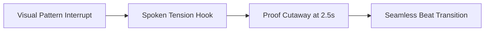

# The First 3 Seconds: How to Engineer Visual, Spoken, and On-Screen Hooks Without Clickbait

In short-form video, the opening three seconds decide whether a post succeeds. If you fail to earn attention in the first two seconds, your lighting and message will never be seen. Yet many creators resort to clickbait or countdowns that ruin trust and drive viewers away.

This guide explains how to build high-retention openings by aligning visual motion, spoken dialogue, and on-screen text without sacrificing trust.

## Quick answer

To build a high-retention hook without clickbait, follow three rules.
1. **Synchronize Three Layers at Once:** Pair physical motion with clear spoken tension and a concise on-screen keyword.
2. **Open an Information Gap:** State a specific tension that requires watching the demonstration to resolve.
3. **Show Clear Context Immediately:** Display the physical product, screen, or topic in the very first frame.



## The Multi-Sensory Triad Framework

```text
               ┌── [1. VISUAL LAYER (0.0s - 0.5s)] Active physical motion & camera proximity
3-SECOND HOOK ─┼── [2. SPOKEN LAYER (0.0s - 2.5s)] Specific tension or cognitive dissonance line
               └── [3. ON-SCREEN LAYER (0.2s - 2.8s)] 3-5 word high-contrast keyword anchor
```

### Layer 1: The Visual Pattern Interrupt (0.0s – 0.5s)
Before sound is processed, the eye detects motion, contrast, and faces. A static shot invites viewers to scroll past. Instead, start with an active physical movement.
- A macro texture reveal (beauty, food, crafts).
- A deliberate camera push-in or lens tilt.
- Stepping directly into a tight eye-level frame while making direct lens contact.

### Layer 2: The Spoken Tension Hook (0.0s – 2.5s)
Your opening sentence must introduce a specific problem or insight. Avoid generic statements. Use specific language like: the reason your videos look amateur is your lighting angle, not your camera.

### Layer 3: The Restrained On-Screen Text Anchor (0.2s – 2.8s)
Most viewers watch video without sound during their initial feed browse. Clean text placed in the upper-third safe zone reinforces your hook without cluttering the screen.

---

## 4 Hook Archetypes That Drive Retention Without Clickbait

| Hook Archetype. | Psychological Mechanism. | Example Script Opening. | Best Creator Lanes. |
| :--- | :--- | :--- | :--- |
| **Reverse Expectation**. | Anterior Cingulate Cortex conflict. | *"Why spending more time on editing is actually ruining your retention."*. | Creator Education, B2B, Tech. |
| **Cost of Inaction**. | Amygdala Loss Aversion. | *"The hidden setting on your phone that is compressing all your 4K footage."*. | Photography, Lifestyle, Tech. |
| **Proof-First Reveal**. | Reward Prediction Confirmation. | *"This single template generated 40 client inquiries without a single paid ad."*. | Consulting, Business, UGC. |
| **Quiet Curiosity Gap**. | Default Mode Network suppression. | *"What happens when you replace daily posting with a weekly batch brief."*. | Personal Brand, Wellness. |

---

## How to Put the 3-Second Rule into Practice on Set

### Step 1: Write the Hook in 3 Separate Variations
Never shoot a video with only one opening idea. In your pre-production brief, draft three distinct hook modes:
1. *The Direct Solution Hook:* simple utility for high search intent.
2. *The Contrarian Take Hook:* High cognitive dissonance for non-follower discovery.
3. *The Proof-First Hook:* Visual artifact demo for commercial conversion.

### Step 2: Record the Hook Takes First
Film all three hook variations at the beginning of your filming block when your energy. Vocal resonance, and posture are highest. Maintain locked exposure and eye-level camera height.

### Step 3: Trim the Audio Breath in Post-Production
During editing, zoom in on your audio waveform. Cut the millisecond of inhale breath before your first spoken word so the speech attacks with immediate momentum.

---

## Fill-in-the-Blank Hook Formula

Adapt this high-retention opening framework for your next shoot.

```text
[Visual Action: Place/hold artifact directly in center frame]
+ [Spoken Line: "If you want to achieve [specific desired outcome]. Stop doing [common inefficient habit] and make this one adjustment."]
+ [On-Screen Text: "Stop doing [bad habit] ❌"]
+ [Proof Cutaway at 0:02.5s: Reveal screenshot, data. Or product in action]
```

---

## Frequently Asked Questions

### Should I put a countdown timer or fake cliffhanger in my hook?
No. Viewers quickly recognize artificial retention hacks and will leave negative comments or skip to the end. The strongest retention comes from genuine information density and structural proof delivery.

### How long should my spoken opening line be?
Aim for 6 to 12 words delivered crisply within 2.0 to 2.8 seconds. Anything longer than 3.5 seconds risks losing viewer interest before the core premise lands.

### Where should on-screen text be positioned on Instagram Reels?
Place text in the vertical safe zone: twenty percent from the top and forty percent from the bottom. This prevents overlap with captions and buttons.
