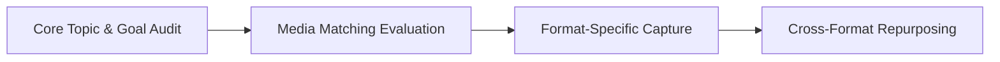

# Format Utility Matrix: Deciding Between Reels, Carousels, and Searchable Text Guides

A major problem for social media audiences is format mismatch. Viewers dislike sitting through a 90-second video to find a quick ten-second code snippet or a three-step checklist. On the flip side, nobody wants to squint at a dense ten-slide carousel when a 15-second physical demo would make the idea clear at once.

When creators force every idea into one format, they waste hours. They also confuse their audience. Format is not a vanity choice. It is a way to deliver value.

This guide shows how to match your content to the best format. Use Reels, Carousels, or Searchable Text to get the best reach and saves.

## Quick answer

To choose the optimal format for any creative idea:
1. **Choose 9:16 Video / Reels** when the idea needs physical proof, high emotion, clear audio, or fast visual hooks.
2. **Choose Multi-Slide Carousels** when the concept is a framework, a comparison table, or a step-by-step checklist meant for saves.
3. **Choose Searchable Website Text** when the reader needs fast search, code to copy, or deep trade-offs.



## The Information Job & Media Matching Engine

```text
CONCEPT GOAL ──┬── [Visual Motion / Emotion] ──► 9:16 Short-Form Reel (Discovery Engine)
               ├── [Reference / Comparison] ──► 10-Slide Carousel (Save & Retention Asset)
               └── [Searchable Deep Nuance] ──► Web Resource Article (SEO & Moat Asset)
```

### 1. When Video is Mandatory (The proof Job)
Video thrives on motion, visual change, and vocal energy. If your idea needs visual proof (like cooking, camera setups, or fitness form), text feels incomplete. Video wins here.

### 2. When Carousels Outperform Video (The Reference Job)
When someone wants to study a five-step framework, compare tools, or save a cheat sheet, video is slow. Viewers have to scrub back and forth. A swipeable carousel lets them read at their own pace. This drives huge save signals.

### 3. When Searchable Text is Required (The Utility Job)
For technical topics, contract terms, script formulas, and business trade-offs, web text is best. Readers can search with Ctrl+F, copy text, and bookmark the permanent link.

---

## The Format Utility Decision Matrix

| Content Goal. | Primary Recommended Format. | Key Performance Indicator. | Why This Format Wins. |
| :--- | :--- | :--- | :--- |
| **Physical Transformation**. | 9:16 Short-Form Reel. | Watch Time & Completion. | Shows real-time visual proof in seconds. |
| **Contrarian Opinion / Rant**. | Eye-Level Talking Head Reel. | Comments & DM Shares. | Vocal tone and conviction build parasocial trust. |
| **Step-by-Step Tutorial**. | 10-Slide Carousel. | Save Rate & Profile Visits. | Viewer controls pace; easy to bookmark. |
| **Product Comparison / Specs**. | Side-by-Side Carousel Table. | Save Rate & External Clicks. | Allows visual comparison without video scrubbing. |
| **Complete Industry Playbook**. | Website Markdown Article. | SEO Rank & Direct Inquiries. | Searchable, indexable by AI, and evergreen. |

---

## The 1-Idea-to-3-Format Repurposing Pipeline

To maximize ROI without creator burnout, structure your high-value ideas through this 3-tier cascade:

### Tier 1: The Core Deep Asset (Searchable Website Guide)
Write the complete 800-word tactical guide on your website with complete tables. Formulas, and FAQs (your permanent digital asset).

### Tier 2: The Visual proof (9:16 Reel)
Film a 30-second high-energy Reel demonstrating the single most surprising finding or contrarian hook from the guide. Hook the viewer and direct them to the vault/link for the full breakdown.

### Tier 3: The Reference Extraction (Instagram Carousel)
Condense the article's core decision table and step-by-step rules into a clean 7-slide carousel designed specifically to generate bookmarks and saves.

---

## Fill-in-the-Blank Format Selector Formula

Run any idea through this quick test before opening your editor:

```text
1. "Can this idea be understood without seeing a physical movement?".
   -> If YES, test Carousel or Text first.
   -> If NO, film a Reel.

2. "Will the viewer want to reference this information 3 weeks from now?".
   -> If YES, add a Carousel or Website Guide layer for Saves.
   -> If NO, focus entirely on 30s Reel entertainment/discovery.
```

---

## Frequently Asked Questions

### Does posting Carousels hurt my reach if Instagram is prioritizing Reels?
No. Instagram's algorithm scores feeds on diverse engagement signals. Carousels typically yield 2x to 3x higher save rates and comment depth than Reels. This boosts your account's overall authority score.

### Can I include video clips inside a Carousel?
Yes. Mixed-media carousels (combining static text slides with 3-second micro-video demo loops) are among the highest-converting formats on social media.

### What is the optimal number of slides for an educational Carousel?
7 to 10 slides. Slide 1 must be a bold, high-contrast hook. Slides 2–8 deliver concise one-point-per-slide value; slide 9 summarizes the framework. Slide 10 provides the next action.
