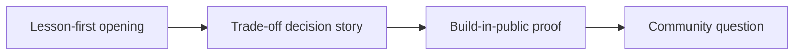

# Founder Storytelling Reels Framework for Personal Branding

Natural delivery comes from short beats. It does not come from reciting long paragraphs. **Founder Storytelling Reels Framework for Personal Branding** has one clear job. The practical goal is to share startup lessons, trade-offs, and vision without sounding boastful. This guide is built for founders, consultants and B2B teams. Set **lesson-first opening** alongside **trade-off decision story** before adding extra steps or decorative edits.

## Quick answer

Start with **Lesson-first opening**. Use **Trade-off decision story** to show the method clearly on camera in 4K at 60fps. Let **Build-in-public proof** deliver the visual proof under locked 5600K light. Treat **Community question** as your review gate. The core rule is simple: lead with operational friction, show a receipt and explain the trade-off in plain language.

## Why Lesson-first opening and Trade-off decision story must agree

Thought leadership sounds interchangeable when it opens with a job title instead of a real decision and its consequences. Here, the issue starts when **lesson-first opening** is planned without **trade-off decision story**. The draft may look good. Yet the creator still does not know what to film or approve.

Start with the smallest version of **lesson-first opening** that delivers stronger category recall. Check it against a metric with enough context to interpret it. Keep this boundary in mind: Do not publish confidential customer information. If proof is not ready, tighten the promise. Do not mask it with buzzwords.

## Decision map for Founder Storytelling Reels Framework for Personal Branding

| Decision | Evidence to prepare | Boundary |
| :--- | :--- | :--- |
| **Lesson-first opening** | Prepare a metric with enough context to interpret it | Do not publish confidential customer information. |
| **Trade-off decision story** | Prepare an anonymised workflow screen | Avoid turning one result into a universal promise. |
| **Build-in-public proof** | Prepare a decision memo excerpt | Avoid turning one result into a universal promise. |
| **Community question** | Prepare an anonymised workflow screen | Avoid turning one result into a universal promise. |

## How to put the method into practice

### 1. Lesson-first opening

Open lesson-first opening in the first 0-3s with the visual result before any setup. Pair the spoken line with clear 4K 60fps action. Keep it aligned with **trade-off decision story**.

Verify this step with a metric with enough context to interpret it. Do not publish confidential customer information. Look for stronger category recall. If that outcome is missing, adjust **lesson-first opening** before filming **trade-off decision story**.

### 2. Trade-off decision story

Make trade-off decision story easy to verify on set. Confirm the proof before moving to **build-in-public proof**.

Verify this step with an anonymised workflow screen. Avoid turning one result into a universal promise. Look for stronger category recall. If that outcome is missing, adjust **trade-off decision story** before filming **build-in-public proof**.

### 3. Build-in-public proof

Build build-in-public proof around visible proof. Show the before-and-after test under identical light with zero filter trickery. Keep it aligned with **community question**.

Verify this step with a decision memo excerpt. Avoid turning one result into a universal promise. Look for sales-relevant questions. If that outcome is missing, adjust **build-in-public proof** before filming **community question**.

### 4. Community question

Use community question to set a clear boundary for **lesson-first opening**. Name what counts as done and what needs a retake.

Verify this step with an anonymised workflow screen. Avoid turning one result into a universal promise. Look for stronger category recall. If that outcome is missing, adjust **community question** before filming **lesson-first opening**.

## A script you can adapt

Use this 30-second script structure for **Founder Storytelling Reels Framework for Personal Branding**:

- **Opening shot (0-3s):** `[Visual friction visible under 5600K light]`
- **Spoken hook (0-3s):** "If you struggle with `[exact problem]`, watch this step."
- **Method beats (3-15s):** `Lesson-first opening followed by Trade-off decision story`
- **Proof beat (15-25s):** `a decision memo excerpt`
- **Call to action (25-30s):** "Save this card before your next shoot."

Read the lines for **Lesson-first opening** in **Founder Storytelling Reels Framework for Personal Branding** aloud. Trim any sentence that takes more than 4 seconds to say on camera.

## A practical first pass

Suppose founders, consultants and B2B teams must complete one short video script in a short 45-minute window. First, they lock **lesson-first opening**. They prepare an anonymised workflow screen. Then they use **build-in-public proof** to keep the promise visible on camera in 4K at 60fps. Avoid turning one result into a universal promise. During review, they judge **community question** against stronger category recall. A vague request for more polish is rejected.

## Review Community question before the next pass

- **Direction:** Does lesson-first opening name one clear choice?
- **Visibility:** Can the viewer see trade-off decision story without reading the caption?
- **Proof:** Does a decision memo excerpt back up the main claim under 5600K light?
- **Boundary:** Has the creator respected this guardrail: Avoid turning one result into a universal promise.
- **Learning:** Will the next pass improve based on sales-relevant questions?

## Frequently asked questions

### What must Lesson-first opening decide first?

Set one clear default for **lesson-first opening** next to **trade-off decision story**. State the exact condition that justifies a change. A metric with enough context to interpret it is far more useful than a long reference deck because you can test it directly on set.

### How can Trade-off decision story be tested with simple gear?

Protect the proof moment above all else. Cut optional shots first. A short version works well when **trade-off decision story** stays visible and claims stay inside your approved boundary.

### When should Community question be updated?

Update **community question** when repeated passes on **build-in-public proof** show the same friction. A shift in audience, offer, or weekly capacity also justifies an update. A single slow video is not a reason to rebuild your whole system.

### How long should this workflow take for Founder Storytelling Reels Framework for Personal Branding?

Aim for 45 minutes total production for **Founder Storytelling Reels Framework for Personal Branding**. Spend 15 minutes setting up your mic and camera, film 3 takes, and confirm a metric with enough context to interpret it before tearing down.

## Next step

Use **lesson-first opening** and **build-in-public proof** as the only two must-haves on the next card. For a packed brief, [go to the store](/store).
