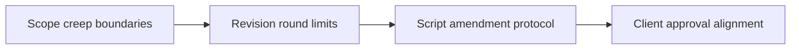

# Handling Major UGC Revision Requests Without Friction

Most revision disputes start from an unwritten approval rule. **Handling Major UGC Revision Requests Without Friction** has one clear job. The practical goal is to manage brand review cycles, scope creep, and script amendments cleanly. This guide is built for UGC creators and brand teams. Set **scope creep boundaries** alongside **revision round limits** before adding extra steps or decorative edits.

## Quick answer

Start with **Scope creep boundaries**. Use **Revision round limits** to show the method clearly on camera in 4K at 60fps. Let **Script amendment protocol** deliver the visual proof under locked 5600K light. Treat **Client approval alignment** as your review gate. The core rule is simple: agree on the claim, evidence and approval route before the first take.

## What the handoff must settle

Revision rounds multiply when the brief leaves product truth, usage and proof open to interpretation. Here, the issue starts when **scope creep boundaries** is planned without **revision round limits**. The draft may look good. Yet the creator still does not know what to film or approve.

Start with the smallest version of **scope creep boundaries** that delivers fewer avoidable revisions. Check it against an approved product detail. Keep this boundary in mind: Treat a new concept as new scope, not a small revision. If proof is not ready, tighten the promise. Do not mask it with buzzwords.

## Decision map for Handling Major UGC Revision Requests Without Friction

| Decision | Evidence to prepare | Boundary |
| :--- | :--- | :--- |
| **Scope creep boundaries** | Prepare an approved product detail | Treat a new concept as new scope, not a small revision. |
| **Revision round limits** | Prepare a real-use demonstration | Keep one feedback owner for each approval round. |
| **Script amendment protocol** | Prepare an approved product detail | Keep one feedback owner for each approval round. |
| **Client approval alignment** | Prepare an approved product detail | Separate paid usage from organic posting rights. |

## How to put the method into practice

### 1. Scope creep boundaries

Treat scope creep boundaries as a direct operational step. Make it support **revision round limits** and follow this rule: agree on the claim, evidence and approval route before the first take.

Verify this step with an approved product detail. Treat a new concept as new scope, not a small revision. Look for fewer avoidable revisions. If that outcome is missing, adjust **scope creep boundaries** before filming **revision round limits**.

### 2. Revision round limits

Write revision round limits with explicit legal scope. Separate 30-day organic rights from paid ad whitelisting to stop scope creep. Keep it aligned with **script amendment protocol**.

Verify this step with a real-use demonstration. Keep one feedback owner for each approval round. Look for usable hook variations. If that outcome is missing, adjust **revision round limits** before filming **script amendment protocol**.

### 3. Script amendment protocol

Test script amendment protocol under your real time limit. Keep only the step that protects the proof for **client approval alignment**.

Verify this step with an approved product detail. Keep one feedback owner for each approval round. Look for clearer approvals. If that outcome is missing, adjust **script amendment protocol** before filming **client approval alignment**.

### 4. Client approval alignment

Write client approval alignment with explicit legal scope. Separate 30-day organic rights from paid ad whitelisting to stop scope creep. Keep it aligned with **scope creep boundaries**.

Verify this step with an approved product detail. Separate paid usage from organic posting rights. Look for fewer avoidable revisions. If that outcome is missing, adjust **client approval alignment** before filming **scope creep boundaries**.

## A script you can adapt

Use this approval brief for **Handling Major UGC Revision Requests Without Friction**:

- **Objective:** `[One clear audience outcome]`
- **Required claim:** `[Approved fact or disclosure boundary]`
- **Rights scope:** `[30-day organic posting vs paid ad whitelisting]`
- **Evidence beat (0-15s):** `an approved product detail`
- **Revision limit:** `[One round of script fixes within 48 hours; new concepts require new scope]`

Keep **Scope creep boundaries** inside the signed claim boundary before shooting take one.

## A practical first pass

Suppose UGC creators and brand teams must complete one approval-ready brief in a short 45-minute window. First, they lock **scope creep boundaries**. They prepare a real-use demonstration. Then they use **script amendment protocol** to keep the promise visible on camera in 4K at 60fps. Keep one feedback owner for each approval round. During review, they judge **client approval alignment** against fewer avoidable revisions. A vague request for more polish is rejected.

## Review Client approval alignment before the next pass

- **Direction:** Does scope creep boundaries name one clear choice?
- **Visibility:** Can the viewer see revision round limits without reading the caption?
- **Proof:** Does an approved product detail back up the main claim under 5600K light?
- **Boundary:** Has the creator respected this guardrail: Separate paid usage from organic posting rights.
- **Learning:** Will the next pass improve based on clearer approvals?

## Frequently asked questions

### What must Scope creep boundaries decide first?

Set one clear default for **scope creep boundaries** next to **revision round limits**. State the exact condition that justifies a change. An approved product detail is far more useful than a long reference deck because you can test it directly on set.

### How can Revision round limits be tested with simple gear?

Protect the proof moment above all else. Cut optional shots first. A short version works well when **revision round limits** stays visible and claims stay inside your approved boundary.

### When should Client approval alignment be updated?

Update **client approval alignment** when repeated passes on **script amendment protocol** show the same friction. A shift in audience, offer, or weekly capacity also justifies an update. A single slow video is not a reason to rebuild your whole system.

### How long should this workflow take for Handling Major UGC Revision Requests Without Friction?

Timebox **scope creep boundaries** to 30 minutes on Monday, then capture **script amendment protocol** in one focused 40-minute filming block with locked 5600K key light.

## Next step

Before the first take, settle **scope creep boundaries** and **script amendment protocol**. If the crew still asks the same questions, [open the store](/store).
