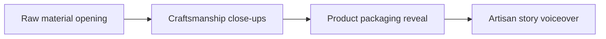

# Handmade Craft & Product Process Filming Framework

The most expensive shot is the retake caused by vague direction. **Handmade Craft & Product Process Filming Framework** has one clear job. The practical goal is to showcase raw materials, craftsmanship, and packaging details for artisan brands. This guide is built for creators building a repeatable publishing system. Set **raw material opening** alongside **craftsmanship close-ups** before adding extra steps or decorative edits.

## Quick answer

Start with **Raw material opening**. Use **Craftsmanship close-ups** to show the method clearly on camera in 4K at 60fps. Let **Product packaging reveal** deliver the visual proof under locked 5600K light. Treat **Artisan story voiceover** as your review gate. The core rule is simple: give each piece one job and resolve the opening, evidence and next action before filming.

## Set the production constraint

Ideas stay unfinished when audience promise, proof and production limits are decided after recording begins. Here, the issue starts when **raw material opening** is planned without **craftsmanship close-ups**. The draft may look good. Yet the creator still does not know what to film or approve.

Start with the smallest version of **raw material opening** that delivers more finished pieces. Check it against a before-and-after decision. Keep this boundary in mind: Do not make several promises in one piece. If proof is not ready, tighten the promise. Do not mask it with buzzwords.

## Decision map for Handmade Craft & Product Process Filming Framework

| Decision | Evidence to prepare | Boundary |
| :--- | :--- | :--- |
| **Raw material opening** | Prepare a before-and-after decision | Do not make several promises in one piece. |
| **Craftsmanship close-ups** | Prepare a completed example | Remove any scene that does not support the point. |
| **Product packaging reveal** | Prepare a completed example | Choose a format that fits the evidence. |
| **Artisan story voiceover** | Prepare an audience question answered on screen | Review comparable posts rather than isolated spikes. |

## How to put the method into practice

### 1. Raw material opening

Open raw material opening in the first 0-3s with the visual result before any setup. Pair the spoken line with clear 4K 60fps action. Keep it aligned with **craftsmanship close-ups**.

Verify this step with a before-and-after decision. Do not make several promises in one piece. Look for more finished pieces. If that outcome is missing, adjust **raw material opening** before filming **craftsmanship close-ups**.

### 2. Craftsmanship close-ups

Set up craftsmanship close-ups with a fixed 50mm or 85mm macro lens. Keep camera distance locked at 3 to 4 feet across takes. Keep it aligned with **product packaging reveal**.

Verify this step with a completed example. Remove any scene that does not support the point. Look for shorter planning time. If that outcome is missing, adjust **craftsmanship close-ups** before filming **product packaging reveal**.

### 3. Product packaging reveal

Test product packaging reveal under your real time limit. Keep only the step that protects the proof for **artisan story voiceover**.

Verify this step with a completed example. Choose a format that fits the evidence. Look for shorter planning time. If that outcome is missing, adjust **product packaging reveal** before filming **artisan story voiceover**.

### 4. Artisan story voiceover

Record artisan story voiceover with a mic 4-6 inches from the source. Apply a -48dB noise gate and keep background music ducked at -22dB. Keep it aligned with **raw material opening**.

Verify this step with an audience question answered on screen. Review comparable posts rather than isolated spikes. Look for useful saves and replies. If that outcome is missing, adjust **artisan story voiceover** before filming **raw material opening**.

## A script you can adapt

Use this shot note for **Handmade Craft & Product Process Filming Framework**:

- **Opening frame:** `[Main tension visible under 5600K key light in 4K at 60fps]`
- **Hook (0-3s):** `[Spoken problem line matching the first frame]`
- **Coverage (3-15s):** `Raw material opening → Craftsmanship close-ups → [proof macro close-up]`
- **Continuity (15-25s):** `[Camera height locked at eye level; mic at 5 inches]`
- **Call to action (25-30s):** `[One direct comment or save prompt]`

For **Raw material opening**, record a completed example before adding optional B-roll shots.

## A practical first pass

Suppose creators building a repeatable publishing system must complete one complete filming pass in a short 45-minute window. First, they lock **raw material opening**. They prepare a completed example. Then they use **product packaging reveal** to keep the promise visible on camera in 4K at 60fps. Choose a format that fits the evidence. During review, they judge **artisan story voiceover** against useful saves and replies. A vague request for more polish is rejected.

## Review Artisan story voiceover before the next pass

- **Direction:** Does raw material opening name one clear choice?
- **Visibility:** Can the viewer see craftsmanship close-ups without reading the caption?
- **Proof:** Does a completed example back up the main claim under 5600K light?
- **Boundary:** Has the creator respected this guardrail: Review comparable posts rather than isolated spikes.
- **Learning:** Will the next pass improve based on shorter planning time?

## Frequently asked questions

### What must Raw material opening decide first?

Set one clear default for **raw material opening** next to **craftsmanship close-ups**. State the exact condition that justifies a change. A before-and-after decision is far more useful than a long reference deck because you can test it directly on set.

### How can Craftsmanship close-ups be tested with simple gear?

Protect the proof moment above all else. Cut optional shots first. A short version works well when **craftsmanship close-ups** stays visible and claims stay inside your approved boundary.

### When should Artisan story voiceover be updated?

Update **artisan story voiceover** when repeated passes on **product packaging reveal** show the same friction. A shift in audience, offer, or weekly capacity also justifies an update. A single slow video is not a reason to rebuild your whole system.

### How long should this workflow take for Handmade Craft & Product Process Filming Framework?

Timebox **raw material opening** to 30 minutes on Monday, then capture **product packaging reveal** in one focused 40-minute filming block with locked 5600K key light.

## Next step

Use **raw material opening** and **product packaging reveal** as the only two must-haves on the next card. For a packed brief, [go to the store](/store).
