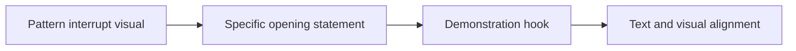

# UGC Hook Planning for TikTok & Reels

The opening line only works when the first frame shows the same promise. **UGC Hook Planning for TikTok & Reels** has one clear job. The practical goal is to plan honest UGC openings that align the first image, spoken line, product demonstration, and expected payoff. This guide is built for UGC creators and brand teams. Set **pattern interrupt visual** alongside **specific opening statement** before adding extra steps or decorative edits.

## Quick answer

Start with **Pattern interrupt visual**. Use **Specific opening statement** to show the method clearly on camera in 4K at 60fps. Let **Demonstration hook** deliver the visual proof under locked 5600K light. Treat **Text and visual alignment** as your review gate. The core rule is simple: agree on the claim, evidence and approval route before the first take.

## Why Pattern interrupt visual and Specific opening statement must agree

Revision rounds multiply when the brief leaves product truth, usage and proof open to interpretation. Here, the issue starts when **pattern interrupt visual** is planned without **specific opening statement**. The draft may look good. Yet the creator still does not know what to film or approve.

Start with the smallest version of **pattern interrupt visual** that delivers clearer approvals. Check it against a brief-to-final-frame check. Keep this boundary in mind: Separate paid usage from organic posting rights. If proof is not ready, tighten the promise. Do not mask it with buzzwords.

## Decision map for UGC Hook Planning for TikTok & Reels

| Decision | Evidence to prepare | Boundary |
| :--- | :--- | :--- |
| **Pattern interrupt visual** | Prepare a brief-to-final-frame check | Separate paid usage from organic posting rights. |
| **Specific opening statement** | Prepare an approved product detail | Treat a new concept as new scope, not a small revision. |
| **Demonstration hook** | Prepare a real-use demonstration | Keep one feedback owner for each approval round. |
| **Text and visual alignment** | Prepare a clearly labelled comparison | Keep one feedback owner for each approval round. |

## How to put the method into practice

### 1. Pattern interrupt visual

Open pattern interrupt visual in the first 0-3s with the visual result before any setup. Pair the spoken line with clear 4K 60fps action. Keep it aligned with **specific opening statement**.

Verify this step with a brief-to-final-frame check. Separate paid usage from organic posting rights. Look for clearer approvals. If that outcome is missing, adjust **pattern interrupt visual** before filming **specific opening statement**.

### 2. Specific opening statement

Open specific opening statement in the first 0-3s with the visual result before any setup. Pair the spoken line with clear 4K 60fps action. Keep it aligned with **demonstration hook**.

Verify this step with an approved product detail. Treat a new concept as new scope, not a small revision. Look for fewer avoidable revisions. If that outcome is missing, adjust **specific opening statement** before filming **demonstration hook**.

### 3. Demonstration hook

Open demonstration hook in the first 0-3s with the visual result before any setup. Pair the spoken line with clear 4K 60fps action. Keep it aligned with **text and visual alignment**.

Verify this step with a real-use demonstration. Keep one feedback owner for each approval round. Look for usable hook variations. If that outcome is missing, adjust **demonstration hook** before filming **text and visual alignment**.

### 4. Text and visual alignment

Use text and visual alignment to set a clear boundary for **pattern interrupt visual**. Name what counts as done and what needs a retake.

Verify this step with a clearly labelled comparison. Keep one feedback owner for each approval round. Look for clearer approvals. If that outcome is missing, adjust **text and visual alignment** before filming **pattern interrupt visual**.

## A script you can adapt

Use this 30-second script structure for **UGC Hook Planning for TikTok & Reels**:

- **Opening shot (0-3s):** `[Visual friction visible under 5600K light]`
- **Spoken hook (0-3s):** "If you struggle with `[exact problem]`, watch this step."
- **Method beats (3-15s):** `Pattern interrupt visual followed by Specific opening statement`
- **Proof beat (15-25s):** `a real-use demonstration`
- **Call to action (25-30s):** "Save this card before your next shoot."

Read the lines for **Pattern interrupt visual** in **UGC Hook Planning for TikTok & Reels** aloud. Trim any sentence that takes more than 4 seconds to say on camera.

## A practical first pass

Suppose UGC creators and brand teams must complete one short video script in a short 45-minute window. First, they lock **pattern interrupt visual**. They prepare an approved product detail. Then they use **demonstration hook** to keep the promise visible on camera in 4K at 60fps. Keep one feedback owner for each approval round. During review, they judge **text and visual alignment** against clearer approvals. A vague request for more polish is rejected.

## Review Text and visual alignment before the next pass

- **Direction:** Does pattern interrupt visual name one clear choice?
- **Visibility:** Can the viewer see specific opening statement without reading the caption?
- **Proof:** Does a real-use demonstration back up the main claim under 5600K light?
- **Boundary:** Has the creator respected this guardrail: Keep one feedback owner for each approval round.
- **Learning:** Will the next pass improve based on usable hook variations?

## Frequently asked questions

### What must Pattern interrupt visual decide first?

Set one clear default for **pattern interrupt visual** next to **specific opening statement**. State the exact condition that justifies a change. A brief-to-final-frame check is far more useful than a long reference deck because you can test it directly on set.

### How can Specific opening statement be tested with simple gear?

Protect the proof moment above all else. Cut optional shots first. A short version works well when **specific opening statement** stays visible and claims stay inside your approved boundary.

### When should Text and visual alignment be updated?

Update **text and visual alignment** when repeated passes on **demonstration hook** show the same friction. A shift in audience, offer, or weekly capacity also justifies an update. A single slow video is not a reason to rebuild your whole system.

### How long should this workflow take for UGC Hook Planning for TikTok & Reels?

Timebox **pattern interrupt visual** to 30 minutes on Monday, then capture **demonstration hook** in one focused 40-minute filming block with locked 5600K key light.

## Next step

Film the next piece only after **pattern interrupt visual** and **demonstration hook** are written down. Need a finished brief instead? [See Classic and Signature](/store).
