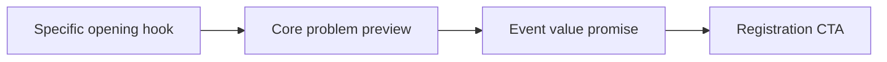

# Webinar Reels Hooks and Registration Structure

A good script starts with what viewers see. It does not start with a long speech to memorize. **Webinar Reels Hooks and Registration Structure** has one clear job. The practical goal is to plan webinar promotion Reels that explain the audience problem, session value, event details, and one clear registration path. This guide is built for founders, consultants and B2B teams. Set **specific opening hook** alongside **core problem preview** before adding extra steps or decorative edits.

## Quick answer

Start with **Specific opening hook**. Use **Core problem preview** to show the method clearly on camera in 4K at 60fps. Let **Event value promise** deliver the visual proof under locked 5600K light. Treat **Registration CTA** as your review gate. The core rule is simple: lead with operational friction, show a receipt and explain the trade-off in plain language.

## Why Specific opening hook and Core problem preview must agree

Thought leadership sounds interchangeable when it opens with a job title instead of a real decision and its consequences. Here, the issue starts when **specific opening hook** is planned without **core problem preview**. The draft may look good. Yet the creator still does not know what to film or approve.

Start with the smallest version of **specific opening hook** that delivers qualified replies. Check it against a before-and-after process. Keep this boundary in mind: Avoid turning one result into a universal promise. If proof is not ready, tighten the promise. Do not mask it with buzzwords.

## Decision map for Webinar Reels Hooks and Registration Structure

| Decision | Evidence to prepare | Boundary |
| :--- | :--- | :--- |
| **Specific opening hook** | Prepare a before-and-after process | Avoid turning one result into a universal promise. |
| **Core problem preview** | Prepare a before-and-after process | Avoid turning one result into a universal promise. |
| **Event value promise** | Prepare a before-and-after process | Avoid turning one result into a universal promise. |
| **Registration CTA** | Prepare a before-and-after process | Give metrics a timeframe and baseline. |

## How to put the method into practice

### 1. Specific opening hook

Open specific opening hook in the first 0-3s with the visual result before any setup. Pair the spoken line with clear 4K 60fps action. Keep it aligned with **core problem preview**.

Verify this step with a before-and-after process. Avoid turning one result into a universal promise. Look for qualified replies. If that outcome is missing, adjust **specific opening hook** before filming **core problem preview**.

### 2. Core problem preview

Make core problem preview easy to verify on set. Confirm the proof before moving to **event value promise**.

Verify this step with a before-and-after process. Avoid turning one result into a universal promise. Look for clearer expertise signals. If that outcome is missing, adjust **core problem preview** before filming **event value promise**.

### 3. Event value promise

Focus event value promise on one specific viewer problem. Deliver one measurable outcome without inflated claims. Keep it aligned with **registration CTA**.

Verify this step with a before-and-after process. Avoid turning one result into a universal promise. Look for clearer expertise signals. If that outcome is missing, adjust **event value promise** before filming **registration CTA**.

### 4. Registration CTA

Make registration CTA a direct prompt: ask for one specific action or keyword response in the final 5s of the video. Keep it aligned with **specific opening hook**.

Verify this step with a before-and-after process. Give metrics a timeframe and baseline. Look for clearer expertise signals. If that outcome is missing, adjust **registration CTA** before filming **specific opening hook**.

## A script you can adapt

Use this 30-second script structure for **Webinar Reels Hooks and Registration Structure**:

- **Opening shot (0-3s):** `[Visual friction visible under 5600K light]`
- **Spoken hook (0-3s):** "If you struggle with `[exact problem]`, watch this step."
- **Method beats (3-15s):** `Specific opening hook followed by Core problem preview`
- **Proof beat (15-25s):** `a before-and-after process`
- **Call to action (25-30s):** "Save this card before your next shoot."

Read the lines for **Specific opening hook** in **Webinar Reels Hooks and Registration Structure** aloud. Trim any sentence that takes more than 4 seconds to say on camera.

## A practical first pass

Suppose founders, consultants and B2B teams must complete one short video script in a short 45-minute window. First, they lock **specific opening hook**. They prepare a before-and-after process. Then they use **event value promise** to keep the promise visible on camera in 4K at 60fps. Avoid turning one result into a universal promise. During review, they judge **registration CTA** against clearer expertise signals. A vague request for more polish is rejected.

## Review Registration CTA before the next pass

- **Direction:** Does specific opening hook name one clear choice?
- **Visibility:** Can the viewer see core problem preview without reading the caption?
- **Proof:** Does a before-and-after process back up the main claim under 5600K light?
- **Boundary:** Has the creator respected this guardrail: Give metrics a timeframe and baseline.
- **Learning:** Will the next pass improve based on clearer expertise signals?

## Frequently asked questions

### What must Specific opening hook decide first?

Set one clear default for **specific opening hook** next to **core problem preview**. State the exact condition that justifies a change. A before-and-after process is far more useful than a long reference deck because you can test it directly on set.

### How can Core problem preview be tested with simple gear?

Protect the proof moment above all else. Cut optional shots first. A short version works well when **core problem preview** stays visible and claims stay inside your approved boundary.

### When should Registration CTA be updated?

Update **registration CTA** when repeated passes on **event value promise** show the same friction. A shift in audience, offer, or weekly capacity also justifies an update. A single slow video is not a reason to rebuild your whole system.

### How long should this workflow take for Webinar Reels Hooks and Registration Structure?

Timebox **specific opening hook** to 30 minutes on Monday, then capture **event value promise** in one focused 40-minute filming block with locked 5600K key light.

## Next step

Before the first take, settle **specific opening hook** and **event value promise**. If the crew still asks the same questions, [open the store](/store).
