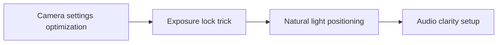

# How to Film High-Quality Reels With iPhone Only

A simple shot list shows what must be on camera even when time runs short. **How to Film High-Quality Reels With iPhone Only** has one clear job. The practical goal is to optimize iPhone camera settings, 4K 24fps, exposure lock, and natural light. This guide is built for solo creators improving a small production setup. Set **camera settings optimization** alongside **exposure lock trick** before adding extra steps or decorative edits.

## Quick answer

Start with **Camera settings optimization**. Use **Exposure lock trick** to show the method clearly on camera in 4K at 60fps. Let **Natural light positioning** deliver the visual proof under locked 5600K light. Treat **Audio clarity setup** as your review gate. The core rule is simple: stabilise the setup with measurable defaults before adding equipment.

## Set the production constraint

Buying more gear does not fix footage when exposure, white balance, distance and room sound change every session. Here, the issue starts when **camera settings optimization** is planned without **exposure lock trick**. The draft may look good. Yet the creator still does not know what to film or approve.

Start with the smallest version of **camera settings optimization** that delivers consistent skin and product colour. Check it against a repeatable camera-position marker. Keep this boundary in mind: Reserve space for the subject to move. If proof is not ready, tighten the promise. Do not mask it with buzzwords.

## Decision map for How to Film High-Quality Reels With iPhone Only

| Decision | Evidence to prepare | Boundary |
| :--- | :--- | :--- |
| **Camera settings optimization** | Prepare a repeatable camera-position marker | Reserve space for the subject to move. |
| **Exposure lock trick** | Prepare a short audio test | Test audio at the actual recording distance. |
| **Natural light positioning** | Prepare a short audio test | Save settings only after checking the proof shot. |
| **Audio clarity setup** | Prepare a repeatable camera-position marker | Match colour temperature or switch one source off. |

## How to put the method into practice

### 1. Camera settings optimization

Set up camera settings optimization with a fixed 50mm or 85mm macro lens. Keep camera distance locked at 3 to 4 feet across takes. Keep it aligned with **exposure lock trick**.

Verify this step with a repeatable camera-position marker. Reserve space for the subject to move. Look for consistent skin and product colour. If that outcome is missing, adjust **camera settings optimization** before filming **exposure lock trick**.

### 2. Exposure lock trick

Set exposure lock trick under a locked 5600K diffused key light. Lock manual exposure at 100% before take one to stop flicker. Keep it aligned with **natural light positioning**.

Verify this step with a short audio test. Test audio at the actual recording distance. Look for faster setup. If that outcome is missing, adjust **exposure lock trick** before filming **natural light positioning**.

### 3. Natural light positioning

Set natural light positioning under a locked 5600K diffused key light. Lock manual exposure at 100% before take one to stop flicker. Keep it aligned with **audio clarity setup**.

Verify this step with a short audio test. Save settings only after checking the proof shot. Look for consistent skin and product colour. If that outcome is missing, adjust **natural light positioning** before filming **audio clarity setup**.

### 4. Audio clarity setup

Record audio clarity setup with a mic 4-6 inches from the source. Apply a -48dB noise gate and keep background music ducked at -22dB. Keep it aligned with **camera settings optimization**.

Verify this step with a repeatable camera-position marker. Match colour temperature or switch one source off. Look for fewer unusable takes. If that outcome is missing, adjust **audio clarity setup** before filming **camera settings optimization**.

## A script you can adapt

Use this shot note for **How to Film High-Quality Reels With iPhone Only**:

- **Opening frame:** `[Main tension visible under 5600K key light in 4K at 60fps]`
- **Hook (0-3s):** `[Spoken problem line matching the first frame]`
- **Coverage (3-15s):** `Camera settings optimization → Exposure lock trick → [proof macro close-up]`
- **Continuity (15-25s):** `[Camera height locked at eye level; mic at 5 inches]`
- **Call to action (25-30s):** `[One direct comment or save prompt]`

For **Camera settings optimization**, record a short audio test before adding optional B-roll shots.

## A practical first pass

Suppose solo creators improving a small production setup must complete one complete filming pass in a short 45-minute window. First, they lock **camera settings optimization**. They prepare a short audio test. Then they use **natural light positioning** to keep the promise visible on camera in 4K at 60fps. Save settings only after checking the proof shot. During review, they judge **audio clarity setup** against fewer unusable takes. A vague request for more polish is rejected.

## Review Audio clarity setup before the next pass

- **Direction:** Does camera settings optimization name one clear choice?
- **Visibility:** Can the viewer see exposure lock trick without reading the caption?
- **Proof:** Does a short audio test back up the main claim under 5600K light?
- **Boundary:** Has the creator respected this guardrail: Match colour temperature or switch one source off.
- **Learning:** Will the next pass improve based on consistent skin and product colour?

## Frequently asked questions

### What must Camera settings optimization decide first?

Set one clear default for **camera settings optimization** next to **exposure lock trick**. State the exact condition that justifies a change. A repeatable camera-position marker is far more useful than a long reference deck because you can test it directly on set.

### How can Exposure lock trick be tested with simple gear?

Protect the proof moment above all else. Cut optional shots first. A short version works well when **exposure lock trick** stays visible and claims stay inside your approved boundary.

### When should Audio clarity setup be updated?

Update **audio clarity setup** when repeated passes on **natural light positioning** show the same friction. A shift in audience, offer, or weekly capacity also justifies an update. A single slow video is not a reason to rebuild your whole system.

### How long should this workflow take for How to Film High-Quality Reels With iPhone Only?

Aim for 45 minutes total production for **How to Film High-Quality Reels With iPhone Only**. Spend 15 minutes setting up your mic and camera, film 3 takes, and confirm a repeatable camera-position marker before tearing down.

## Next step

Before the first take, settle **camera settings optimization** and **natural light positioning**. If the crew still asks the same questions, [open the store](/store).
