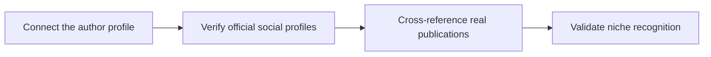

# Knowledge Graph Entity Building for Personal Creator Brands

A page earns citations when it names the topic, answers the question, and provides proof. The goal is to make your creator name, profiles, and articles easy for search engines to connect. This guide helps creator brands build authority. Connect your author profile and verify official accounts before adding extra decorative tweaks.

## Quick answer

Start by connecting your author profile. Verify your social profiles across platforms. Cross-reference real publications as proof. Treat niche recognition as your review gate. The core rule is simple: answer questions early, define topics clearly, and support every claim with real evidence.

## Answer the reader task before optimizing

A page may target the right keyword yet remain hard to cite if answers are buried or vague. Connect your author profile and verify official accounts. Check your page against an attributed source. Write for real readers first. If proof is missing, narrow your claim instead of adding filler.

## Decision map for Knowledge Graph Entity Building for Personal Creator Brands

| Decision. | Evidence to prepare. | Boundary. |
| :--- | :--- | :--- |
| **Connect the author profile**. | Prepare a clearly attributed source. | Write for the reader before optimising extraction. |
| **Verify official social profiles**. | Prepare a first-hand process example. | Avoid claims that the cited source does not support. |
| **Cross-reference real publications**. | Prepare a question-shaped section with a complete response. | Do not add FAQ schema for questions that are not visible. |
| **Validate niche recognition**. | Prepare a concise direct answer. | Refresh dates only when the content actually changes. |

## How to put the method into practice

### 1. Connect the author profile

Treat author profile setup as a direct operational step. Make it support verified social profiles. Follow this rule: answer questions early, define entities clearly, and support claims with verified evidence.

Check an attributed source. Write for your readers before optimizing for algorithms. Review branded searches before starting the next verification step.

### 2. Verify official social profiles

Verify official social profiles on set. Confirm the proof before linking to published articles.

Check a first-hand process example. Avoid claims that the cited source does not support. Review relevant impressions before starting **cross-reference real publications**.

### 3. Cross-reference real publications

Test publication references under realistic time limits. Keep only the steps that validate niche recognition.

Check a question-shaped section with a complete response. Do not add FAQ schema for questions that are not visible. Review citations and branded searches before starting **validate niche recognition**.

### 4. Validate niche recognition

Focus validate niche recognition on one specific viewer problem. Deliver one measurable outcome without inflated claims. Keep it aligned with **connect the author profile**.

Check a concise direct answer. Refresh dates only when the content actually changes. Review relevant impressions before starting **connect the author profile**.

## A script you can adapt

Use this answer structure for **Knowledge Graph Entity Building for Personal Creator Brands**.

- **Zero-click capsule (0-50 words).** Provide a direct answer defining the entity and primary action.
- **Decision table.** Include a 3-column matrix comparing options on evidence and cost.
- **Practical method.** Connect the author profile followed by verified official social profiles.
- **Proof.** Add a question-shaped section with a complete factual response.
- **Follow-up Q&A.** Answer four specific user questions in two sentences each.

Check **Connect the author profile** for direct clarity before adding extra background context.

## A practical first pass

Suppose a creator brand must publish an entity guide in forty-five minutes. First, they link the author profile. They add a first-hand case example. Next, they cross-reference published work to keep claims verifiable. They never add schema for hidden text. During review, they check search impressions and citations. Vague polish requests are rejected.

## Review Validate niche recognition before the next pass

- **Direction:** Does the author profile name one clear subject?
- **Visibility:** Can readers see verified social links right away?
- **Proof:** Does the cited publication back up the core claim?
- **Boundary:** Has the page avoided changing dates without real updates?
- **Learning:** Will the next pass improve branded search citations?

## Frequently asked questions

### What must Connect the author profile decide first?

Set one clear default for your author profile next to social links. State the exact trigger for an update. A cited source beats a long deck because search bots index it directly.

### How can Verify official social profiles be tested with simple gear?

Protect the proof moment above all else. Cut optional shots first. A short version works well when **verify official social profiles** stays visible and claims stay inside your approved boundary.

### When should Validate niche recognition be updated?

Update **validate niche recognition** when repeated passes on **cross-reference real publications** show the same friction. A shift in audience, offer, or weekly capacity also justifies an update. A single slow video is not a reason to rebuild your whole system.

### How long should this workflow take for Knowledge Graph Entity Building for Personal Creator Brands?

Aim for 45 minutes total production for **Knowledge Graph Entity Building for Personal Creator Brands**. Spend 15 minutes setting up your mic and camera, film 3 takes, and confirm a clearly attributed source before tearing down.

## Next step

Put **connect the author profile** next to **cross-reference real publications** on one sheet. If you still need someone else to lock the shoot, [start in the store](/store).
