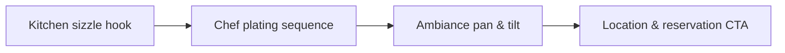

# Local Restaurant & Hospitality Video Content Brief

Most revision disputes start from an unwritten approval rule. **Local Restaurant & Hospitality Video Content Brief** has one clear job. The practical goal is to plan food sizzle shots, kitchen ambiance, and chef story reels for hospitality. This guide is built for UGC creators and brand teams. Set **kitchen sizzle hook** alongside **chef plating sequence** before adding extra steps or decorative edits.

## Quick answer

Start with **Kitchen sizzle hook**. Use **Chef plating sequence** to show the method clearly on camera in 4K at 60fps. Let **Ambiance pan & tilt** deliver the visual proof under locked 5600K light. Treat **Location & reservation CTA** as your review gate. The core rule is simple: agree on the claim, evidence and approval route before the first take.

## What the handoff must settle

Revision rounds multiply when the brief leaves product truth, usage and proof open to interpretation. Here, the issue starts when **kitchen sizzle hook** is planned without **chef plating sequence**. The draft may look good. Yet the creator still does not know what to film or approve.

Start with the smallest version of **kitchen sizzle hook** that delivers claim-safe final assets. Check it against an approved product detail. Keep this boundary in mind: Separate paid usage from organic posting rights. If proof is not ready, tighten the promise. Do not mask it with buzzwords.

## Decision map for Local Restaurant & Hospitality Video Content Brief

| Decision | Evidence to prepare | Boundary |
| :--- | :--- | :--- |
| **Kitchen sizzle hook** | Prepare an approved product detail | Separate paid usage from organic posting rights. |
| **Chef plating sequence** | Prepare an approved product detail | Separate paid usage from organic posting rights. |
| **Ambiance pan & tilt** | Prepare a clearly labelled comparison | Keep one feedback owner for each approval round. |
| **Location & reservation CTA** | Prepare a brief-to-final-frame check | Treat a new concept as new scope, not a small revision. |

## How to put the method into practice

### 1. Kitchen sizzle hook

Open kitchen sizzle hook in the first 0-3s with the visual result before any setup. Pair the spoken line with clear 4K 60fps action. Keep it aligned with **chef plating sequence**.

Verify this step with an approved product detail. Separate paid usage from organic posting rights. Look for claim-safe final assets. If that outcome is missing, adjust **kitchen sizzle hook** before filming **chef plating sequence**.

### 2. Chef plating sequence

Cut chef plating sequence on action: show the step, reveal the proof in 3-15s, and trim empty pauses to keep pace tight. Keep it aligned with **ambiance pan & tilt**.

Verify this step with an approved product detail. Separate paid usage from organic posting rights. Look for claim-safe final assets. If that outcome is missing, adjust **chef plating sequence** before filming **ambiance pan & tilt**.

### 3. Ambiance pan & tilt

Test ambiance pan & tilt under your real time limit. Keep only the step that protects the proof for **location & reservation CTA**.

Verify this step with a clearly labelled comparison. Keep one feedback owner for each approval round. Look for clearer approvals. If that outcome is missing, adjust **ambiance pan & tilt** before filming **location & reservation CTA**.

### 4. Location & reservation CTA

Make location & reservation CTA a direct prompt: ask for one specific action or keyword response in the final 5s of the video. Keep it aligned with **kitchen sizzle hook**.

Verify this step with a brief-to-final-frame check. Treat a new concept as new scope, not a small revision. Look for clearer approvals. If that outcome is missing, adjust **location & reservation CTA** before filming **kitchen sizzle hook**.

## A script you can adapt

Use this approval brief for **Local Restaurant & Hospitality Video Content Brief**:

- **Objective:** `[One clear audience outcome]`
- **Required claim:** `[Approved fact or disclosure boundary]`
- **Rights scope:** `[30-day organic posting vs paid ad whitelisting]`
- **Evidence beat (0-15s):** `a clearly labelled comparison`
- **Revision limit:** `[One round of script fixes within 48 hours; new concepts require new scope]`

Keep **Kitchen sizzle hook** inside the signed claim boundary before shooting take one.

## A practical first pass

Suppose UGC creators and brand teams must complete one approval-ready brief in a short 45-minute window. First, they lock **kitchen sizzle hook**. They prepare an approved product detail. Then they use **ambiance pan & tilt** to keep the promise visible on camera in 4K at 60fps. Keep one feedback owner for each approval round. During review, they judge **location & reservation CTA** against clearer approvals. A vague request for more polish is rejected.

## Review Location & reservation CTA before the next pass

- **Direction:** Does kitchen sizzle hook name one clear choice?
- **Visibility:** Can the viewer see chef plating sequence without reading the caption?
- **Proof:** Does a clearly labelled comparison back up the main claim under 5600K light?
- **Boundary:** Has the creator respected this guardrail: Treat a new concept as new scope, not a small revision.
- **Learning:** Will the next pass improve based on clearer approvals?

## Frequently asked questions

### What must Kitchen sizzle hook decide first?

Set one clear default for **kitchen sizzle hook** next to **chef plating sequence**. State the exact condition that justifies a change. An approved product detail is far more useful than a long reference deck because you can test it directly on set.

### How can Chef plating sequence be tested with simple gear?

Protect the proof moment above all else. Cut optional shots first. A short version works well when **chef plating sequence** stays visible and claims stay inside your approved boundary.

### When should Location & reservation CTA be updated?

Update **location & reservation CTA** when repeated passes on **ambiance pan & tilt** show the same friction. A shift in audience, offer, or weekly capacity also justifies an update. A single slow video is not a reason to rebuild your whole system.

### How long should this workflow take for Local Restaurant & Hospitality Video Content Brief?

Aim for 45 minutes total production for **Local Restaurant & Hospitality Video Content Brief**. Spend 15 minutes setting up your mic and camera, film 3 takes, and confirm an approved product detail before tearing down.

## Next step

Write **kitchen sizzle hook** and **ambiance pan & tilt** on one card before you shoot. If the same two points still stall the set, [pick a brief in the store](/store).
