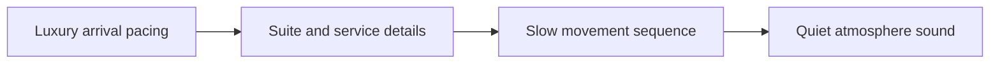

# Luxury Travel B-Roll Storytelling & Itinerary Sequence

A good script starts with what viewers see. It does not start with a long speech to memorize. **Luxury Travel B-Roll Storytelling & Itinerary Sequence** has one clear job. The practical goal is to show service, space, pacing, and atmosphere without reducing luxury travel to generic slow-motion footage. This guide is built for travel creators. Set **luxury arrival pacing** alongside **suite and service details** before adding extra steps or decorative edits.

## Quick answer

Start with **Luxury arrival pacing**. Use **Suite and service details** to show the method clearly on camera in 4K at 60fps. Let **Slow movement sequence** deliver the visual proof under locked 5600K light. Treat **Quiet atmosphere sound** as your review gate. The core rule is simple: anchor every sequence in a real location detail and a useful route decision.

## Why Luxury arrival pacing and Suite and service details must agree

Generic montages create atmosphere but give viewers no route, timing or place-specific reason to save the post. Here, the issue starts when **luxury arrival pacing** is planned without **suite and service details**. The draft may look good. Yet the creator still does not know what to film or approve.

Start with the smallest version of **luxury arrival pacing** that delivers trip-planning saves. Check it against a place-specific detail. Keep this boundary in mind: Name when timing, season or access changes the experience. If proof is not ready, tighten the promise. Do not mask it with buzzwords.

## Decision map for Luxury Travel B-Roll Storytelling & Itinerary Sequence

| Decision | Evidence to prepare | Boundary |
| :--- | :--- | :--- |
| **Luxury arrival pacing** | Prepare a place-specific detail | Name when timing, season or access changes the experience. |
| **Suite and service details** | Prepare a route map | Avoid presenting one visit as a universal rule. |
| **Slow movement sequence** | Prepare a clearly stated timing or access note | Use real ambient sound when it helps describe the place. |
| **Quiet atmosphere sound** | Prepare a route map | Do not reveal private or unsafe location details. |

## How to put the method into practice

### 1. Luxury arrival pacing

Cut luxury arrival pacing on action: show the step, reveal the proof in 3-15s, and trim empty pauses to keep pace tight. Keep it aligned with **suite and service details**.

Verify this step with a place-specific detail. Name when timing, season or access changes the experience. Look for trip-planning saves. If that outcome is missing, adjust **luxury arrival pacing** before filming **suite and service details**.

### 2. Suite and service details

Make suite and service details easy to verify on set. Confirm the proof before moving to **slow movement sequence**.

Verify this step with a route map. Avoid presenting one visit as a universal rule. Look for recognisable place storytelling. If that outcome is missing, adjust **suite and service details** before filming **slow movement sequence**.

### 3. Slow movement sequence

Cut slow movement sequence on action: show the step, reveal the proof in 3-15s, and trim empty pauses to keep pace tight. Keep it aligned with **quiet atmosphere sound**.

Verify this step with a clearly stated timing or access note. Use real ambient sound when it helps describe the place. Look for trip-planning saves. If that outcome is missing, adjust **slow movement sequence** before filming **quiet atmosphere sound**.

### 4. Quiet atmosphere sound

Record quiet atmosphere sound with a mic 4-6 inches from the source. Apply a -48dB noise gate and keep background music ducked at -22dB. Keep it aligned with **luxury arrival pacing**.

Verify this step with a route map. Do not reveal private or unsafe location details. Look for recognisable place storytelling. If that outcome is missing, adjust **quiet atmosphere sound** before filming **luxury arrival pacing**.

## A script you can adapt

Use this 30-second script structure for **Luxury Travel B-Roll Storytelling & Itinerary Sequence**:

- **Opening shot (0-3s):** `[Visual friction visible under 5600K light]`
- **Spoken hook (0-3s):** "If you struggle with `[exact problem]`, watch this step."
- **Method beats (3-15s):** `Luxury arrival pacing followed by Suite and service details`
- **Proof beat (15-25s):** `a clearly stated timing or access note`
- **Call to action (25-30s):** "Save this card before your next shoot."

Read the lines for **Luxury arrival pacing** in **Luxury Travel B-Roll Storytelling & Itinerary Sequence** aloud. Trim any sentence that takes more than 4 seconds to say on camera.

## A practical first pass

Suppose travel creators must complete one short video script in a short 45-minute window. First, they lock **luxury arrival pacing**. They prepare a route map. Then they use **slow movement sequence** to keep the promise visible on camera in 4K at 60fps. Use real ambient sound when it helps describe the place. During review, they judge **quiet atmosphere sound** against recognisable place storytelling. A vague request for more polish is rejected.

## Review Quiet atmosphere sound before the next pass

- **Direction:** Does luxury arrival pacing name one clear choice?
- **Visibility:** Can the viewer see suite and service details without reading the caption?
- **Proof:** Does a clearly stated timing or access note back up the main claim under 5600K light?
- **Boundary:** Has the creator respected this guardrail: Do not reveal private or unsafe location details.
- **Learning:** Will the next pass improve based on trip-planning saves?

## Frequently asked questions

### What must Luxury arrival pacing decide first?

Set one clear default for **luxury arrival pacing** next to **suite and service details**. State the exact condition that justifies a change. A place-specific detail is far more useful than a long reference deck because you can test it directly on set.

### How can Suite and service details be tested with simple gear?

Protect the proof moment above all else. Cut optional shots first. A short version works well when **suite and service details** stays visible and claims stay inside your approved boundary.

### When should Quiet atmosphere sound be updated?

Update **quiet atmosphere sound** when repeated passes on **slow movement sequence** show the same friction. A shift in audience, offer, or weekly capacity also justifies an update. A single slow video is not a reason to rebuild your whole system.

### How long should this workflow take for Luxury Travel B-Roll Storytelling & Itinerary Sequence?

Plan 40 minutes for the entire one short video script. Lock **luxury arrival pacing** before setup, record 3 clean passes, and review trip-planning saves immediately.

## Next step

Keep **luxury arrival pacing** and **slow movement sequence** on a page you can hold. If that is still too loose, [compare brief packages](/store).
