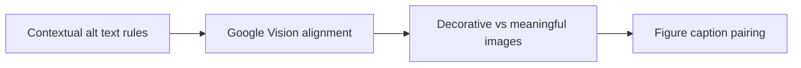

# Multimodal Image Alt Text Optimization for AI Search

Search structure must make facts easy to find. It must not sound written for a robot. **Multimodal Image Alt Text tuning for AI Search** has one clear job. The practical goal is to write concise 80-140 character descriptive alt text for AI vision models. This guide is built for creator brands publishing reference-quality pages. Set **contextual alt text rules** alongside **google Vision alignment** before adding extra steps or decorative edits.

## Quick answer

Start with **Contextual alt text rules**. Use **Google Vision alignment** to show the method clearly on camera in 4K at 60fps. Let **Decorative vs meaningful images** deliver the visual proof under locked 5600K light. Treat **Figure caption pairing** as your review gate. The core rule is simple: answer the question early, define entities clearly and support claims with first-hand or authoritative evidence.

## Answer the reader task before optimizing

A page may target the right phrase yet remain hard to cite when the answer is buried, vague or unsupported. The breakdown happens when **contextual alt text rules** is separated from **google Vision alignment**. Check your page against a clearly attributed source. Do not add FAQ schema for questions that are not visible. If proof is missing, narrow the promise instead of adding vague claims.

## Decision map for Multimodal Image Alt Text Optimization for AI Search

| Decision | Evidence to prepare | Boundary |
| :--- | :--- | :--- |
| **Contextual alt text rules** | Prepare a clearly attributed source | Do not add FAQ schema for questions that are not visible. |
| **Google Vision alignment** | Prepare a first-hand process example | Write for the reader before optimising extraction. |
| **Decorative vs meaningful images** | Prepare a clearly attributed source | Write for the reader before optimising extraction. |
| **Figure caption pairing** | Prepare a clearly attributed source | Do not add FAQ schema for questions that are not visible. |

## How to put the method into practice

### 1. Contextual alt text rules

Treat contextual alt text rules as a direct operational step. Make it support **google Vision alignment** and follow this rule: answer the question early, define entities clearly and support claims with first-hand or authoritative evidence.

Check a clearly attributed source. Do not add FAQ schema for questions that are not visible. Review qualified organic visits before starting **google Vision alignment**.

### 2. Google Vision alignment

Make google Vision alignment easy to verify on set. Confirm the proof before moving to **decorative vs meaningful images**.

Check a first-hand process example. Write for the reader before optimising extraction. Review qualified organic visits before starting **decorative vs meaningful images**.

### 3. Decorative vs meaningful images

Test decorative vs meaningful images under your real time limit. Keep only the step that protects the proof for **figure caption pairing**.

Check a clearly attributed source. Write for the reader before optimising extraction. Review qualified organic visits before starting **figure caption pairing**.

### 4. Figure caption pairing

Make figure caption pairing a direct prompt: ask for one specific action or keyword response in the final 5s of the video. Keep it aligned with **contextual alt text rules**.

Check a clearly attributed source. Do not add FAQ schema for questions that are not visible. Review engagement with the next useful page before starting **contextual alt text rules**.

## A script you can adapt

Use this answer structure for **Multimodal Image Alt Text tuning for AI Search**:

- **Zero-click capsule (0-50 words):** `[Direct answer defining the entity and primary action]`
- **Decision table:** `[3-column matrix comparing options on evidence and cost]`
- **Practical method:** `Contextual alt text rules followed by Google Vision alignment`
- **Proof:** `a clearly attributed source`
- **Follow-up Q&A:** `[4 specific user questions answered in 2 sentences each]`

Check **Contextual alt text rules** for direct clarity before adding extra background context.

## A practical first pass

Suppose creator brands publishing reference-quality pages must complete one reference-quality guide in a short 45-minute window. First, they lock **contextual alt text rules**. They prepare a first-hand process example. Then they use **decorative vs meaningful images** to keep the promise visible on camera in 4K at 60fps. Write for the reader before optimising extraction. During review, they judge **figure caption pairing** against engagement with the next useful page. A vague request for more polish is rejected.

## Review Figure caption pairing before the next pass

- **Direction:** Does contextual alt text rules name one clear choice?
- **Visibility:** Can the viewer see google Vision alignment without reading the caption?
- **Proof:** Does a clearly attributed source back up the main claim under 5600K light?
- **Boundary:** Has the creator respected this guardrail: Do not add FAQ schema for questions that are not visible.
- **Learning:** Will the next pass improve based on qualified organic visits?

## Frequently asked questions

### What must Contextual alt text rules decide first?

Set one clear default for **contextual alt text rules** next to **google Vision alignment**. State the exact condition that justifies a change. A clearly attributed source is far more useful than a long reference deck because you can test it directly on set.

### How can Google Vision alignment be tested with simple gear?

Protect the proof moment above all else. Cut optional shots first. A short version works well when **google Vision alignment** stays visible and claims stay inside your approved boundary.

### When should Figure caption pairing be updated?

Update **figure caption pairing** when repeated passes on **decorative vs meaningful images** show the same friction. A shift in audience, offer, or weekly capacity also justifies an update. A single slow video is not a reason to rebuild your whole system.

### How long should this workflow take for Multimodal Image Alt Text Optimization for AI Search?

Aim for 45 minutes total production for **Multimodal Image Alt Text tuning for AI Search**. Spend 15 minutes setting up your mic and camera, film 3 takes, and confirm a clearly attributed source before tearing down.

## Next step

Use **contextual alt text rules** and **decorative vs meaningful images** as the only two must-haves on the next card. For a packed brief, [go to the store](/store).
