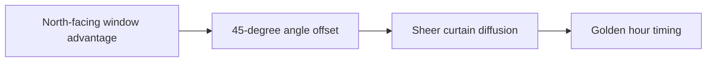

# Natural Light Window Positioning Guide for Clean Skin Tones

A practical workflow cuts context switching before it tries to add more volume. **Natural Light Window Positioning Guide for Clean Skin Tones** has one clear job. The practical goal is to position your desk and camera relative to windows for soft, flattering light. This guide is built for solo creators improving a small production setup. Set **north-facing window advantage** alongside **45-degree angle offset** before adding extra steps or decorative edits.

## Quick answer

Start with **North-facing window advantage**. Use **45-degree angle offset** to show the method clearly on camera in 4K at 60fps. Let **Sheer curtain diffusion** deliver the visual proof under locked 5600K light. Treat **Golden hour timing** as your review gate. The core rule is simple: stabilise the setup with measurable defaults before adding equipment.

## Build the minimum workable version

Buying more gear does not fix footage when exposure, white balance, distance and room sound change every session. Here, the issue starts when **north-facing window advantage** is planned without **45-degree angle offset**. The draft may look good. Yet the creator still does not know what to film or approve.

Start with the smallest version of **north-facing window advantage** that delivers cleaner audio. Check it against a repeatable camera-position marker. Keep this boundary in mind: Save settings only after checking the proof shot. If proof is not ready, tighten the promise. Do not mask it with buzzwords.

## Decision map for Natural Light Window Positioning Guide for Clean Skin Tones

| Decision | Evidence to prepare | Boundary |
| :--- | :--- | :--- |
| **North-facing window advantage** | Prepare a repeatable camera-position marker | Save settings only after checking the proof shot. |
| **45-degree angle offset** | Prepare a repeatable camera-position marker | Save settings only after checking the proof shot. |
| **Sheer curtain diffusion** | Prepare a labelled setup diagram | Test audio at the actual recording distance. |
| **Golden hour timing** | Prepare a repeatable camera-position marker | Test audio at the actual recording distance. |

## How to put the method into practice

### 1. North-facing window advantage

Treat north-facing window advantage as a direct operational step. Make it support **45-degree angle offset** and follow this rule: stabilise the setup with measurable defaults before adding equipment.

Verify this step with a repeatable camera-position marker. Save settings only after checking the proof shot. Look for cleaner audio. If that outcome is missing, adjust **north-facing window advantage** before filming **45-degree angle offset**.

### 2. 45-degree angle offset

Set up 45-degree angle offset with a fixed 50mm or 85mm macro lens. Keep camera distance locked at 3 to 4 feet across takes. Keep it aligned with **sheer curtain diffusion**.

Verify this step with a repeatable camera-position marker. Save settings only after checking the proof shot. Look for consistent skin and product colour. If that outcome is missing, adjust **45-degree angle offset** before filming **sheer curtain diffusion**.

### 3. Sheer curtain diffusion

Test sheer curtain diffusion under your real time limit. Keep only the step that protects the proof for **golden hour timing**.

Verify this step with a labelled setup diagram. Test audio at the actual recording distance. Look for faster setup. If that outcome is missing, adjust **sheer curtain diffusion** before filming **golden hour timing**.

### 4. Golden hour timing

Use golden hour timing to set a clear boundary for **north-facing window advantage**. Name what counts as done and what needs a retake.

Verify this step with a repeatable camera-position marker. Test audio at the actual recording distance. Look for consistent skin and product colour. If that outcome is missing, adjust **golden hour timing** before filming **north-facing window advantage**.

## A script you can adapt

Use this shoot card for **Natural Light Window Positioning Guide for Clean Skin Tones**:

- **Audience job:** `[The exact moment this post helps the viewer]`
- **Promise:** `[One clear outcome delivered in 30 seconds]`
- **Workflow:** `North-facing window advantage → 45-degree angle offset → Sheer curtain diffusion`
- **Proof:** `a labelled setup diagram`
- **Capacity rule:** `[Cap weekly filming to a single 45-minute block]`
- **Call to action:** `[One clear save or reply prompt]`

Finish **North-facing window advantage** and **45-degree angle offset** for **Natural Light Window Positioning Guide for Clean Skin Tones** before adding extra format variations.

## A practical first pass

Suppose solo creators improving a small production setup must complete one finished content cycle in a short 45-minute window. First, they lock **north-facing window advantage**. They prepare a repeatable camera-position marker. Then they use **sheer curtain diffusion** to keep the promise visible on camera in 4K at 60fps. Test audio at the actual recording distance. During review, they judge **golden hour timing** against consistent skin and product colour. A vague request for more polish is rejected.

## Review Golden hour timing before the next pass

- **Direction:** Does north-facing window advantage name one clear choice?
- **Visibility:** Can the viewer see 45-degree angle offset without reading the caption?
- **Proof:** Does a labelled setup diagram back up the main claim under 5600K light?
- **Boundary:** Has the creator respected this guardrail: Test audio at the actual recording distance.
- **Learning:** Will the next pass improve based on faster setup?

## Frequently asked questions

### What must North-facing window advantage decide first?

Set one clear default for **north-facing window advantage** next to **45-degree angle offset**. State the exact condition that justifies a change. A repeatable camera-position marker is far more useful than a long reference deck because you can test it directly on set.

### How can 45-degree angle offset be tested with simple gear?

Protect the proof moment above all else. Cut optional shots first. A short version works well when **45-degree angle offset** stays visible and claims stay inside your approved boundary.

### When should Golden hour timing be updated?

Update **golden hour timing** when repeated passes on **sheer curtain diffusion** show the same friction. A shift in audience, offer, or weekly capacity also justifies an update. A single slow video is not a reason to rebuild your whole system.

### How long should this workflow take for Natural Light Window Positioning Guide for Clean Skin Tones?

Timebox **north-facing window advantage** to 30 minutes on Monday, then capture **sheer curtain diffusion** in one focused 40-minute filming block with locked 5600K key light.

## Next step

Before the first take, settle **north-facing window advantage** and **sheer curtain diffusion**. If the crew still asks the same questions, [open the store](/store).
