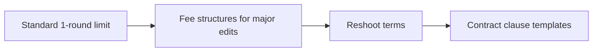

# Normal Revision Limits for Brand Deals & Campaign Contracts

A good brief removes guesswork while keeping the creator's natural voice. **Normal Revision Limits for Brand Deals & Campaign Contracts** has one clear job. The practical goal is to set clear contract boundaries for free vs paid revision rounds. This guide is built for UGC creators and brand teams. Set **standard 1-round limit** alongside **fee structures for major edits** before adding extra steps or decorative edits.

## Quick answer

Start with **Standard 1-round limit**. Use **Fee structures for major edits** to show the method clearly on camera in 4K at 60fps. Let **Reshoot terms** deliver the visual proof under locked 5600K light. Treat **Contract clause templates** as your review gate. The core rule is simple: agree on the claim, evidence and approval route before the first take.

## What the handoff must settle

Revision rounds multiply when the brief leaves product truth, usage and proof open to interpretation. Here, the issue starts when **standard 1-round limit** is planned without **fee structures for major edits**. The draft may look good. Yet the creator still does not know what to film or approve.

Start with the smallest version of **standard 1-round limit** that delivers fewer avoidable revisions. Check it against a brief-to-final-frame check. Keep this boundary in mind: Separate paid usage from organic posting rights. If proof is not ready, tighten the promise. Do not mask it with buzzwords.

## Decision map for Normal Revision Limits for Brand Deals & Campaign Contracts

| Decision | Evidence to prepare | Boundary |
| :--- | :--- | :--- |
| **Standard 1-round limit** | Prepare a brief-to-final-frame check | Separate paid usage from organic posting rights. |
| **Fee structures for major edits** | Prepare an approved product detail | Separate paid usage from organic posting rights. |
| **Reshoot terms** | Prepare a real-use demonstration | Do not improvise a product claim on set. |
| **Contract clause templates** | Prepare a real-use demonstration | Keep one feedback owner for each approval round. |

## How to put the method into practice

### 1. Standard 1-round limit

Treat standard 1-round limit as a direct operational step. Make it support **fee structures for major edits** and follow this rule: agree on the claim, evidence and approval route before the first take.

Verify this step with a brief-to-final-frame check. Separate paid usage from organic posting rights. Look for fewer avoidable revisions. If that outcome is missing, adjust **standard 1-round limit** before filming **fee structures for major edits**.

### 2. Fee structures for major edits

Cut fee structures for major edits on action: show the step, reveal the proof in 3-15s, and trim empty pauses to keep pace tight. Keep it aligned with **reshoot terms**.

Verify this step with an approved product detail. Separate paid usage from organic posting rights. Look for clearer approvals. If that outcome is missing, adjust **fee structures for major edits** before filming **reshoot terms**.

### 3. Reshoot terms

Test reshoot terms under your real time limit. Keep only the step that protects the proof for **contract clause templates**.

Verify this step with a real-use demonstration. Do not improvise a product claim on set. Look for usable hook variations. If that outcome is missing, adjust **reshoot terms** before filming **contract clause templates**.

### 4. Contract clause templates

Write contract clause templates with explicit legal scope. Separate 30-day organic rights from paid ad whitelisting to stop scope creep. Keep it aligned with **standard 1-round limit**.

Verify this step with a real-use demonstration. Keep one feedback owner for each approval round. Look for usable hook variations. If that outcome is missing, adjust **contract clause templates** before filming **standard 1-round limit**.

## A script you can adapt

Use this approval brief for **Normal Revision Limits for Brand Deals & Campaign Contracts**:

- **Objective:** `[One clear audience outcome]`
- **Required claim:** `[Approved fact or disclosure boundary]`
- **Rights scope:** `[30-day organic posting vs paid ad whitelisting]`
- **Evidence beat (0-15s):** `a real-use demonstration`
- **Revision limit:** `[One round of script fixes within 48 hours; new concepts require new scope]`

Keep **Standard 1-round limit** inside the signed claim boundary before shooting take one.

## A practical first pass

Suppose UGC creators and brand teams must complete one approval-ready brief in a short 45-minute window. First, they lock **standard 1-round limit**. They prepare an approved product detail. Then they use **reshoot terms** to keep the promise visible on camera in 4K at 60fps. Do not improvise a product claim on set. During review, they judge **contract clause templates** against usable hook variations. A vague request for more polish is rejected.

## Review Contract clause templates before the next pass

- **Direction:** Does standard 1-round limit name one clear choice?
- **Visibility:** Can the viewer see fee structures for major edits without reading the caption?
- **Proof:** Does a real-use demonstration back up the main claim under 5600K light?
- **Boundary:** Has the creator respected this guardrail: Keep one feedback owner for each approval round.
- **Learning:** Will the next pass improve based on usable hook variations?

## Frequently asked questions

### What must Standard 1-round limit decide first?

Set one clear default for **standard 1-round limit** next to **fee structures for major edits**. State the exact condition that justifies a change. A brief-to-final-frame check is far more useful than a long reference deck because you can test it directly on set.

### How can Fee structures for major edits be tested with simple gear?

Protect the proof moment above all else. Cut optional shots first. A short version works well when **fee structures for major edits** stays visible and claims stay inside your approved boundary.

### When should Contract clause templates be updated?

Update **contract clause templates** when repeated passes on **reshoot terms** show the same friction. A shift in audience, offer, or weekly capacity also justifies an update. A single slow video is not a reason to rebuild your whole system.

### How long should this workflow take for Normal Revision Limits for Brand Deals & Campaign Contracts?

Aim for 45 minutes total production for **Normal Revision Limits for Brand Deals & Campaign Contracts**. Spend 15 minutes setting up your mic and camera, film 3 takes, and confirm a brief-to-final-frame check before tearing down.

## Next step

Before the first take, settle **standard 1-round limit** and **reshoot terms**. If the crew still asks the same questions, [open the store](/store).
