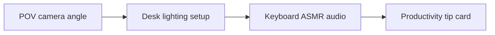

# Over-The-Shoulder Desk Setup Reels Framework

A practical workflow cuts context switching before it tries to add more volume. **Over-The-Shoulder Desk Setup Reels Framework** has one clear job. The practical goal is to film immersive desk productivity and coding videos from a natural POV angle. This guide is built for creators building a repeatable publishing system. Set **POV camera angle** alongside **desk lighting setup** before adding extra steps or decorative edits.

## Quick answer

Start with **POV camera angle**. Use **Desk lighting setup** to show the method clearly on camera in 4K at 60fps. Let **Keyboard ASMR audio** deliver the visual proof under locked 5600K light. Treat **Productivity tip card** as your review gate. The core rule is simple: give each piece one job and resolve the opening, evidence and next action before filming.

## Build the minimum workable version

Ideas stay unfinished when audience promise, proof and production limits are decided after recording begins. Here, the issue starts when **POV camera angle** is planned without **desk lighting setup**. The draft may look good. Yet the creator still does not know what to film or approve.

Start with the smallest version of **POV camera angle** that delivers shorter planning time. Check it against a completed example. Keep this boundary in mind: Choose a format that fits the evidence. If proof is not ready, tighten the promise. Do not mask it with buzzwords.

## Decision map for Over-The-Shoulder Desk Setup Reels Framework

| Decision | Evidence to prepare | Boundary |
| :--- | :--- | :--- |
| **POV camera angle** | Prepare a completed example | Choose a format that fits the evidence. |
| **Desk lighting setup** | Prepare an audience question answered on screen | Choose a format that fits the evidence. |
| **Keyboard ASMR audio** | Prepare a before-and-after decision | Choose a format that fits the evidence. |
| **Productivity tip card** | Prepare an audience question answered on screen | Review comparable posts rather than isolated spikes. |

## How to put the method into practice

### 1. POV camera angle

Set up POV camera angle with a fixed 50mm or 85mm macro lens. Keep camera distance locked at 3 to 4 feet across takes. Keep it aligned with **desk lighting setup**.

Verify this step with a completed example. Choose a format that fits the evidence. Look for shorter planning time. If that outcome is missing, adjust **POV camera angle** before filming **desk lighting setup**.

### 2. Desk lighting setup

Set desk lighting setup under a locked 5600K diffused key light. Lock manual exposure at 100% before take one to stop flicker. Keep it aligned with **keyboard ASMR audio**.

Verify this step with an audience question answered on screen. Choose a format that fits the evidence. Look for stronger format recognition. If that outcome is missing, adjust **desk lighting setup** before filming **keyboard ASMR audio**.

### 3. Keyboard ASMR audio

Record keyboard ASMR audio with a mic 4-6 inches from the source. Apply a -48dB noise gate and keep background music ducked at -22dB. Keep it aligned with **productivity tip card**.

Verify this step with a before-and-after decision. Choose a format that fits the evidence. Look for more finished pieces. If that outcome is missing, adjust **keyboard ASMR audio** before filming **productivity tip card**.

### 4. Productivity tip card

Use productivity tip card to set a clear boundary for **POV camera angle**. Name what counts as done and what needs a retake.

Verify this step with an audience question answered on screen. Review comparable posts rather than isolated spikes. Look for stronger format recognition. If that outcome is missing, adjust **productivity tip card** before filming **POV camera angle**.

## A script you can adapt

Use this shoot card for **Over-The-Shoulder Desk Setup Reels Framework**:

- **Audience job:** `[The exact moment this post helps the viewer]`
- **Promise:** `[One clear outcome delivered in 30 seconds]`
- **Workflow:** `POV camera angle → Desk lighting setup → Keyboard ASMR audio`
- **Proof:** `a before-and-after decision`
- **Capacity rule:** `[Cap weekly filming to a single 45-minute block]`
- **Call to action:** `[One clear save or reply prompt]`

Finish **POV camera angle** and **Desk lighting setup** for **Over-The-Shoulder Desk Setup Reels Framework** before adding extra format variations.

## A practical first pass

Suppose creators building a repeatable publishing system must complete one finished content cycle in a short 45-minute window. First, they lock **POV camera angle**. They prepare an audience question answered on screen. Then they use **keyboard ASMR audio** to keep the promise visible on camera in 4K at 60fps. Choose a format that fits the evidence. During review, they judge **productivity tip card** against stronger format recognition. A vague request for more polish is rejected.

## Review Productivity tip card before the next pass

- **Direction:** Does POV camera angle name one clear choice?
- **Visibility:** Can the viewer see desk lighting setup without reading the caption?
- **Proof:** Does a before-and-after decision back up the main claim under 5600K light?
- **Boundary:** Has the creator respected this guardrail: Review comparable posts rather than isolated spikes.
- **Learning:** Will the next pass improve based on more finished pieces?

## Frequently asked questions

### What must POV camera angle decide first?

Set one clear default for **POV camera angle** next to **desk lighting setup**. State the exact condition that justifies a change. A completed example is far more useful than a long reference deck because you can test it directly on set.

### How can Desk lighting setup be tested with simple gear?

Protect the proof moment above all else. Cut optional shots first. A short version works well when **desk lighting setup** stays visible and claims stay inside your approved boundary.

### When should Productivity tip card be updated?

Update **productivity tip card** when repeated passes on **keyboard ASMR audio** show the same friction. A shift in audience, offer, or weekly capacity also justifies an update. A single slow video is not a reason to rebuild your whole system.

### How long should this workflow take for Over-The-Shoulder Desk Setup Reels Framework?

Keep the shoot for **Over-The-Shoulder Desk Setup Reels Framework** within a 45-minute filming block. Set up lighting in 10 minutes, film 3 takes of **desk lighting setup** in 4K at 60fps, and lock your primary cut.

## Next step

Put **POV camera angle** next to **keyboard ASMR audio** on one sheet. If you still need someone else to lock the shoot, [start in the store](/store).
