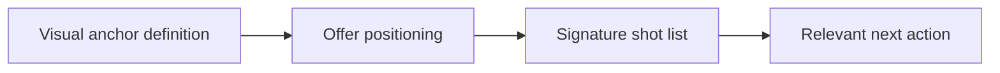

# Personal Brand Creative Direction Guide for Expert Creators

A plan becomes useful when you can film without rethinking the strategy each time. **Personal Brand Creative Direction Guide for Expert Creators** has one clear job. The practical goal is to turn expertise into a recognizable visual system with clear positioning, proof, and production choices. This guide is built for founders, consultants and B2B teams. Set **visual anchor definition** alongside **offer positioning** before adding extra steps or decorative edits.

## Quick answer

Start with **Visual anchor definition**. Use **Offer positioning** to show the method clearly on camera in 4K at 60fps. Let **Signature shot list** deliver the visual proof under locked 5600K light. Treat **Relevant next action** as your review gate. The core rule is simple: lead with operational friction, show a receipt and explain the trade-off in plain language.

## Build the minimum workable version

Thought leadership sounds interchangeable when it opens with a job title instead of a real decision and its consequences. Here, the issue starts when **visual anchor definition** is planned without **offer positioning**. The draft may look good. Yet the creator still does not know what to film or approve.

Start with the smallest version of **visual anchor definition** that delivers sales-relevant questions. Check it against a before-and-after process. Keep this boundary in mind: Avoid turning one result into a universal promise. If proof is not ready, tighten the promise. Do not mask it with buzzwords.

## Decision map for Personal Brand Creative Direction Guide for Expert Creators

| Decision | Evidence to prepare | Boundary |
| :--- | :--- | :--- |
| **Visual anchor definition** | Prepare a before-and-after process | Avoid turning one result into a universal promise. |
| **Offer positioning** | Prepare an anonymised workflow screen | End with one relevant next action. |
| **Signature shot list** | Prepare an anonymised workflow screen | Do not publish confidential customer information. |
| **Relevant next action** | Prepare a decision memo excerpt | Give metrics a timeframe and baseline. |

## How to put the method into practice

### 1. Visual anchor definition

Treat visual anchor definition as a direct operational step. Make it support **offer positioning** and follow this rule: lead with operational friction, show a receipt and explain the trade-off in plain language.

Verify this step with a before-and-after process. Avoid turning one result into a universal promise. Look for sales-relevant questions. If that outcome is missing, adjust **visual anchor definition** before filming **offer positioning**.

### 2. Offer positioning

Focus offer positioning on one specific viewer problem. Deliver one measurable outcome without inflated claims. Keep it aligned with **signature shot list**.

Verify this step with an anonymised workflow screen. End with one relevant next action. Look for qualified replies. If that outcome is missing, adjust **offer positioning** before filming **signature shot list**.

### 3. Signature shot list

Set up signature shot list with a fixed 50mm or 85mm macro lens. Keep camera distance locked at 3 to 4 feet across takes. Keep it aligned with **relevant next action**.

Verify this step with an anonymised workflow screen. Do not publish confidential customer information. Look for qualified replies. If that outcome is missing, adjust **signature shot list** before filming **relevant next action**.

### 4. Relevant next action

Use relevant next action to set a clear boundary for **visual anchor definition**. Name what counts as done and what needs a retake.

Verify this step with a decision memo excerpt. Give metrics a timeframe and baseline. Look for sales-relevant questions. If that outcome is missing, adjust **relevant next action** before filming **visual anchor definition**.

## A script you can adapt

Use this shoot card for **Personal Brand Creative Direction Guide for Expert Creators**:

- **Audience job:** `[The exact moment this post helps the viewer]`
- **Promise:** `[One clear outcome delivered in 30 seconds]`
- **Workflow:** `Visual anchor definition → Offer positioning → Signature shot list`
- **Proof:** `an anonymised workflow screen`
- **Capacity rule:** `[Cap weekly filming to a single 45-minute block]`
- **Call to action:** `[One clear save or reply prompt]`

Finish **Visual anchor definition** and **Offer positioning** for **Personal Brand Creative Direction Guide for Expert Creators** before adding extra format variations.

## A practical first pass

Suppose founders, consultants and B2B teams must complete one finished content cycle in a short 45-minute window. First, they lock **visual anchor definition**. They prepare an anonymised workflow screen. Then they use **signature shot list** to keep the promise visible on camera in 4K at 60fps. Do not publish confidential customer information. During review, they judge **relevant next action** against sales-relevant questions. A vague request for more polish is rejected.

## Review Relevant next action before the next pass

- **Direction:** Does visual anchor definition name one clear choice?
- **Visibility:** Can the viewer see offer positioning without reading the caption?
- **Proof:** Does an anonymised workflow screen back up the main claim under 5600K light?
- **Boundary:** Has the creator respected this guardrail: Give metrics a timeframe and baseline.
- **Learning:** Will the next pass improve based on qualified replies?

## Frequently asked questions

### What must Visual anchor definition decide first?

Set one clear default for **visual anchor definition** next to **offer positioning**. State the exact condition that justifies a change. A before-and-after process is far more useful than a long reference deck because you can test it directly on set.

### How can Offer positioning be tested with simple gear?

Protect the proof moment above all else. Cut optional shots first. A short version works well when **offer positioning** stays visible and claims stay inside your approved boundary.

### When should Relevant next action be updated?

Update **relevant next action** when repeated passes on **signature shot list** show the same friction. A shift in audience, offer, or weekly capacity also justifies an update. A single slow video is not a reason to rebuild your whole system.

### How long should this workflow take for Personal Brand Creative Direction Guide for Expert Creators?

Timebox **visual anchor definition** to 30 minutes on Monday, then capture **signature shot list** in one focused 40-minute filming block with locked 5600K key light.

## Next step

Film the next piece only after **visual anchor definition** and **signature shot list** are written down. Need a finished brief instead? [See Classic and Signature](/store).
