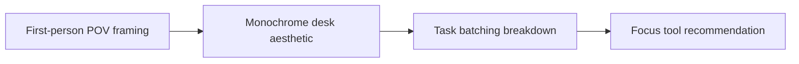

# POV Workspace Productivity Reels & Lighting Setup

The most expensive shot is the retake caused by vague direction. **POV Workspace Productivity Reels & Lighting Setup** has one clear job. The practical goal is to share deep-work systems and desk aesthetics from a first-person perspective. This guide is built for privacy-first and faceless creators. Set **first-person POV framing** alongside **monochrome desk aesthetic** before adding extra steps or decorative edits.

## Quick answer

Start with **First-person POV framing**. Use **Monochrome desk aesthetic** to show the method clearly on camera in 4K at 60fps. Let **Task batching breakdown** deliver the visual proof under locked 5600K light. Treat **Focus tool recommendation** as your review gate. The core rule is simple: choose a visual narrator and repeat a small set of identity cues without exposing private context.

## Set the production constraint

Hands-only footage feels generic when objects, sound and movement have no recurring point of view. Here, the issue starts when **first-person POV framing** is planned without **monochrome desk aesthetic**. The draft may look good. Yet the creator still does not know what to film or approve.

Start with the smallest version of **first-person POV framing** that delivers clearer stories without face-forward footage. Check it against a recognisable sound cue. Keep this boundary in mind: Check screens and reflections for private information. If proof is not ready, tighten the promise. Do not mask it with buzzwords.

## Decision map for POV Workspace Productivity Reels & Lighting Setup

| Decision | Evidence to prepare | Boundary |
| :--- | :--- | :--- |
| **First-person POV framing** | Prepare a recognisable sound cue | Check screens and reflections for private information. |
| **Monochrome desk aesthetic** | Prepare a recurring object | Use sound as structure, not as decoration. |
| **Task batching breakdown** | Prepare a recurring object | Give each B-roll shot a narrative job. |
| **Focus tool recommendation** | Prepare a recurring object | Keep text short enough to read without pausing. |

## How to put the method into practice

### 1. First-person POV framing

Set up first-person POV framing with a fixed 50mm or 85mm macro lens. Keep camera distance locked at 3 to 4 feet across takes. Keep it aligned with **monochrome desk aesthetic**.

Verify this step with a recognisable sound cue. Check screens and reflections for private information. Look for clearer stories without face-forward footage. If that outcome is missing, adjust **first-person POV framing** before filming **monochrome desk aesthetic**.

### 2. Monochrome desk aesthetic

Make monochrome desk aesthetic easy to verify on set. Confirm the proof before moving to **task batching breakdown**.

Verify this step with a recurring object. Use sound as structure, not as decoration. Look for safer production. If that outcome is missing, adjust **monochrome desk aesthetic** before filming **task batching breakdown**.

### 3. Task batching breakdown

Timebox task batching breakdown to a 45-minute filming block. Cap batching at 3 to 4 short videos to preserve voice energy. Keep it aligned with **focus tool recommendation**.

Verify this step with a recurring object. Give each B-roll shot a narrative job. Look for more consistent episodes. If that outcome is missing, adjust **task batching breakdown** before filming **focus tool recommendation**.

### 4. Focus tool recommendation

Use focus tool recommendation to set a clear boundary for **first-person POV framing**. Name what counts as done and what needs a retake.

Verify this step with a recurring object. Keep text short enough to read without pausing. Look for clearer stories without face-forward footage. If that outcome is missing, adjust **focus tool recommendation** before filming **first-person POV framing**.

## A script you can adapt

Use this shot note for **POV Workspace Productivity Reels & Lighting Setup**:

- **Opening frame:** `[Main tension visible under 5600K key light in 4K at 60fps]`
- **Hook (0-3s):** `[Spoken problem line matching the first frame]`
- **Coverage (3-15s):** `First-person POV framing → Monochrome desk aesthetic → [proof macro close-up]`
- **Continuity (15-25s):** `[Camera height locked at eye level; mic at 5 inches]`
- **Call to action (25-30s):** `[One direct comment or save prompt]`

For **First-person POV framing**, record a recurring object before adding optional B-roll shots.

## A practical first pass

Suppose privacy-first and faceless creators must complete one complete filming pass in a short 45-minute window. First, they lock **first-person POV framing**. They prepare a recurring object. Then they use **task batching breakdown** to keep the promise visible on camera in 4K at 60fps. Give each B-roll shot a narrative job. During review, they judge **focus tool recommendation** against clearer stories without face-forward footage. A vague request for more polish is rejected.

## Review Focus tool recommendation before the next pass

- **Direction:** Does first-person POV framing name one clear choice?
- **Visibility:** Can the viewer see monochrome desk aesthetic without reading the caption?
- **Proof:** Does a recurring object back up the main claim under 5600K light?
- **Boundary:** Has the creator respected this guardrail: Keep text short enough to read without pausing.
- **Learning:** Will the next pass improve based on more consistent episodes?

## Frequently asked questions

### What must First-person POV framing decide first?

Set one clear default for **first-person POV framing** next to **monochrome desk aesthetic**. State the exact condition that justifies a change. A recognisable sound cue is far more useful than a long reference deck because you can test it directly on set.

### How can Monochrome desk aesthetic be tested with simple gear?

Protect the proof moment above all else. Cut optional shots first. A short version works well when **monochrome desk aesthetic** stays visible and claims stay inside your approved boundary.

### When should Focus tool recommendation be updated?

Update **focus tool recommendation** when repeated passes on **task batching breakdown** show the same friction. A shift in audience, offer, or weekly capacity also justifies an update. A single slow video is not a reason to rebuild your whole system.

### How long should this workflow take for POV Workspace Productivity Reels & Lighting Setup?

Plan 40 minutes for the entire one complete filming pass. Lock **first-person POV framing** before setup, record 3 clean passes, and review clearer stories without face-forward footage immediately.

## Next step

Film the next piece only after **first-person POV framing** and **task batching breakdown** are written down. Need a finished brief instead? [See Classic and Signature](/store).
