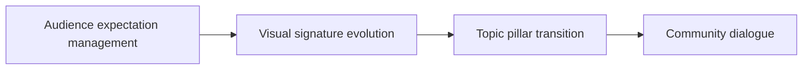

# Rebranding Friction for Longtime Lifestyle Creators

The real question is not which option sounds best. It is which trade-off fits your limit. **Rebranding Friction for Longtime Lifestyle Creators** has one clear job. The practical goal is to evolve your lifestyle brand aesthetics and topic pillars smoothly. This guide is built for creators building a repeatable publishing system. Set **audience expectation management** alongside **visual signature evolution** before adding extra steps or decorative edits.

## Quick answer

Start with **Audience expectation management**. Use **Visual signature evolution** to show the method clearly on camera in 4K at 60fps. Let **Topic pillar transition** deliver the visual proof under locked 5600K light. Treat **Community dialogue** as your review gate. The core rule is simple: give each piece one job and resolve the opening, evidence and next action before filming.

## Choose the decision behind the comparison

Ideas stay unfinished when audience promise, proof and production limits are decided after recording begins. Here, the issue starts when **audience expectation management** is planned without **visual signature evolution**. The draft may look good. Yet the creator still does not know what to film or approve.

Start with the smallest version of **audience expectation management** that delivers stronger format recognition. Check it against an audience question answered on screen. Keep this boundary in mind: Choose a format that fits the evidence. If proof is not ready, tighten the promise. Do not mask it with buzzwords.

## Decision map for Rebranding Friction for Longtime Lifestyle Creators

| Decision. | Evidence to prepare. | Boundary. |
| :--- | :--- | :--- |
| **Audience expectation management**. | Prepare an audience question answered on screen. | Choose a format that fits the evidence. |
| **Visual signature evolution**. | Prepare a completed example. | Choose a format that fits the evidence. |
| **Topic pillar transition**. | Prepare an audience question answered on screen. | Choose a format that fits the evidence. |
| **Community dialogue**. | Prepare a visible process step. | Review comparable posts rather than isolated spikes. |

## How to put the method into practice

### 1. Audience expectation management

Make audience expectation management a direct prompt: ask for one specific action or keyword response in the final 5s of the video. Keep it aligned with **visual signature evolution**.

Verify this step with an audience question answered on screen. Choose a format that fits the evidence. Look for stronger format recognition. If that outcome is missing, adjust **audience expectation management** before filming **visual signature evolution**.

### 2. Visual signature evolution

Make visual signature evolution easy to verify on set. Confirm the proof before moving to **topic pillar transition**.

Verify this step with a completed example. Choose a format that fits the evidence. Look for more finished pieces. If that outcome is missing, adjust **visual signature evolution** before filming **topic pillar transition**.

### 3. Topic pillar transition

Cut topic pillar transition on action: show the step, reveal the proof in 3-15s, and trim empty pauses to keep pace tight. Keep it aligned with **community dialogue**.

Verify this step with an audience question answered on screen. Choose a format that fits the evidence. Look for more finished pieces. If that outcome is missing, adjust **topic pillar transition** before filming **community dialogue**.

### 4. Community dialogue

Record community dialogue with a mic 4-6 inches from the source. Apply a -48dB noise gate and keep background music ducked at -22dB. Keep it aligned with **audience expectation management**.

Verify this step with a visible process step. Review comparable posts rather than isolated spikes. Look for more finished pieces. If that outcome is missing, adjust **community dialogue** before filming **audience expectation management**.

## A script you can adapt

Use this decision sheet for **Rebranding Friction for Longtime Lifestyle Creators**:

- **Constraint:** `[Time, budget, gear, or recovery limit]`
- **Route A:** `Audience expectation management — [clear pros and costs]`
- **Route B:** `Visual signature evolution — [clear pros and costs]`
- **Proof test:** `an audience question answered on screen`
- **Decision rule:** `[The exact condition that triggers a switch]`
- **Review timeline:** `[Review data after 4 completed episodes]`

Compare **Audience expectation management** against **Visual signature evolution** using real metrics, not vague impressions.

## A practical first pass

Suppose creators must complete a rebranding decision in a short 45-minute window. First, they lock audience expectations. They prepare a completed example. Then they transition topic pillars to keep their promise clear on camera. They choose a format that fits their proof. During review, they judge community feedback by finished posts. Vague requests for extra polish are rejected.

## Review Community dialogue before the next pass

- **Direction:** Does audience expectation management name one clear choice?
- **Visibility:** Can the viewer see visual signature evolution without reading the caption?
- **Proof:** Does an audience question answered on screen back up the main claim under 5600K light?
- **Boundary:** Has the creator respected this guardrail: Review comparable posts rather than isolated spikes.
- **Learning:** Will the next pass improve based on more finished pieces?

## Frequently asked questions

### What must Audience expectation management decide first?

Set one clear default for expectation management next to your visual shift. State the exact trigger for change. Answering a viewer question on screen beats a long reference deck because you can test it directly on set.

### How can Visual signature evolution be tested with simple gear?

Protect the proof moment above all else. Cut optional shots first. A short version works well when **visual signature evolution** stays visible and claims stay inside your approved boundary.

### When should Community dialogue be updated?

Update **community dialogue** when repeated passes on **topic pillar transition** show the same friction. A shift in audience, offer, or weekly capacity also justifies an update. A single slow video is not a reason to rebuild your whole system.

### How long should this workflow take for Rebranding Friction for Longtime Lifestyle Creators?

Plan 40 minutes for the entire one documented choice. Lock **audience expectation management** before setup, record 3 clean passes, and review stronger format recognition immediately.

## Next step

Keep **audience expectation management** and **topic pillar transition** on a page you can hold. If that is still too loose, [compare brief packages](/store).
