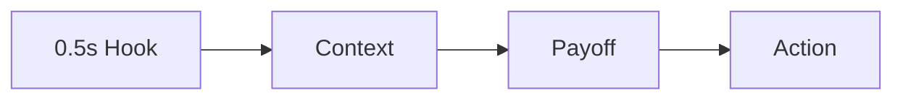

# Reels Script Structures and Hook Planning

Natural delivery comes from short beats, not memorizing long paragraphs. **Reels Script Structures and Hook Planning** has one job: structure short-form scripts from opening image through payoff and next action. Built for creators seeking a repeatable system. Set **visual hook in the first 0.5 seconds** alongside **useful context in the middle third** before decorative edits.

## Quick answer

Start with **Visual hook in the first 0.5 seconds**. Use **Useful context in the middle third** to show the method clearly on camera in 4K at 60fps. Let **Payoff sequence before CTA** deliver the visual proof under locked 5600K light. Treat **Relevant next-action framing** as your review gate. The core rule is simple: give each piece one job and resolve the opening, evidence and next action before filming.

## Why Visual hook in the first 0.5 seconds and Useful context in the middle third must agree

Ideas stay unfinished when audience promise, proof and production limits are decided after recording begins. Here, the issue starts when **visual hook in the first 0.5 seconds** is planned without **useful context in the middle third**. The draft may look good. Yet the creator still does not know what to film or approve.

Start with the smallest version of **visual hook in the first 0.5 seconds** that delivers stronger format recognition. Check it against a before-and-after decision. Keep this boundary in mind: Do not make several promises in one piece. If proof is not ready, tighten the promise. Do not mask it with buzzwords.

## Decision map for Reels Script Structures and Hook Planning

| Decision | Evidence to prepare | Boundary |
| :--- | :--- | :--- |
| **Visual hook in the first 0.5 seconds** | Prepare a before-and-after decision | Do not make several promises in one piece. |
| **Useful context in the middle third** | Prepare a before-and-after decision | Review comparable posts rather than isolated spikes. |
| **Payoff sequence before CTA** | Prepare an audience question answered on screen | Do not make several promises in one piece. |
| **Relevant next-action framing** | Prepare a completed example | Choose a format that fits the evidence. |

## How to put the method into practice

### 1. Visual hook in the first 0.5 seconds

Open visual hook in the first 0.5 seconds in the first 0-3s with the visual result before any setup. Pair the spoken line with clear 4K 60fps action. Keep it aligned with **useful context in the middle third**.

Verify this step with a before-and-after decision. Do not make several promises in one piece. Look for stronger format recognition. If that outcome is missing, adjust **visual hook in the first 0.5 seconds** before filming **useful context in the middle third**.

### 2. Useful context in the middle third

Make useful context in the middle third easy to verify on set. Confirm the proof before moving to **payoff sequence before CTA**.

Verify this step with a before-and-after decision. Review comparable posts rather than isolated spikes. Look for shorter planning time. If that outcome is missing, adjust **useful context in the middle third** before filming **payoff sequence before CTA**.

### 3. Payoff sequence before CTA

Cut payoff sequence before CTA on action: show the step, reveal the proof in 3-15s, and trim empty pauses to keep pace tight. Keep it aligned with **relevant next-action framing**.

Verify this step with an audience question answered on screen. Do not make several promises in one piece. Look for stronger format recognition. If that outcome is missing, adjust **payoff sequence before CTA** before filming **relevant next-action framing**.

### 4. Relevant next-action framing

Use relevant next-action framing to set a clear boundary for **visual hook in the first 0.5 seconds**. Name what counts as done and what needs a retake.

Verify this step with a completed example. Choose a format that fits the evidence. Look for stronger format recognition. If that outcome is missing, adjust **relevant next-action framing** before filming **visual hook in the first 0.5 seconds**.

## A script you can adapt

Use this 30-second script structure for **Reels Script Structures and Hook Planning**:

- **Opening shot (0-3s):** `[Visual friction visible under 5600K light]`
- **Spoken hook (0-3s):** "If you struggle with `[exact problem]`, watch this step."
- **Method beats (3-15s):** `Visual hook in the first 0.5 seconds followed by Useful context in the middle third`
- **Proof beat (15-25s):** `an audience question answered on screen`
- **Call to action (25-30s):** "Save this card before your next shoot."

Read the lines for **Visual hook in the first 0.5 seconds** in **Reels Script Structures and Hook Planning** aloud. Trim any sentence that takes more than 4 seconds to say on camera.

## A practical first pass

Suppose creators building a repeatable publishing system must complete one short video script in a short 45-minute window. First, they lock **visual hook in the first 0.5 seconds**. They prepare a before-and-after decision. Then they use **payoff sequence before CTA** to keep the promise visible on camera in 4K at 60fps. Do not make several promises in one piece. During review, they judge **relevant next-action framing** against stronger format recognition. A vague request for more polish is rejected.

## Review Relevant next-action framing before the next pass

- **Direction:** Does visual hook in the first 0.5 seconds name one clear choice?
- **Visibility:** Can the viewer see useful context in the middle third without reading the caption?
- **Proof:** Does an audience question answered on screen back up the main claim under 5600K light?
- **Boundary:** Has the creator respected this guardrail: Choose a format that fits the evidence.
- **Learning:** Will the next pass improve based on stronger format recognition?

## Frequently asked questions

### What must Visual hook in the first 0.5 seconds decide first?

Set one clear default for **visual hook in the first 0.5 seconds** next to **useful context in the middle third**. State the exact condition that justifies a change. A before-and-after decision is far more useful than a long reference deck because you can test it directly on set.

### How can Useful context in the middle third be tested with simple gear?

Protect the proof moment above all else. Cut optional shots first. A short version works well when **useful context in the middle third** stays visible and claims stay inside your approved boundary.

### When should Relevant next-action framing be updated?

Update **relevant next-action framing** when repeated passes on **payoff sequence before CTA** show the same friction. A shift in audience, offer, or weekly capacity also justifies an update. A single slow video is not a reason to rebuild your whole system.

### How long should this workflow take for Reels Script Structures and Hook Planning?

Timebox **visual hook in the first 0.5 seconds** to 30 minutes on Monday, then capture **payoff sequence before CTA** in one focused 40-minute filming block with locked 5600K key light.

## Next step

Write **visual hook in the first 0.5 seconds** and **payoff sequence before CTA** on one card before you shoot. If the same two points still stall the set, [pick a brief in the store](/store).
