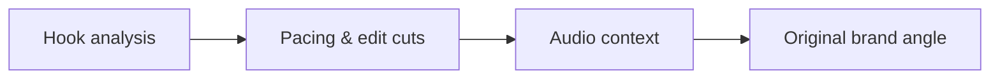

# Studying High-Reach Creator Content for Brand Briefs

Creative freedom works best when facts, deliverables and owners are clear. **Studying High-Reach Creator Content for Brand Briefs** has one clear job. The practical goal is to study successful TikTok and Reels examples without copying them, then translate useful patterns into an original campaign brief. This guide is built for UGC creators and brand teams. Set **hook analysis** alongside **pacing & edit cuts** before adding extra steps or decorative edits.

## Quick answer

Start with **Hook analysis**. Use **Pacing & edit cuts** to show the method clearly on camera in 4K at 60fps. Let **Audio context** deliver the visual proof under locked 5600K light. Treat **Original brand angle** as your review gate. The core rule is simple: agree on the claim, evidence and approval route before the first take.

## What the handoff must settle

Revision rounds multiply when the brief leaves product truth, usage and proof open to interpretation. Here, the issue starts when **hook analysis** is planned without **pacing & edit cuts**. The draft may look good. Yet the creator still does not know what to film or approve.

Start with the smallest version of **hook analysis** that delivers usable hook variations. Check it against an approved product detail. Keep this boundary in mind: Do not improvise a product claim on set. If proof is not ready, tighten the promise. Do not mask it with buzzwords.

## Decision map for Studying High-Reach Creator Content for Brand Briefs

| Decision | Evidence to prepare | Boundary |
| :--- | :--- | :--- |
| **Hook analysis** | Prepare an approved product detail | Do not improvise a product claim on set. |
| **Pacing & edit cuts** | Prepare a brief-to-final-frame check | Do not improvise a product claim on set. |
| **Audio context** | Prepare a real-use demonstration | Separate paid usage from organic posting rights. |
| **Original brand angle** | Prepare a clearly labelled comparison | Treat a new concept as new scope, not a small revision. |

## How to put the method into practice

### 1. Hook analysis

Open hook analysis in the first 0-3s with the visual result before any setup. Pair the spoken line with clear 4K 60fps action. Keep it aligned with **pacing & edit cuts**.

Verify this step with an approved product detail. Do not improvise a product claim on set. Look for usable hook variations. If that outcome is missing, adjust **hook analysis** before filming **pacing & edit cuts**.

### 2. Pacing & edit cuts

Cut pacing & edit cuts on action: show the step, reveal the proof in 3-15s, and trim empty pauses to keep pace tight. Keep it aligned with **audio context**.

Verify this step with a brief-to-final-frame check. Do not improvise a product claim on set. Look for fewer avoidable revisions. If that outcome is missing, adjust **pacing & edit cuts** before filming **audio context**.

### 3. Audio context

Record audio context with a mic 4-6 inches from the source. Apply a -48dB noise gate and keep background music ducked at -22dB. Keep it aligned with **original brand angle**.

Verify this step with a real-use demonstration. Separate paid usage from organic posting rights. Look for clearer approvals. If that outcome is missing, adjust **audio context** before filming **original brand angle**.

### 4. Original brand angle

Set up original brand angle with a fixed 50mm or 85mm macro lens. Keep camera distance locked at 3 to 4 feet across takes. Keep it aligned with **hook analysis**.

Verify this step with a clearly labelled comparison. Treat a new concept as new scope, not a small revision. Look for fewer avoidable revisions. If that outcome is missing, adjust **original brand angle** before filming **hook analysis**.

## A script you can adapt

Use this approval brief for **Studying High-Reach Creator Content for Brand Briefs**:

- **Objective:** `[One clear audience outcome]`
- **Required claim:** `[Approved fact or disclosure boundary]`
- **Rights scope:** `[30-day organic posting vs paid ad whitelisting]`
- **Evidence beat (0-15s):** `a real-use demonstration`
- **Revision limit:** `[One round of script fixes within 48 hours; new concepts require new scope]`

Keep **Hook analysis** inside the signed claim boundary before shooting take one.

## A practical first pass

Suppose UGC creators and brand teams must complete one approval-ready brief in a short 45-minute window. First, they lock **hook analysis**. They prepare a brief-to-final-frame check. Then they use **audio context** to keep the promise visible on camera in 4K at 60fps. Separate paid usage from organic posting rights. During review, they judge **original brand angle** against fewer avoidable revisions. A vague request for more polish is rejected.

## Review Original brand angle before the next pass

- **Direction:** Does hook analysis name one clear choice?
- **Visibility:** Can the viewer see pacing & edit cuts without reading the caption?
- **Proof:** Does a real-use demonstration back up the main claim under 5600K light?
- **Boundary:** Has the creator respected this guardrail: Treat a new concept as new scope, not a small revision.
- **Learning:** Will the next pass improve based on clearer approvals?

## Frequently asked questions

### What must Hook analysis decide first?

Set one clear default for **hook analysis** next to **pacing & edit cuts**. State the exact condition that justifies a change. An approved product detail is far more useful than a long reference deck because you can test it directly on set.

### How can Pacing & edit cuts be tested with simple gear?

Protect the proof moment above all else. Cut optional shots first. A short version works well when **pacing & edit cuts** stays visible and claims stay inside your approved boundary.

### When should Original brand angle be updated?

Update **original brand angle** when repeated passes on **audio context** show the same friction. A shift in audience, offer, or weekly capacity also justifies an update. A single slow video is not a reason to rebuild your whole system.

### How long should this workflow take for Studying High-Reach Creator Content for Brand Briefs?

Timebox **hook analysis** to 30 minutes on Monday, then capture **audio context** in one focused 40-minute filming block with locked 5600K key light.

## Next step

Before the first take, settle **hook analysis** and **audio context**. If the crew still asks the same questions, [open the store](/store).
