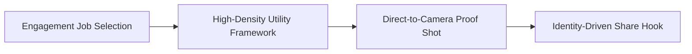

# Save-Worthy vs. Share-Worthy: Engineering High-Value Engagement for Instagram Reels

For years, creators focused on vanity metrics like likes and views. But on Instagram and TikTok, likes carry minimal weight. Modern recommendation engines prioritize two active signals above all else: **Saves** and **Direct Message Shares**.

A video with five thousand views and three hundred saves gets far more reach than a post with twenty thousand views and passive likes.

Content that earns saves is distinct from content that earns shares. This guide explains the psychological triggers for each signal and shows how to engineer both on set.

## Quick answer

To maximize high-value engagement, understand the two mechanics.
1. **To Earn Saves:** Pack your video with clear utility like cheat sheets, gear lists, and formulas that viewers want to revisit later.
2. **To Earn Shares:** Deliver high social currency or relatable humor that viewers want to send to a friend with the message: this is so you.



## The Psychological Divergence: Self-Utility vs. Social Currency

```text
SAVES (Intra-Personal Utility) ──► "I need this for myself later." (Bookmarks. Formulas, Guides)
SHARES (Inter-Personal Utility) ──► "Someone else needs to see this now." (Identity. Humor, Warning)
```

### The Mechanics of the "Save" (The Future-Self Trigger)
Viewers save content when helpful information exceeds what memory holds in thirty seconds. When they see a color grading formula or camera settings table, they save it as a bookmark for their next shoot.

### The Mechanics of the "DM Share" (The Tribe & Identity Trigger)
Viewers share content to connect with friends and spark conversation. When a video captures an unspoken truth about work or creator life, sending it gives social currency to the sender.

---

## Directing Comparison: Save-Engineered vs. Share-Engineered Briefs

| Directing Element. | Save-Optimized Brief. | Share-Optimized Brief. |
| :--- | :--- | :--- |
| **Primary Cognitive Trigger**. | Information Utility & Endowment Effect. | Social Identity & Parasocial Mirroring. |
| **Pacing**. | Measured, clear, high-density bullet points. | Fast-paced, punchy, emotionally expressive. |
| **On-Screen Text**. | Detailed lists, metric numbers, checklist cues. | Bold, expressive punchlines or short quote overlays. |
| **Proof Asset**. | Tangible templates, spreadsheets, shot diagrams. | Lived reaction, comedic timing, or shocking data. |
| **Spoken CTA**. | *"Save this checklist before your next shoot"*. | *"Send this to a creator who needs to hear this"*. |

---

## 4 Tactical Ways to Increase Saves and Shares on Set

### 1. The "Pause-and-Screenshot" Visual Table (Saves)
At twenty seconds, show a high-contrast summary graphic for two seconds with on-screen text: screenshot this checklist. This prompts the viewer to pause or bookmark the video.

### 2. The Specific "Third-Party" Persona Callout (Shares)
In your hook, call out a specific relationship: send this to your editor friend who never locks exposure. This primes the viewer to think of a specific person at once.

### 3. The "Cost of Inaction" Warning (Saves + Shares)
Highlight a costly mistake in your industry. When viewers realize an error could cost them time or money, they save the guide and forward it to colleagues.

---

## Fill-in-the-Blank Engagement Script Frameworks

### For Maximum Saves (Utility Blueprint):
```text
[Hook]: "Here are the 4 camera settings you must change on your phone to get true cinematic 4K footage."
[Body]: "Number 1: Lock exposure at -0.3. Number 2: Set shutter speed to 1/50th. Number 3: Disable HDR video. Number 4: Lock white balance to 5600K."
[CTA]: "Save this cheat sheet so you have it ready on set."
```

### For Maximum Shares (Relatable Identity Blueprint):
```text
[Hook]: "There are two types of creators when it comes to editing."
[Body]: "[show funny exaggerated behavior A] vs [show hyper-organized behavior B]."
[CTA]: "Send this to the person who spends 6 hours tweaking one transition."
```

---

## Frequently Asked Questions

### Which metric is more important for algorithmic growth: Saves or Shares?
Both are tier-one signals. But direct shares carry a higher multiplier because they bring another active user into the app.

### Does asking for a save or share in the caption actually work?
Yes, but only if the video earns it first. A weak clip asking for saves gets ignored. A high-utility post with a clear verbal prompt increases bookmark rates by thirty to fifty percent.
