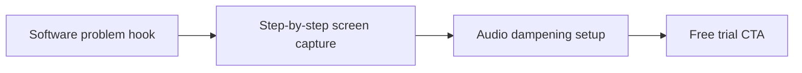

# Screen Recording Tech Tutorials With Professional Voiceover

A plan becomes useful when you can film without rethinking the strategy each time. **Screen Recording Tech Tutorials With Professional Voiceover** has one clear job. The practical goal is to produce crisp software and SaaS tutorials with clean audio and cursor focus. This guide is built for privacy-first and faceless creators. Set **software problem hook** alongside **step-by-step screen capture** before adding extra steps or decorative edits.

## Quick answer

Start with **Software problem hook**. Use **Step-by-step screen capture** to show the method clearly on camera in 4K at 60fps. Let **Audio dampening setup** deliver the visual proof under locked 5600K light. Treat **Free trial CTA** as your review gate. The core rule is simple: choose a visual narrator and repeat a small set of identity cues without exposing private context.

## Build the minimum workable version

Hands-only footage feels generic when objects, sound and movement have no recurring point of view. Here, the issue starts when **software problem hook** is planned without **step-by-step screen capture**. The draft may look good. Yet the creator still does not know what to film or approve.

Start with the smallest version of **software problem hook** that delivers clearer stories without face-forward footage. Check it against a purposeful point-of-view action. Keep this boundary in mind: Keep text short enough to read without pausing. If proof is not ready, tighten the promise. Do not mask it with buzzwords.

## Decision map for Screen Recording Tech Tutorials With Professional Voiceover

| Decision | Evidence to prepare | Boundary |
| :--- | :--- | :--- |
| **Software problem hook** | Prepare a purposeful point-of-view action | Keep text short enough to read without pausing. |
| **Step-by-step screen capture** | Prepare a recognisable sound cue | Keep text short enough to read without pausing. |
| **Audio dampening setup** | Prepare a recurring object | Keep text short enough to read without pausing. |
| **Free trial CTA** | Prepare a recognisable sound cue | Keep text short enough to read without pausing. |

## How to put the method into practice

### 1. Software problem hook

Open software problem hook in the first 0-3s with the visual result before any setup. Pair the spoken line with clear 4K 60fps action. Keep it aligned with **step-by-step screen capture**.

Verify this step with a purposeful point-of-view action. Keep text short enough to read without pausing. Look for clearer stories without face-forward footage. If that outcome is missing, adjust **software problem hook** before filming **step-by-step screen capture**.

### 2. Step-by-step screen capture

Make step-by-step screen capture easy to verify on set. Confirm the proof before moving to **audio dampening setup**.

Verify this step with a recognisable sound cue. Keep text short enough to read without pausing. Look for more consistent episodes. If that outcome is missing, adjust **step-by-step screen capture** before filming **audio dampening setup**.

### 3. Audio dampening setup

Record audio dampening setup with a mic 4-6 inches from the source. Apply a -48dB noise gate and keep background music ducked at -22dB. Keep it aligned with **free trial CTA**.

Verify this step with a recurring object. Keep text short enough to read without pausing. Look for safer production. If that outcome is missing, adjust **audio dampening setup** before filming **free trial CTA**.

### 4. Free trial CTA

Make free trial CTA a direct prompt: ask for one specific action or keyword response in the final 5s of the video. Keep it aligned with **software problem hook**.

Verify this step with a recognisable sound cue. Keep text short enough to read without pausing. Look for more consistent episodes. If that outcome is missing, adjust **free trial CTA** before filming **software problem hook**.

## A script you can adapt

Use this shoot card for **Screen Recording Tech Tutorials With Professional Voiceover**:

- **Audience job:** `[The exact moment this post helps the viewer]`
- **Promise:** `[One clear outcome delivered in 30 seconds]`
- **Workflow:** `Software problem hook → Step-by-step screen capture → Audio dampening setup`
- **Proof:** `a recurring object`
- **Capacity rule:** `[Cap weekly filming to a single 45-minute block]`
- **Call to action:** `[One clear save or reply prompt]`

Finish **Software problem hook** and **Step-by-step screen capture** for **Screen Recording Tech Tutorials With Professional Voiceover** before adding extra format variations.

## A practical first pass

Suppose privacy-first and faceless creators must complete one finished content cycle in a short 45-minute window. First, they lock **software problem hook**. They prepare a recognisable sound cue. Then they use **audio dampening setup** to keep the promise visible on camera in 4K at 60fps. Keep text short enough to read without pausing. During review, they judge **free trial CTA** against more consistent episodes. A vague request for more polish is rejected.

## Review Free trial CTA before the next pass

- **Direction:** Does software problem hook name one clear choice?
- **Visibility:** Can the viewer see step-by-step screen capture without reading the caption?
- **Proof:** Does a recurring object back up the main claim under 5600K light?
- **Boundary:** Has the creator respected this guardrail: Keep text short enough to read without pausing.
- **Learning:** Will the next pass improve based on safer production?

## Frequently asked questions

### What must Software problem hook decide first?

Set one clear default for **software problem hook** next to **step-by-step screen capture**. State the exact condition that justifies a change. A purposeful point-of-view action is far more useful than a long reference deck because you can test it directly on set.

### How can Step-by-step screen capture be tested with simple gear?

Protect the proof moment above all else. Cut optional shots first. A short version works well when **step-by-step screen capture** stays visible and claims stay inside your approved boundary.

### When should Free trial CTA be updated?

Update **free trial CTA** when repeated passes on **audio dampening setup** show the same friction. A shift in audience, offer, or weekly capacity also justifies an update. A single slow video is not a reason to rebuild your whole system.

### How long should this workflow take for Screen Recording Tech Tutorials With Professional Voiceover?

Plan 40 minutes for the entire one finished content cycle. Lock **software problem hook** before setup, record 3 clean passes, and review clearer stories without face-forward footage immediately.

## Next step

Write **software problem hook** and **audio dampening setup** on one card before you shoot. If the same two points still stall the set, [pick a brief in the store](/store).
