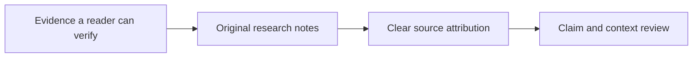

# Sourceable Content Guide for Video Strategists

Search structure must make facts easy to find. It must not sound written for a robot. **Sourceable Content Guide for Video Strategists** has one clear job. The practical goal is to make creator research easier to verify with original evidence, clear attribution, and enough context to understand each claim. This guide is built for creator brands publishing reference-quality pages. Set **evidence a reader can verify** alongside **original research notes** before adding extra steps or decorative edits.

## Quick answer

Start with **Evidence a reader can verify**. Use **Original research notes** to show the method clearly on camera in 4K at 60fps. Let **Clear source attribution** deliver the visual proof under locked 5600K light. Treat **Claim and context review** as your review gate. The core rule is simple: answer the question early, define entities clearly and support claims with first-hand or authoritative evidence.

## Answer the reader task before optimizing

A page may target the right phrase yet remain hard to cite when the answer is buried, vague or unsupported. The breakdown happens when **evidence a reader can verify** is separated from **original research notes**. Check your page against a question-shaped section with a complete response. Write for the reader before optimising extraction. If proof is missing, narrow the promise instead of adding vague claims.

## Decision map for Sourceable Content Guide for Video Strategists

| Decision | Evidence to prepare | Boundary |
| :--- | :--- | :--- |
| **Evidence a reader can verify** | Prepare a question-shaped section with a complete response | Write for the reader before optimising extraction. |
| **Original research notes** | Prepare a concise direct answer | Avoid claims that the cited source does not support. |
| **Clear source attribution** | Prepare a question-shaped section with a complete response | Refresh dates only when the content actually changes. |
| **Claim and context review** | Prepare a concise direct answer | Do not add FAQ schema for questions that are not visible. |

## How to put the method into practice

### 1. Evidence a reader can verify

Build evidence a reader can verify around visible proof. Show the before-and-after test under identical light with zero filter trickery. Keep it aligned with **original research notes**.

Check a question-shaped section with a complete response. Write for the reader before optimising extraction. Review qualified organic visits before starting **original research notes**.

### 2. Original research notes

Make original research notes easy to verify on set. Confirm the proof before moving to **clear source attribution**.

Check a concise direct answer. Avoid claims that the cited source does not support. Review qualified organic visits before starting **clear source attribution**.

### 3. Clear source attribution

Test clear source attribution under your real time limit. Keep only the step that protects the proof for **claim and context review**.

Check a question-shaped section with a complete response. Refresh dates only when the content actually changes. Review qualified organic visits before starting **claim and context review**.

### 4. Claim and context review

Write claim and context review with explicit legal scope. Separate 30-day organic rights from paid ad whitelisting to stop scope creep. Keep it aligned with **evidence a reader can verify**.

Check a concise direct answer. Do not add FAQ schema for questions that are not visible. Review relevant impressions before starting **evidence a reader can verify**.

## A script you can adapt

Use this answer structure for **Sourceable Content Guide for Video Strategists**:

- **Zero-click capsule (0-50 words):** `[Direct answer defining the entity and primary action]`
- **Decision table:** `[3-column matrix comparing options on evidence and cost]`
- **Practical method:** `Evidence a reader can verify followed by Original research notes`
- **Proof:** `a question-shaped section with a complete response`
- **Follow-up Q&A:** `[4 specific user questions answered in 2 sentences each]`

Check **Evidence a reader can verify** for direct clarity before adding extra background context.

## A practical first pass

Suppose creator brands publishing reference-quality pages must complete one reference-quality guide in a short 45-minute window. First, they lock **evidence a reader can verify**. They prepare a concise direct answer. Then they use **clear source attribution** to keep the promise visible on camera in 4K at 60fps. Refresh dates only when the content actually changes. During review, they judge **claim and context review** against relevant impressions. A vague request for more polish is rejected.

## Review Claim and context review before the next pass

- **Direction:** Does evidence a reader can verify name one clear choice?
- **Visibility:** Can the viewer see original research notes without reading the caption?
- **Proof:** Does a question-shaped section with a complete response back up the main claim under 5600K light?
- **Boundary:** Has the creator respected this guardrail: Do not add FAQ schema for questions that are not visible.
- **Learning:** Will the next pass improve based on qualified organic visits?

## Frequently asked questions

### What must Evidence a reader can verify decide first?

Set one clear default for **evidence a reader can verify** next to **original research notes**. State the exact condition that justifies a change. A question-shaped section with a complete response is far more useful than a long reference deck because you can test it directly on set.

### How can Original research notes be tested with simple gear?

Protect the proof moment above all else. Cut optional shots first. A short version works well when **original research notes** stays visible and claims stay inside your approved boundary.

### When should Claim and context review be updated?

Update **claim and context review** when repeated passes on **clear source attribution** show the same friction. A shift in audience, offer, or weekly capacity also justifies an update. A single slow video is not a reason to rebuild your whole system.

### How long should this workflow take for Sourceable Content Guide for Video Strategists?

Timebox **evidence a reader can verify** to 30 minutes on Monday, then capture **clear source attribution** in one focused 40-minute filming block with locked 5600K key light.

## Next step

Before the first take, settle **evidence a reader can verify** and **clear source attribution**. If the crew still asks the same questions, [open the store](/store).
