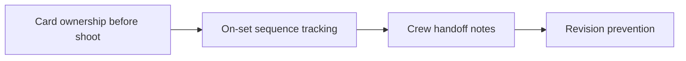

# Shoot-Ready Card System for Creator Teams & SMMs

A practical workflow cuts context switching before it tries to add more volume. **Shoot-Ready Card System for Creator Teams & SMMs** has one clear job. The practical goal is to give each shoot decision a clear owner, sequence, handoff note, and revision boundary on one shared card system. This guide is built for creators building a repeatable publishing system. Set **card ownership before shoot** alongside **on-set sequence tracking** before adding extra steps or decorative edits.

## Quick answer

Start with **Card ownership before shoot**. Use **On-set sequence tracking** to show the method clearly on camera in 4K at 60fps. Let **Crew handoff notes** deliver the visual proof under locked 5600K light. Treat **Revision prevention** as your review gate. The core rule is simple: give each piece one job and resolve the opening, evidence and next action before filming.

## Build the minimum workable version

Ideas stay unfinished when audience promise, proof and production limits are decided after recording begins. Here, the issue starts when **card ownership before shoot** is planned without **on-set sequence tracking**. The draft may look good. Yet the creator still does not know what to film or approve.

Start with the smallest version of **card ownership before shoot** that delivers stronger format recognition. Check it against a completed example. Keep this boundary in mind: Remove any scene that does not support the point. If proof is not ready, tighten the promise. Do not mask it with buzzwords.

## Decision map for Shoot-Ready Card System for Creator Teams & SMMs

| Decision | Evidence to prepare | Boundary |
| :--- | :--- | :--- |
| **Card ownership before shoot** | Prepare a completed example | Remove any scene that does not support the point. |
| **On-set sequence tracking** | Prepare a visible process step | Remove any scene that does not support the point. |
| **Crew handoff notes** | Prepare a before-and-after decision | Do not make several promises in one piece. |
| **Revision prevention** | Prepare a visible process step | Remove any scene that does not support the point. |

## How to put the method into practice

### 1. Card ownership before shoot

Treat card ownership before shoot as a direct operational step. Make it support **on-set sequence tracking** and follow this rule: give each piece one job and resolve the opening, evidence and next action before filming.

Verify this step with a completed example. Remove any scene that does not support the point. Look for stronger format recognition. If that outcome is missing, adjust **card ownership before shoot** before filming **on-set sequence tracking**.

### 2. On-set sequence tracking

Cut on-set sequence tracking on action: show the step, reveal the proof in 3-15s, and trim empty pauses to keep pace tight. Keep it aligned with **crew handoff notes**.

Verify this step with a visible process step. Remove any scene that does not support the point. Look for stronger format recognition. If that outcome is missing, adjust **on-set sequence tracking** before filming **crew handoff notes**.

### 3. Crew handoff notes

Test crew handoff notes under your real time limit. Keep only the step that protects the proof for **revision prevention**.

Verify this step with a before-and-after decision. Do not make several promises in one piece. Look for useful saves and replies. If that outcome is missing, adjust **crew handoff notes** before filming **revision prevention**.

### 4. Revision prevention

Write revision prevention with explicit legal scope. Separate 30-day organic rights from paid ad whitelisting to stop scope creep. Keep it aligned with **card ownership before shoot**.

Verify this step with a visible process step. Remove any scene that does not support the point. Look for shorter planning time. If that outcome is missing, adjust **revision prevention** before filming **card ownership before shoot**.

## A script you can adapt

Use this shoot card for **Shoot-Ready Card System for Creator Teams & SMMs**:

- **Audience job:** `[The exact moment this post helps the viewer]`
- **Promise:** `[One clear outcome delivered in 30 seconds]`
- **Workflow:** `Card ownership before shoot → On-set sequence tracking → Crew handoff notes`
- **Proof:** `a before-and-after decision`
- **Capacity rule:** `[Cap weekly filming to a single 45-minute block]`
- **Call to action:** `[One clear save or reply prompt]`

Finish **Card ownership before shoot** and **On-set sequence tracking** for **Shoot-Ready Card System for Creator Teams & SMMs** before adding extra format variations.

## A practical first pass

Suppose creators building a repeatable publishing system must complete one finished content cycle in a short 45-minute window. First, they lock **card ownership before shoot**. They prepare a visible process step. Then they use **crew handoff notes** to keep the promise visible on camera in 4K at 60fps. Do not make several promises in one piece. During review, they judge **revision prevention** against shorter planning time. A vague request for more polish is rejected.

## Review Revision prevention before the next pass

- **Direction:** Does card ownership before shoot name one clear choice?
- **Visibility:** Can the viewer see on-set sequence tracking without reading the caption?
- **Proof:** Does a before-and-after decision back up the main claim under 5600K light?
- **Boundary:** Has the creator respected this guardrail: Remove any scene that does not support the point.
- **Learning:** Will the next pass improve based on useful saves and replies?

## Frequently asked questions

### What must Card ownership before shoot decide first?

Set one clear default for **card ownership before shoot** next to **on-set sequence tracking**. State the exact condition that justifies a change. A completed example is far more useful than a long reference deck because you can test it directly on set.

### How can On-set sequence tracking be tested with simple gear?

Protect the proof moment above all else. Cut optional shots first. A short version works well when **on-set sequence tracking** stays visible and claims stay inside your approved boundary.

### When should Revision prevention be updated?

Update **revision prevention** when repeated passes on **crew handoff notes** show the same friction. A shift in audience, offer, or weekly capacity also justifies an update. A single slow video is not a reason to rebuild your whole system.

### How long should this workflow take for Shoot-Ready Card System for Creator Teams & SMMs?

Timebox **card ownership before shoot** to 30 minutes on Monday, then capture **crew handoff notes** in one focused 40-minute filming block with locked 5600K key light.

## Next step

Write **card ownership before shoot** and **crew handoff notes** on one card before you shoot. If the same two points still stall the set, [pick a brief in the store](/store).
