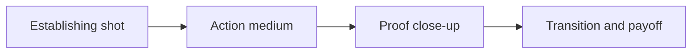

# Short-Form Video Shot List for Creators

The most expensive shot is the retake caused by vague direction. **Short-Form Video Shot List for Creators** has one clear job. The practical goal is to A compact shot language for clearer, faster production. This guide is built for coaches and fitness creators. Set **establishing shot** alongside **action medium** before adding extra steps or decorative edits.

## Quick answer

Start with **Establishing shot**. Use **Action medium** to show the method clearly on camera in 4K at 60fps. Let **Proof close-up** deliver the visual proof under locked 5600K light. Treat **Transition and payoff** as your review gate. The core rule is simple: teach one cue at a time, show the relevant angle and keep outcome language responsible.

## Set the production constraint

A single flattering angle can hide the movement detail that viewers actually need to understand. Here, the issue starts when **establishing shot** is planned without **action medium**. The draft may look good. Yet the creator still does not know what to film or approve.

Start with the smallest version of **establishing shot** that delivers repeatable educational formats. Check it against a slowed technique comparison. Keep this boundary in mind: State when a movement needs individual assessment. If proof is not ready, tighten the promise. Do not mask it with buzzwords.

## Decision map for Short-Form Video Shot List for Creators

| Decision | Evidence to prepare | Boundary |
| :--- | :--- | :--- |
| **Establishing shot** | Prepare a slowed technique comparison | State when a movement needs individual assessment. |
| **Action medium** | Prepare a repeatable progression step | Show the common error before the correction. |
| **Proof close-up** | Prepare a clearly labelled coaching cue | State when a movement needs individual assessment. |
| **Transition and payoff** | Prepare a clearly labelled coaching cue | State when a movement needs individual assessment. |

## How to put the method into practice

### 1. Establishing shot

Set up establishing shot with a fixed 50mm or 85mm macro lens. Keep camera distance locked at 3 to 4 feet across takes. Keep it aligned with **action medium**.

Verify this step with a slowed technique comparison. State when a movement needs individual assessment. Look for repeatable educational formats. If that outcome is missing, adjust **establishing shot** before filming **action medium**.

### 2. Action medium

Make action medium easy to verify on set. Confirm the proof before moving to **proof close-up**.

Verify this step with a repeatable progression step. Show the common error before the correction. Look for repeatable educational formats. If that outcome is missing, adjust **action medium** before filming **proof close-up**.

### 3. Proof close-up

Set up proof close-up with a fixed 50mm or 85mm macro lens. Keep camera distance locked at 3 to 4 feet across takes. Keep it aligned with **transition and payoff**.

Verify this step with a clearly labelled coaching cue. State when a movement needs individual assessment. Look for more qualified enquiries. If that outcome is missing, adjust **proof close-up** before filming **transition and payoff**.

### 4. Transition and payoff

Cut transition and payoff on action: show the step, reveal the proof in 3-15s, and trim empty pauses to keep pace tight. Keep it aligned with **establishing shot**.

Verify this step with a clearly labelled coaching cue. State when a movement needs individual assessment. Look for more qualified enquiries. If that outcome is missing, adjust **transition and payoff** before filming **establishing shot**.

## A script you can adapt

Use this shot note for **Short-Form Video Shot List for Creators**:

- **Opening frame:** `[Main tension visible under 5600K key light in 4K at 60fps]`
- **Hook (0-3s):** `[Spoken problem line matching the first frame]`
- **Coverage (3-15s):** `Establishing shot → Action medium → [proof macro close-up]`
- **Continuity (15-25s):** `[Camera height locked at eye level; mic at 5 inches]`
- **Call to action (25-30s):** `[One direct comment or save prompt]`

For **Establishing shot**, record a clearly labelled coaching cue before adding optional B-roll shots.

## A practical first pass

Suppose coaches and fitness creators must complete one complete filming pass in a short 45-minute window. First, they lock **establishing shot**. They prepare a repeatable progression step. Then they use **proof close-up** to keep the promise visible on camera in 4K at 60fps. State when a movement needs individual assessment. During review, they judge **transition and payoff** against more qualified enquiries. A vague request for more polish is rejected.

## Review Transition and payoff before the next pass

- **Direction:** Does establishing shot name one clear choice?
- **Visibility:** Can the viewer see action medium without reading the caption?
- **Proof:** Does a clearly labelled coaching cue back up the main claim under 5600K light?
- **Boundary:** Has the creator respected this guardrail: State when a movement needs individual assessment.
- **Learning:** Will the next pass improve based on more qualified enquiries?

## Frequently asked questions

### What must Establishing shot decide first?

Set one clear default for **establishing shot** next to **action medium**. State the exact condition that justifies a change. A slowed technique comparison is far more useful than a long reference deck because you can test it directly on set.

### How can Action medium be tested with simple gear?

Protect the proof moment above all else. Cut optional shots first. A short version works well when **action medium** stays visible and claims stay inside your approved boundary.

### When should Transition and payoff be updated?

Update **transition and payoff** when repeated passes on **proof close-up** show the same friction. A shift in audience, offer, or weekly capacity also justifies an update. A single slow video is not a reason to rebuild your whole system.

### How long should this workflow take for Short-Form Video Shot List for Creators?

Plan 40 minutes for the entire one complete filming pass. Lock **establishing shot** before setup, record 3 clean passes, and review repeatable educational formats immediately.

## Next step

Before the first take, settle **establishing shot** and **proof close-up**. If the crew still asks the same questions, [open the store](/store).
