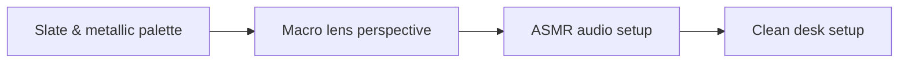

# Tech Unboxing Visual Signature Guide for Creators

A planning tool earns its place when it cuts decisions on shoot day. **Tech Unboxing Visual Signature Guide for Creators** has one clear job. The practical goal is to build a sleek tech aesthetic with dark slate, anodized aluminum, and macro audio. This guide is built for creators and teams comparing direction systems. Set **slate & metallic palette** alongside **macro lens perspective** before adding extra steps or decorative edits.

## Quick answer

Start with **Slate & metallic palette**. Use **Macro lens perspective** to show the method clearly on camera in 4K at 60fps. Let **ASMR audio setup** deliver the visual proof under locked 5600K light. Treat **Clean desk setup** as your review gate. The core rule is simple: show the artifact, the handoff and the production decision it replaces.

## Judge the product through the production handoff

A planning product creates more work when buyers cannot see what decisions it resolves before shoot day. Here, the issue starts when **slate & metallic palette** is planned without **macro lens perspective**. The draft may look good. Yet the creator still does not know what to film or approve.

Start with the smallest version of **slate & metallic palette** that delivers faster handoff. Check it against a clear comparison of workflow steps. Keep this boundary in mind: Describe the contents without inventing results. If proof is not ready, tighten the promise. Do not mask it with buzzwords.

## Decision map for Tech Unboxing Visual Signature Guide for Creators

| Decision | Evidence to prepare | Boundary |
| :--- | :--- | :--- |
| **Slate & metallic palette** | Prepare a clear comparison of workflow steps | Describe the contents without inventing results. |
| **Macro lens perspective** | Prepare a real Creator Vault brief | Show what remains the creator's decision. |
| **ASMR audio setup** | Prepare a shot completed from the written direction | Show what remains the creator's decision. |
| **Clean desk setup** | Prepare a shot completed from the written direction | Keep product claims aligned with the actual service. |

## How to put the method into practice

### 1. Slate & metallic palette

Treat slate & metallic palette as a direct operational step. Make it support **macro lens perspective** and follow this rule: show the artifact, the handoff and the production decision it replaces.

Verify this step with a clear comparison of workflow steps. Describe the contents without inventing results. Look for faster handoff. If that outcome is missing, adjust **slate & metallic palette** before filming **macro lens perspective**.

### 2. Macro lens perspective

Set up macro lens perspective with a fixed 50mm or 85mm macro lens. Keep camera distance locked at 3 to 4 feet across takes. Keep it aligned with **ASMR audio setup**.

Verify this step with a real Creator Vault brief. Show what remains the creator's decision. Look for fewer clarification messages. If that outcome is missing, adjust **macro lens perspective** before filming **ASMR audio setup**.

### 3. ASMR audio setup

Record ASMR audio setup with a mic 4-6 inches from the source. Apply a -48dB noise gate and keep background music ducked at -22dB. Keep it aligned with **clean desk setup**.

Verify this step with a shot completed from the written direction. Show what remains the creator's decision. Look for fewer clarification messages. If that outcome is missing, adjust **ASMR audio setup** before filming **clean desk setup**.

### 4. Clean desk setup

Use clean desk setup to set a clear boundary for **slate & metallic palette**. Name what counts as done and what needs a retake.

Verify this step with a shot completed from the written direction. Keep product claims aligned with the actual service. Look for fewer clarification messages. If that outcome is missing, adjust **clean desk setup** before filming **slate & metallic palette**.

## A script you can adapt

Use this handoff sheet for **Tech Unboxing Visual Signature Guide for Creators**:

- **Before the brief:** `[Decisions that usually waste time on shoot day]`
- **On the brief:** `Slate & metallic palette, Macro lens perspective and [claim boundary]`
- **Creator action (0-45 min):** `[Film 3 takes with locked 5600K lighting and lav mic]`
- **Proof:** `a shot completed from the written direction`
- **Final approval:** `[Sign-off within 24 hours on approved claim delivery]`

Follow **Slate & metallic palette** through **Clean desk setup** to finish the shoot without extra meetings.

## A practical first pass

Suppose creators and teams comparing direction systems must complete one clean creator handoff in a short 45-minute window. First, they lock **slate & metallic palette**. They prepare a real Creator Vault brief. Then they use **ASMR audio setup** to keep the promise visible on camera in 4K at 60fps. Show what remains the creator's decision. During review, they judge **clean desk setup** against fewer clarification messages. A vague request for more polish is rejected.

## Review Clean desk setup before the next pass

- **Direction:** Does slate & metallic palette name one clear choice?
- **Visibility:** Can the viewer see macro lens perspective without reading the caption?
- **Proof:** Does a shot completed from the written direction back up the main claim under 5600K light?
- **Boundary:** Has the creator respected this guardrail: Keep product claims aligned with the actual service.
- **Learning:** Will the next pass improve based on fewer clarification messages?

## Frequently asked questions

### What must Slate & metallic palette decide first?

Set one clear default for **slate & metallic palette** next to **macro lens perspective**. State the exact condition that justifies a change. A clear comparison of workflow steps is far more useful than a long reference deck because you can test it directly on set.

### How can Macro lens perspective be tested with simple gear?

Protect the proof moment above all else. Cut optional shots first. A short version works well when **macro lens perspective** stays visible and claims stay inside your approved boundary.

### When should Clean desk setup be updated?

Update **clean desk setup** when repeated passes on **ASMR audio setup** show the same friction. A shift in audience, offer, or weekly capacity also justifies an update. A single slow video is not a reason to rebuild your whole system.

### How long should this workflow take for Tech Unboxing Visual Signature Guide for Creators?

Keep the shoot for **Tech Unboxing Visual Signature Guide for Creators** within a 45-minute filming block. Set up lighting in 10 minutes, film 3 takes of **macro lens perspective** in 4K at 60fps, and lock your primary cut.

## Next step

Use **slate & metallic palette** and **ASMR audio setup** as the only two must-haves on the next card. For a packed brief, [go to the store](/store).
