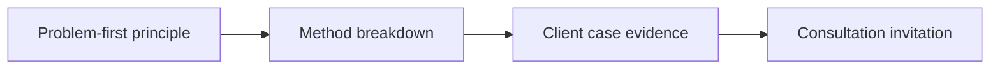

# Thought Leadership Video System for Consultants

Consistency is easier to protect when each post has one goal and one clear proof. **Thought Leadership Video System for Consultants** has one clear job. The practical goal is to turn consulting expertise into useful LinkedIn and Reels videos built around buyer problems, evidence, trade-offs, and consultation fit. This guide is built for founders, consultants and B2B teams. Set **problem-first principle** alongside **method breakdown** before adding extra steps or decorative edits.

## Quick answer

Start with **Problem-first principle**. Use **Method breakdown** to show the method clearly on camera in 4K at 60fps. Let **Client case evidence** deliver the visual proof under locked 5600K light. Treat **Consultation invitation** as your review gate. The core rule is simple: lead with operational friction, show a receipt and explain the trade-off in plain language.

## Build the minimum workable version

Thought leadership sounds interchangeable when it opens with a job title instead of a real decision and its consequences. Here, the issue starts when **problem-first principle** is planned without **method breakdown**. The draft may look good. Yet the creator still does not know what to film or approve.

Start with the smallest version of **problem-first principle** that delivers stronger category recall. Check it against a decision memo excerpt. Keep this boundary in mind: Do not publish confidential customer information. If proof is not ready, tighten the promise. Do not mask it with buzzwords.

## Decision map for Thought Leadership Video System for Consultants

| Decision | Evidence to prepare | Boundary |
| :--- | :--- | :--- |
| **Problem-first principle** | Prepare a decision memo excerpt | Do not publish confidential customer information. |
| **Method breakdown** | Prepare an anonymised workflow screen | End with one relevant next action. |
| **Client case evidence** | Prepare a decision memo excerpt | Avoid turning one result into a universal promise. |
| **Consultation invitation** | Prepare a decision memo excerpt | Do not publish confidential customer information. |

## How to put the method into practice

### 1. Problem-first principle

Treat problem-first principle as a direct operational step. Make it support **method breakdown** and follow this rule: lead with operational friction, show a receipt and explain the trade-off in plain language.

Verify this step with a decision memo excerpt. Do not publish confidential customer information. Look for stronger category recall. If that outcome is missing, adjust **problem-first principle** before filming **method breakdown**.

### 2. Method breakdown

Make method breakdown easy to verify on set. Confirm the proof before moving to **client case evidence**.

Verify this step with an anonymised workflow screen. End with one relevant next action. Look for clearer expertise signals. If that outcome is missing, adjust **method breakdown** before filming **client case evidence**.

### 3. Client case evidence

Build client case evidence around visible proof. Show the before-and-after test under identical light with zero filter trickery. Keep it aligned with **consultation invitation**.

Verify this step with a decision memo excerpt. Avoid turning one result into a universal promise. Look for clearer expertise signals. If that outcome is missing, adjust **client case evidence** before filming **consultation invitation**.

### 4. Consultation invitation

Use consultation invitation to set a clear boundary for **problem-first principle**. Name what counts as done and what needs a retake.

Verify this step with a decision memo excerpt. Do not publish confidential customer information. Look for qualified replies. If that outcome is missing, adjust **consultation invitation** before filming **problem-first principle**.

## A script you can adapt

Use this shoot card for **Thought Leadership Video System for Consultants**:

- **Audience job:** `[The exact moment this post helps the viewer]`
- **Promise:** `[One clear outcome delivered in 30 seconds]`
- **Workflow:** `Problem-first principle → Method breakdown → Client case evidence`
- **Proof:** `a decision memo excerpt`
- **Capacity rule:** `[Cap weekly filming to a single 45-minute block]`
- **Call to action:** `[One clear save or reply prompt]`

Finish **Problem-first principle** and **Method breakdown** for **Thought Leadership Video System for Consultants** before adding extra format variations.

## A practical first pass

Suppose founders, consultants and B2B teams must complete one finished content cycle in a short 45-minute window. First, they lock **problem-first principle**. They prepare an anonymised workflow screen. Then they use **client case evidence** to keep the promise visible on camera in 4K at 60fps. Avoid turning one result into a universal promise. During review, they judge **consultation invitation** against qualified replies. A vague request for more polish is rejected.

## Review Consultation invitation before the next pass

- **Direction:** Does problem-first principle name one clear choice?
- **Visibility:** Can the viewer see method breakdown without reading the caption?
- **Proof:** Does a decision memo excerpt back up the main claim under 5600K light?
- **Boundary:** Has the creator respected this guardrail: Do not publish confidential customer information.
- **Learning:** Will the next pass improve based on clearer expertise signals?

## Frequently asked questions

### What must Problem-first principle decide first?

Set one clear default for **problem-first principle** next to **method breakdown**. State the exact condition that justifies a change. A decision memo excerpt is far more useful than a long reference deck because you can test it directly on set.

### How can Method breakdown be tested with simple gear?

Protect the proof moment above all else. Cut optional shots first. A short version works well when **method breakdown** stays visible and claims stay inside your approved boundary.

### When should Consultation invitation be updated?

Update **consultation invitation** when repeated passes on **client case evidence** show the same friction. A shift in audience, offer, or weekly capacity also justifies an update. A single slow video is not a reason to rebuild your whole system.

### How long should this workflow take for Thought Leadership Video System for Consultants?

Timebox **problem-first principle** to 30 minutes on Monday, then capture **client case evidence** in one focused 40-minute filming block with locked 5600K key light.

## Next step

Keep **problem-first principle** and **client case evidence** on a page you can hold. If that is still too loose, [compare brief packages](/store).
