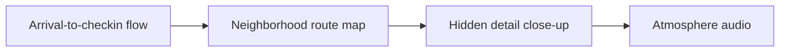

# Travel Creator Cinematic B-Roll Brief & Filming Guide

A practical tool comparison shows which choices are settled and which stay with the creator. **Travel Creator Cinematic B-Roll Brief & Filming Guide** has one clear job. The practical goal is to plan travel video itineraries with location specificity and route logic. This guide is built for creators and teams comparing direction systems. Set **arrival-to-checkin flow** alongside **neighborhood route map** before adding extra steps or decorative edits.

## Quick answer

Start with **Arrival-to-checkin flow**. Use **Neighborhood route map** to show the method clearly on camera in 4K at 60fps. Let **Hidden detail close-up** deliver the visual proof under locked 5600K light. Treat **Atmosphere audio** as your review gate. The core rule is simple: show the artifact, the handoff and the production decision it replaces.

## Judge the product through the production handoff

A planning product creates more work when buyers cannot see what decisions it resolves before shoot day. Here, the issue starts when **arrival-to-checkin flow** is planned without **neighborhood route map**. The draft may look good. Yet the creator still does not know what to film or approve.

Start with the smallest version of **arrival-to-checkin flow** that delivers better fit between tier and job. Check it against a shot completed from the written direction. Keep this boundary in mind: Keep product claims aligned with the actual service. If proof is not ready, tighten the promise. Do not mask it with buzzwords.

## Decision map for Travel Creator Cinematic B-Roll Brief & Filming Guide

| Decision | Evidence to prepare | Boundary |
| :--- | :--- | :--- |
| **Arrival-to-checkin flow** | Prepare a shot completed from the written direction | Keep product claims aligned with the actual service. |
| **Neighborhood route map** | Prepare a strategist-to-creator handoff | Do not present colour as the only difference between tiers. |
| **Hidden detail close-up** | Prepare a real Creator Vault brief | Keep product claims aligned with the actual service. |
| **Atmosphere audio** | Prepare a real Creator Vault brief | Show what remains the creator's decision. |

## How to put the method into practice

### 1. Arrival-to-checkin flow

Cut arrival-to-checkin flow on action: show the step, reveal the proof in 3-15s, and trim empty pauses to keep pace tight. Keep it aligned with **neighborhood route map**.

Verify this step with a shot completed from the written direction. Keep product claims aligned with the actual service. Look for better fit between tier and job. If that outcome is missing, adjust **arrival-to-checkin flow** before filming **neighborhood route map**.

### 2. Neighborhood route map

Make neighborhood route map easy to verify on set. Confirm the proof before moving to **hidden detail close-up**.

Verify this step with a strategist-to-creator handoff. Do not present colour as the only difference between tiers. Look for faster handoff. If that outcome is missing, adjust **neighborhood route map** before filming **hidden detail close-up**.

### 3. Hidden detail close-up

Set up hidden detail close-up with a fixed 50mm or 85mm macro lens. Keep camera distance locked at 3 to 4 feet across takes. Keep it aligned with **atmosphere audio**.

Verify this step with a real Creator Vault brief. Keep product claims aligned with the actual service. Look for faster handoff. If that outcome is missing, adjust **hidden detail close-up** before filming **atmosphere audio**.

### 4. Atmosphere audio

Record atmosphere audio with a mic 4-6 inches from the source. Apply a -48dB noise gate and keep background music ducked at -22dB. Keep it aligned with **arrival-to-checkin flow**.

Verify this step with a real Creator Vault brief. Show what remains the creator's decision. Look for more complete shoots. If that outcome is missing, adjust **atmosphere audio** before filming **arrival-to-checkin flow**.

## A script you can adapt

Use this handoff sheet for **Travel Creator Cinematic B-Roll Brief & Filming Guide**:

- **Before the brief:** `[Decisions that usually waste time on shoot day]`
- **On the brief:** `Arrival-to-checkin flow, Neighborhood route map and [claim boundary]`
- **Creator action (0-45 min):** `[Film 3 takes with locked 5600K lighting and lav mic]`
- **Proof:** `a real Creator Vault brief`
- **Final approval:** `[Sign-off within 24 hours on approved claim delivery]`

Follow **Arrival-to-checkin flow** through **Atmosphere audio** to finish the shoot without extra meetings.

## A practical first pass

Suppose creators and teams comparing direction systems must complete one clean creator handoff in a short 45-minute window. First, they lock **arrival-to-checkin flow**. They prepare a strategist-to-creator handoff. Then they use **hidden detail close-up** to keep the promise visible on camera in 4K at 60fps. Keep product claims aligned with the actual service. During review, they judge **atmosphere audio** against more complete shoots. A vague request for more polish is rejected.

## Review Atmosphere audio before the next pass

- **Direction:** Does arrival-to-checkin flow name one clear choice?
- **Visibility:** Can the viewer see neighborhood route map without reading the caption?
- **Proof:** Does a real Creator Vault brief back up the main claim under 5600K light?
- **Boundary:** Has the creator respected this guardrail: Show what remains the creator's decision.
- **Learning:** Will the next pass improve based on faster handoff?

## Frequently asked questions

### What must Arrival-to-checkin flow decide first?

Set one clear default for **arrival-to-checkin flow** next to **neighborhood route map**. State the exact condition that justifies a change. A shot completed from the written direction is far more useful than a long reference deck because you can test it directly on set.

### How can Neighborhood route map be tested with simple gear?

Protect the proof moment above all else. Cut optional shots first. A short version works well when **neighborhood route map** stays visible and claims stay inside your approved boundary.

### When should Atmosphere audio be updated?

Update **atmosphere audio** when repeated passes on **hidden detail close-up** show the same friction. A shift in audience, offer, or weekly capacity also justifies an update. A single slow video is not a reason to rebuild your whole system.

### How long should this workflow take for Travel Creator Cinematic B-Roll Brief & Filming Guide?

Plan 40 minutes for the entire one clean creator handoff. Lock **arrival-to-checkin flow** before setup, record 3 clean passes, and review better fit between tier and job immediately.

## Next step

Film the next piece only after **arrival-to-checkin flow** and **hidden detail close-up** are written down. Need a finished brief instead? [See Classic and Signature](/store).
